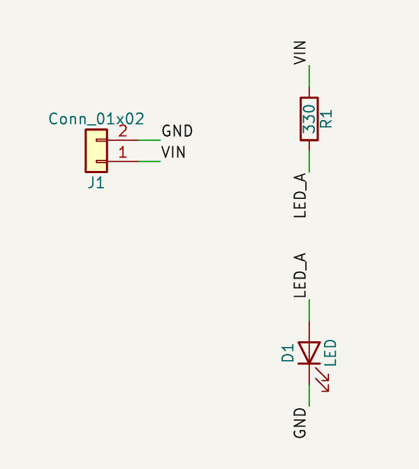

# AI Circuit Studio

자연어 회로 요구사항 → AI 설계안 → 사용자 승인 → Circuit IR(JSON) → Markdown 문서 + KiCad 회로도를 만드는 데스크톱 앱입니다.
기획서는 [`docs/AI_Circuit_Studio_Development_Plan_v1.md`](docs/AI_Circuit_Studio_Development_Plan_v1.md)에 있습니다.

> **현재 단계: Phase 0 (KiCad 생성 PoC).** UI, AI, 백엔드 API는 아직 없습니다.
> 지금은 **수동으로 작성한 Circuit IR → `.kicad_sch` → ERC / Netlist / SVG** 경로가 실제로 동작하는지 확인하는 단계입니다.



## Phase 0 결과 요약

| 항목 | 결과 |
|---|---|
| Circuit IR 최소 모델 (Pydantic v2) | ✅ `circuit_core/models.py`, JSON Schema: `docs/schema/circuit-ir.schema.json` |
| LED + 직렬저항 + 2핀 커넥터 fixture | ✅ `tests/fixtures/circuits/led_resistor_connector.json` |
| `.kicad_sch` 생성 (KiCad 10 형식) | ✅ `kicad_adapter/schematic.py` |
| KiCad가 파일을 읽는가 | ✅ kicad-cli 10.0.8이 로드하고 다시 저장함. 차이는 generator 2줄뿐 |
| ERC | ✅ 오류 0, 경고 0 (*자동 검사일 뿐, 전기적 설계 검증이 아님*) |
| Netlist ↔ IR 연결 비교 | ✅ 일치. 회전 0/90/180/270도 검증함 |
| SVG 미리보기 | ✅ |
| KiCad **GUI**에서 열기 | ⏳ 아직 하지 않음. Windows에서 수동 확인 필요 |
| SKiDL/schematizer 비교 실험 | ⏳ 계획만 세움 ([ADR-001](docs/adr/ADR-001-eda-generation-strategy.md)) |

자세한 내용은 [`docs/phase0-report.md`](docs/phase0-report.md)를 보세요.

## 빠른 시작

필요한 것: Python 3.12+, [uv](https://docs.astral.sh/uv/). KiCad 검사를 하려면 KiCad 10.0 또는 Docker도 필요합니다.

```bash
uv sync                      # 의존성 설치
uv run pytest                # 테스트 (KiCad 없으면 KiCad 테스트 5개는 skip)
```

### 회로도 생성

```bash
uv run aics generate tests/fixtures/circuits/led_resistor_connector.json \
    --out projects/led-demo/outputs \
    --symbol-dir tests/fixtures/kicad_symbols \
    --check
```

`--out` 폴더에 생기는 파일:

| 파일 | 내용 |
|---|---|
| `schematic.kicad_sch`, `schematic.kicad_pro` | KiCad 10 회로도와 최소 프로젝트 파일. KiCad에서 바로 열 수 있음 |
| `symbol_sources.json` | 사용한 심볼 라이브러리 경로와 형식 버전(출처 기록) |
| `erc.json` | kicad-cli ERC 원본 리포트 (`--check`) |
| `schematic.net` | KiCad가 추출한 Netlist (`--check`) |
| `schematic.svg` | 회로도 미리보기 (`--check`) |
| `check_report.json` | 검사 요약: ERC 개수, Netlist ↔ IR 일치 여부 (`--check`) |

`--symbol-dir`를 생략하면 `KICAD10_SYMBOL_DIR` 환경 변수나 OS별 기본 설치 경로에서 심볼을 찾습니다.
`tests/fixtures/kicad_symbols`는 테스트용으로 심볼 3개만 뽑아 둔 것이고, 실제로는 설치된 KiCad 라이브러리를 쓰세요.

종료 코드: `0` 성공, `1` 생성 또는 검사 실패, `2` 입력 오류, `3` kicad-cli가 없어 **검사를 하지 않음**(성공이 아님).

### kicad-cli 연결

다음 순서로 찾습니다.

1. `AICS_KICAD_CLI`: kicad-cli 실행 파일 경로
2. `PATH`의 `kicad-cli`
3. Windows 기본 경로 `C:\Program Files\KiCad\10.0\bin\kicad-cli.exe`
4. `AICS_KICAD_DOCKER_IMAGE`: KiCad 공식 Docker 이미지 (Linux 개발/CI용)

**Windows (목표 플랫폼):** [KiCad 10.0](https://www.kicad.org/download/)을 설치하면 3번 경로로 자동 인식됩니다(아직 Windows에서 직접 확인하지 않음).

```powershell
uv run aics kicad-info
uv run aics generate tests\fixtures\circuits\led_resistor_connector.json --out projects\led-demo\outputs `
    --symbol-dir "C:\Program Files\KiCad\10.0\share\kicad\symbols" --check
```

**Linux / CI (Docker):**

```bash
docker pull kicad/kicad:10.0.8          # Docker Hub 요청 제한(429)에 걸리면 mirror.gcr.io/kicad/kicad:10.0.8
export AICS_KICAD_DOCKER_IMAGE=kicad/kicad:10.0.8
uv run aics kicad-info                  # → kicad-cli: 10.0.8 (docker: kicad/kicad:10.0.8)
uv run pytest -m kicad                  # KiCad 통합 테스트만 실행
```

Docker 실행 시 출력 폴더는 `/work`로 마운트되고, 컨테이너는 네트워크 없이(`--network none`) 실행됩니다.

## 저장소 구조

기획서 7장의 구조를 따르며, 아직 필요하지 않은 폴더는 만들지 않았습니다.

```text
circuit_core/        ✅ Circuit IR Pydantic 모델(models.py)과 L0/L1 검증(validation.py)
kicad_adapter/       ✅ KiCad 생성기·kicad-cli 실행·Netlist/ERC 파싱
  sexpr.py             S-expression 읽기/쓰기 (KiCad 포맷과 바이트 단위 동일)
  symbols.py           설치된 .kicad_sym에서 심볼·핀 좌표 읽기
  schematic.py         IR → .kicad_sch 생성 (결정적)
  cli.py               kicad-cli 실행 (native / Docker, 인자 배열만 사용)
  netlist.py, erc.py   결과 파싱 및 IR 비교
  pipeline.py          생성 → ERC → Netlist 비교 → SVG
  __main__.py          `aics` 명령
tests/               ✅ 단위 / golden / KiCad 통합 테스트
docs/                ✅ 기획서, ADR, IR JSON Schema, Phase 0 보고서
scripts/             ✅ 심볼 subset 추출 도구
desktop/             ⏳ Phase 1: Electron + React
backend/             ⏳ Phase 1: FastAPI
ai_engine/           ⏳ Phase 2: 요구사항 구조화, 설계안, patch
templates/           ⏳ Phase 3: 검증된 회로 블록
projects/<id>/       ⏳ Phase 1: 프로젝트 파일 (outputs/는 git에서 제외)
```

## Circuit IR 핵심 규칙

- **연결은 KiCad 심볼의 핀 번호로만 저장합니다.** 예를 들어 `Device:LED`는 1=K, 2=A입니다. `"A"`/`"K"` 같은 핀 이름은 근거로만 기록하고, 생성 전에 라이브러리와 대조해 다르면 파일을 만들지 않습니다.
- 생성 전에 부품의 모든 핀이 라이브러리 심볼과 정확히 일치해야 합니다(빠진 핀, 없는 핀, 이름 불일치는 오류).
- 배치(`layout`)는 연결과 분리되어 있습니다. 배치를 바꾸거나 지워도 Netlist는 바뀌지 않으며, 배치 때문에 서로 다른 Net이 맞닿으면 생성을 거부합니다.
- 검증 상태의 기본값은 `unverified`입니다. 이 PoC는 어떤 경우에도 `verified`로 바꾸지 않습니다.
- 생성된 심볼에는 숨김 필드 `AICS_ID`(IR component id)가 들어갑니다. 나중에 KiCad 파일을 IR로 되돌릴 때 쓰기 위한 것입니다.

## 검증 상태 표현

| 표시 | 의미 |
|---|---|
| Not checked | kicad-cli를 실행하지 못함 (종료 코드 3, 테스트는 skip) |
| Automated checks passed | ERC 오류 0이고 Netlist가 IR과 일치함. **설계가 맞다는 뜻이 아님** |
| Engineer reviewed | 사람이 검토함. 이 PoC에는 없음 |

## 현재 제약

- KiCad 10.0.x만 지원합니다([ADR-002](docs/adr/ADR-002-kicad-version.md)). 생성된 파일은 KiCad 9 이하에서 열리지 않습니다.
- 지원하지 않는 것(만나면 오류): 파생 심볼(`extends`), 다중 유닛 심볼, 미러, 전원 심볼, 계층 시트, `.kicad_symdir` 라이브러리, 의도적 미연결(no-connect) 표시.
- 연결은 label stub 방식이라 핀 사이를 직접 잇는 배선이 없습니다. 자동 배치는 단순 격자이고, 부품 몸체가 겹치는지는 검사하지 않습니다.
- 개발 환경(Linux 컨테이너)에서만 검증했습니다. **Windows 11에서는 아직 실행해 보지 않았습니다.**

## 개발

```bash
uv run pytest                              # 전체
uvx ruff check .                           # lint
AICS_UPDATE_GOLDEN=1 uv run pytest         # golden 파일/JSON Schema 갱신 (diff 확인 후 커밋)
```
