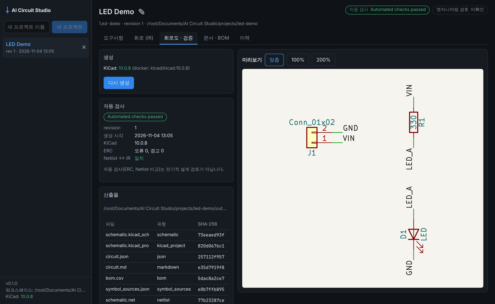

# AI Circuit Studio

자연어 회로 요구사항 → AI 설계안 → 사용자 승인 → Circuit IR(JSON) → Markdown 문서 + KiCad 회로도를 만드는 Windows 우선 데스크톱 앱입니다.
기획서는 [`docs/AI_Circuit_Studio_Development_Plan.md`](docs/AI_Circuit_Studio_Development_Plan.md)(v1.9)에 있습니다.
궁극적인 목표는 **하나의 입력 창**에서 회로도, 아트웍(PCB), 펌웨어까지 다루는 것입니다(기획서 1장 제품 비전).



## 진행 상황

| 단계 | 상태 | 내용 |
|---|---|---|
| Phase 0 — KiCad 생성 PoC | ✅ 완료 | IR → `.kicad_sch`, ERC/Netlist/SVG, 생성 방식 A/B 평가 ([보고서](docs/phase0-report.md)) |
| Phase 1 — Core MVP | ✅ 완료 | 데스크톱 앱, 프로젝트 저장·복원, revision, 문서·BOM, KiCad 생성 job, 산출물 관리 ([보고서](docs/phase1-report.md)) |
| Phase 1.5 — 보드·페이지, 가져오기, 보유 자재 | ✅ 완료 | 프로젝트→보드→페이지, PDF 회로도 카피(회로도 MD 가져오기 + AI 변환 옵션), 보유 자재 우선 사용 ([보고서](docs/phase1_5-report.md)) |
| Phase 1.6 — 데이터시트 | ✅ 완료 | 제조사가 확실한 부품의 데이터시트 수집(KiCad 심볼 링크·제조사 주소 규칙·Mouser/DigiKey 검색·직접 올리기), 요약 MD, 핀맵·전압·외부 부품 대조 ([보고서](docs/phase1_6-report.md)) |
| Phase 2 — 변경 흐름과 AI 설계·검토 | ✅ 완료 | 요구사항 → AI 회로 설계 → 제안(비교 표·KiCad 검사·AI 검토) → 승인 ([보고서](docs/phase2-report.md)) |
| Phase 2 이후 개선 | ✅ 완료 | AI 출력 한국어, 검토 반영 수정안, 읽기 쉬운 회로도(블록 배치·전원 심볼·직접 배선), Claude 공급자 ([회로도 예](docs/images/schematic-auto-layout.png)) |
| Phase 3 — 엔지니어링 템플릿 | ✅ 완료 | 다중 유닛 심볼, 검토된 회로 템플릿 4종, AI 설계의 템플릿 우선 사용, 엔지니어 검토 기록 ([보고서](docs/phase3-report.md)) |
| Phase 4 — 제한된 AI EDA Agent | ✅ 완료 | 계획(dry-run) → 범위 승인 → 허용 도구만 쓰는 격리 실행 → 코드 검증 → 제안 → 승인 ([보고서](docs/phase4-report.md)) |
| Phase 4 이후 개선 | ✅ 완료 | 회로도 영문 주석, 레귤레이터·크리스탈 블록, KiCad에서 고친 배치·연결·값·부품 가져오기, Windows 설치 파일, 선택 근거 기록·기술 검토·근거 리포트, 쌓이는 설계 가이드 ([ADR-009](docs/adr/ADR-009-schematic-notes-and-compact-blocks.md)~[ADR-013](docs/adr/ADR-013-design-guide.md), 연구노트 [ADR-015](docs/adr/ADR-015-research-notes.md), AI 성능 평가 [ADR-016](docs/adr/ADR-016-ai-evaluation.md)) |
| Phase 5 — PCB·시뮬레이션·펌웨어 | 제안 | 기능마다 검증 방법과 순서를 [ADR-014](docs/adr/ADR-014-phase5-verification-first.md)(제안)로 정리, 승인 후 착수 |

## 지금 할 수 있는 것

- **단계 화면 (기본).** 프로젝트를 열면 한 장씩 넘기며 진행합니다([ADR-017](docs/adr/ADR-017-step-screens.md)): **1 아이디어**(평소 말로 적기) → **2 요구사항**(AI가 정리한 카드 확인·고치기, AI의 질문에 답) → **3 설계 준비**(적용할 설계 지침·검토된 템플릿·보유 자재·데이터시트 받아 대조 여부·보낼 데이터) → **4 AI 설계**(부품 고르기 → 데이터시트 받기·AI 요약 → 핀 연결 → KiCad 검사 → 제안 만들기 진행 기록) → **5 검토**(자동 반복 검토) → **6 확인·승인**(마지막 제안 요약 표, 「자세히」는 제안 슬라이드) → **7 회로도·출력**(미리보기, KiCad에서 열기, BOM·데이터시트·연구노트).
  - **부품을 찾지 못하면 고르기**: AI가 고른 부품의 KiCad 심볼이 없으면 설계를 끝내지 않고 부품마다 **1) 다른 부품으로 대체**(라이브러리로 확인한 것만) **2) 다른 방법으로 진행**(외부 모듈 헤더, AI 방안) **3) 기타 의견**(직접 적기) 중에서 고르게 하고, AI의 질문에도 답하게 합니다. 대체 부품을 고르면 부품 계획을 다시 묻지 않고 핀 연결부터 이어서 설계합니다(고급 화면의 「요구사항」 탭에서도 같음).
  - **자동 반복 검토**: 「수정 필요 0건 · 수정 권장 n건 이하」가 될 때까지 AI 검토 → 의견을 반영한 수정안 → 다시 검토를 반복합니다. 최대 횟수, 비슷한 의견이 다시 나옴, 의견이 줄지 않음, 수정안이 회로를 바꾸지 않음, AI가 남은 의견을 고치지 않기로 함, 수정안의 KiCad 검사 실패에서 멈추고, AI 호출 상한을 미리 보여 줍니다. 회차마다 새 제안이 생기며 회로는 사람이 승인해야만 바뀝니다.
  - **근거 있는 검토, 고칠 곳만 고치는 수정안**([ADR-006 추가 절](docs/adr/ADR-006-ai-circuit-design.md)): AI 검토 의견마다 근거(앱이 준 근거 번호·설계 지침·요구사항 문장·회로의 핀이나 Net)를 적게 하고 앱이 확인합니다. 확인되지 않은 의견은 「근거 확인 안 됨」으로 보이며 자동 반복과 수정안에 쓰지 않습니다. 수정안은 회로 전체를 다시 설계하지 않고 고칠 곳만 편집하며(안 되면 다시 설계), 고치지 않은 의견은 이유를 남깁니다.
  - **관점별로 깊게 검토**(5단계의 칸, 기본 켬): 한 번에 전부 보는 검토에 더해 **요구사항 대조 · 전원·보호 · 인터페이스·아날로그 · MCU·부하 구동**을 따로 검토합니다(회로에 해당하는 관점만, 검토마다 AI 호출 +최대 4회). 관점마다 확인 항목을 하나씩 「확인함 · 문제 · 판단 못 함 · 해당 없음」과 계산으로 답하게 해서, 지적이 없어도 무엇을 봤는지 남습니다. 지적은 같은 근거 확인을 거쳐 일반 검토와 합쳐집니다. **「판단 못 함」**(정격이 적히지 않은 부품, 받지 못한 데이터시트 등)은 지적으로 세지 않지만 「남은 의견」 아래와 6단계 표에 따로 보입니다 — 사람이 확인할 것입니다. 확인 항목의 답은 AI가 쓴 것이고, 앱이 그 계산을 다시 확인하지는 않습니다.
  - **설계 지침을 처음부터**: 부품을 고른 뒤 그 부품에 맞는 지침을 다시 골라 연결 단계에 주고, 설계가 끝나면 지침 자동 점검으로 위반을 찾아 그 부분만 바로 고친 뒤 제안을 만듭니다. 수정안도 지침을 따르게 합니다.
  - **작업 상태창**: AI 설계·검토·회로도 생성 같은 작업은 화면과 상관없이 백엔드에서 끝까지 돕니다. 오른쪽 아래 「작업」 창에 어느 프로젝트에서 무슨 작업이 어느 단계인지 모든 화면에서 보이고, 끝나면 눌러 결과로 갑니다.
  - 오른쪽 위 **고급 화면(탭)**에 기존 기능이 모두 있습니다. 탭 11개를 **설계**(요구사항·템플릿·제안·회로 데이터)·**검증**(회로도 · 검증·검토·Agent)·**자료**(자재·데이터시트·문서 · BOM)·**기록**(이력) 4묶음으로 정리했습니다. 아래 설명의 탭 이름은 고급 화면 기준입니다.
- **요구사항 → AI 회로 설계 → 제안 → 승인.** 「요구사항」 탭에 만들 회로를 적고 **AI로 회로 설계**를 누릅니다(AI 기능 필요).
  1. AI가 부품을 고르면 앱이 설치된 KiCad 라이브러리에서 실제 심볼과 핀 번호로 바꿉니다.
  2. AI가 그 핀 번호로만 연결을 정합니다. 앱이 모든 핀을 검사하고, 틀리면 AI에게 다시 고치게 합니다(최대 2회).
  3. 결과는 「제안」 탭에 나옵니다. 앱이 계산한 비교 표, 제안 전용 폴더에서 돌린 KiCad ERC·Netlist 검사, 데이터시트 대조, AI 검토 의견을 보고 **승인**하면 회로가 저장되고 회로도가 다시 생성됩니다. **거부**하면 아무것도 바뀌지 않습니다.
  4. 검토 의견을 반영한 **수정안**도 만들 수 있고(의견마다 **이 의견 반영하기**, 검사 문제는 **AI로 검사 문제 고치기**, 떠 있는 입력 핀은 AI 없이 **바로 고치기**), 저장된 회로를 **AI 검토**할 수도 있습니다. 승인한 제안도 그 회로가 지금 회로인 동안은 같은 버튼으로 고칠 수 있고, 「회로도 · 검증」의 검사 결과에도 같은 버튼이 있습니다. 직접 값을 바꾸는 제안(예: R1 330→1k)도 같은 화면에서 만듭니다.
- **검토된 회로 템플릿.** 「템플릿」 탭에서 3.3V LDO(AMS1117), 5V 벅(LM2596), CAN 트랜시버(SN65HVD230), MCU 최소 회로(ATmega328P)를 골라 연결할 Net 이름만 정하면 제안으로 들어갑니다. 템플릿마다 데이터시트 근거 절과 검토 체크리스트가 있고, AI 설계도 맞는 템플릿을 먼저 씁니다(제안 표의 「출처」에 템플릿/AI 표시).
- **선택의 근거 기록.** 회로에 "설계 결정"을 남깁니다. 결정마다 무엇을 골랐는지, 누가 정했는지(사용자 요구 반영 / 요구 수정 / AI 선정 / 템플릿 / 엔지니어), 이유, 계산, 출처가 들어갑니다. AI 설계와 템플릿은 자동으로 남기고, 「제안」 탭에서 엔지니어가 직접 적을 수도 있습니다. 요구를 바꾼 결정은 원래 요청도 함께 적어야 합니다.
- **기술 검토 (자동 계산).** 「검토」 탭 맨 위에 콘덴서 정격 전압·극성·종류, LED 방향·직렬 저항·전류, 저항 소비 전력, 레귤레이터 드롭아웃·발열·최대 전류, 다이오드 전류·역전압, 퓨즈 정격, IC 디커플링, I2C 풀업 값(버스 속도별 범위), 크리스탈 부하 콘덴서를 계산한 결과가 계산식과 함께 나옵니다. 「전원 조건」 표에 Net 전압(최저~최고 범위 포함)과 부하 전류를 적으면(제안으로 반영) 최악 조건(최저 입력에서 드롭아웃, 최고 입력에서 발열·정격)으로 계산하고, 「부품 사양」에 데이터시트의 정격·콘덴서 종류·ESR을 적으면 값 문자열 대신 그 값을 씁니다. AI가 아니라 코드가 계산하며, 설계 검증이 아니라 확인할 목록입니다(ADR-011).
- **근거 리포트.** 「문서 · BOM → 근거 리포트」에서 요구사항 원문, 결정과 근거(누가 정했는지별), 부품별 근거(근거가 없는 부품 표시), 기술 검토, 제안·승인 이력, 리뷰 체크리스트를 한 문서로 봅니다. 생성 결과물에 `rationale.md`로도 저장됩니다.
- **엔지니어 검토 기록.** 「검토」 탭에 검토자, 확인한 데이터시트(개정·쪽), 체크 항목 결과를 남깁니다. 이 기록만 헤더의 「엔지니어링 검토」 상태를 바꾸고, 회로가 바뀌면 다시 「검토 필요」가 됩니다.
- **설계 가이드(쌓이는 설계 지침).** 사이드바 **설계 가이드**에 회로를 그릴 때 공통으로 지킬 지침이 모입니다([ADR-013](docs/adr/ADR-013-design-guide.md)).
  - 앱 기본 지침 46개(전원 예산, 레귤레이터 발열·드롭아웃, 디커플링, 역극성·과전류 보호, 리셋·부트 핀, I2C 풀업, 모터 드라이버, 릴레이·MOSFET 구동, 포토커플러 절연, RS-485, ADC 입력 보호, USB-C 등)에서 시작합니다.
  - 쌓이는 길: 직접 작성, 「검토」 탭·제안 화면의 **다음 설계에 반영할 점 남기기**(그대로 정리하거나 **AI로 지침 문장 만들기**), AI 검토 의견의 **지침 후보로**, 제안 거부 이유, AI 수정 요청의 **다음 설계에도 반영**.
  - AI가 쓴 문장은 항상 **후보**로 들어오고, 사람이 **채택**해야 쓰입니다. 채택·폐기·고침은 누가 언제 했는지 이력에 남습니다.
  - 쓰이는 곳: 채택된 지침 중 그 회로·요구사항에 해당하는 것이 AI 설계·수정·검토·Agent에 주어지고(AI는 따른 지침 id를 답함), 제안과 「검토」 탭의 **설계 지침 확인** 체크리스트(자동 검사가 연결된 지침은 위반·충족 표시), 엔지니어 검토 체크리스트에 나옵니다.
  - 지침마다 AI가 따른 횟수, AI 검토가 지적한 횟수, 엔지니어 검토에서 문제로 기록된 횟수가 쌓입니다. **문서로 내보내기**로 분야별 Markdown 가이드를 받고, **문서 가져오기**로 사내 기준서(Markdown 목록·CSV)를 후보로 넣을 수 있습니다.
  - 어떤 보드가 일부러 지침을 따르지 않으면 체크리스트의 **예외로 기록**으로 이유를 설계 결정에 남깁니다(제안으로). 그 지침은 「예외」로 표시되고 근거 리포트에 나옵니다.
- **연구노트.** 회로를 검토하면서 확인한 것, 배운 점, 다음 설계에 적용할 것을 동료가 읽고 쓸 수 있는 노트로 남깁니다([ADR-015](docs/adr/ADR-015-research-notes.md)).
  - 「검토」 탭의 **AI로 연구노트 쓰기**, 또는 「제안」 탭의 AI 검토에서 **AI 검토 때 연구노트도 쓰기**(기본 켜짐)로 AI가 초안을 씁니다.
  - 노트는 요약·배경·확인한 것(방법과 결과)·배운 점·다음에 적용할 것·열린 질문으로 나뉩니다. AI는 앱이 계산·확인한 근거(기술 검토, 데이터시트 대조와 쪽 번호, 설계 지침, 설계 결정, KiCad 검사, AI 검토)에 번호를 붙여 인용하고, 근거 없는 문장은 「일반 지식, 확인 필요」로 표시됩니다.
  - 사람이 읽고 **검토함으로 표시**하거나 고칩니다(고친 줄은 사람 표시, 버전 이력). 다음에 적용할 것은 **지침 후보로** 설계 가이드에 넘깁니다. 사람이 직접 쓸 수도 있고, 사이드바 **연구노트**에서 모든 프로젝트의 노트를 검색하고 Markdown으로 내려받습니다.
- **AI 성능 평가.** 사이드바 **AI 성능 평가**에서 지금 고른 AI(공급자·모델)를 같은 시험으로 잽니다([ADR-016](docs/adr/ADR-016-ai-evaluation.md)).
  - 설계: 예제 요구사항으로 설계 → 완성률, 요구 충족률(사례별 검사), IR 오류, KiCad 검사, 기술 검토 실패, 근거 기록률. 검토: 예제에 심은 결함 10개 탐지율과 깨끗한 회로의 잘못된 오류 지적(앱 계산 검토와 비교). 연구노트: 근거 인용률, 없는 근거 번호, 근거 없는 쪽 번호.
  - 채점은 모두 코드가 하고, 예제 보드만 보냅니다. 호출 수·토큰·시간도 기록하고, 이전 평가와 지표별로 비교한 보고서를 내려받을 수 있습니다.
- **제한된 AI Agent.** 「Agent」 탭에 변경을 요청하면 AI가 먼저 계획과 변경 범위(연산·대상)만 제안합니다. 범위를 승인하면 허용된 EDA 도구(회로 읽기·검증·patch·회로도 생성·ERC·Netlist 비교)만으로 격리된 폴더에서 실행하고, 앱이 코드로 다시 검증한 뒤 결과를 제안으로 올립니다. 호출 수·토큰·시간 상한이 있고 모든 단계가 기록됩니다.
- **프로젝트 → 보드(A, B, …) → 페이지.** 보드 하나가 회로 하나, revision 이력 하나, KiCad 프로젝트 하나입니다. 보드 안의 회로는 여러 페이지로 나눌 수 있고, 페이지를 오가는 Net은 자동으로 연결됩니다.
- **회로 편집과 검사.** 「회로 데이터」 탭에서 부품 표를 보고, 「JSON 원문 보기」를 펼쳐 Circuit IR(JSON)을 넣거나 편집하면 규칙 검사와 KiCad 라이브러리 핀 대조를 하고, 저장할 때마다 revision을 남깁니다.
- **KiCad 생성과 자동 검사.** 보드마다 `.kicad_pro`와 페이지별 `.kicad_sch`를 만들고 ERC, Netlist ↔ IR 비교, SVG 미리보기를 실행합니다. 같은 입력이면 같은 파일이 나옵니다.
- **PDF 회로도 카피.**
  - 1단계(AI 없음): 코파일럿 등으로 PDF를 "회로도 MD v0.1"로 옮겨 적고([프롬프트](docs/prompts/pdf-schematic-to-markdown.md)), **회로도 MD 가져오기**로 넣습니다.
  - 2단계(선택): 설정에서 AI를 켜면 **PDF 가져오기 (AI)**가 고른 AI(Gemini, Claude, ChatGPT)로 옮겨 적은 뒤 1단계와 같은 규칙으로 가져옵니다.
  - 어느 쪽이든 핀 번호는 KiCad 라이브러리로만 정하고, 결과는 편집기에서 검토한 뒤 저장해야 반영됩니다.
- **보유 자재 우선 사용.** **보유 자재** 화면에 자재 목록(CSV/XLSX)을 올리면, 각 보드의 **자재** 탭에서 부품마다 보유/대체 가능/미보유를 판정하고 재고를 확인합니다. **보유 자재 적용**은 제조사 품번과 풋프린트를 새 revision으로 저장합니다. AI를 켜면 보유 목록 안에서 대체 자재를 추천받을 수 있습니다.
- **데이터시트.** 제조사·품번이 확실한 부품(또는 부품 전용 KiCad 심볼)은 보드의 **데이터시트** 탭에서 데이터시트를 받습니다.
  - **데이터시트 찾기**에서 부품마다 받을 곳을 고르고 **선택한 곳에서 받기**를 누릅니다(확인 후 HTTPS). 실패하면 같은 부품의 다른 곳을 차례로 시도하고, 앱이 PDF 본문에서 품번을 확인합니다.
    - **유통사 검색**(Mouser·DigiKey): 설정 › 데이터시트 검색에 키를 넣으면 **유통사에서 찾기**가 품번으로 정확한 링크를 찾습니다. 보내는 것은 품번뿐이고, 키는 OS 보안 저장소(또는 `MOUSER_API_KEY`, `DIGIKEY_CLIENT_ID`·`DIGIKEY_CLIENT_SECRET`)에만 둡니다.
    - **KiCad 심볼 링크**: 심볼에 들어 있는 링크(제품군 문서일 수 있음).
    - **제조사 사이트**: TI·ST·onsemi·Diodes·Nexperia는 품번으로 주소를 만들어 시도합니다(예: `ti.com/lit/gpn/drv8871`). 받은 PDF에 품번(또는 주소의 제품군 이름)이 없으면 저장하지 않습니다.
    - 사이트가 자동 다운로드를 막으면 **브라우저에서 열기**로 연 뒤 받은 PDF를 **PDF 올리기**로 넣습니다.
  - AI 설계·수정 제안도 「제안」 탭의 검사 결과에서 승인 전에 같은 방법으로 데이터시트를 받고, **AI로 요약**한 뒤 **데이터시트 대조 다시 하기**로 확인할 수 있습니다.
  - 대조하려면 "데이터시트 요약 MD"가 필요합니다. **코파일럿 프롬프트 복사**로 프롬프트를 받아 코파일럿에게 만들게 하거나([형식](docs/prompts/datasheet-summary.md)), AI를 켜고 **AI로 요약**을 씁니다. 직접 쓰려면 **요약 틀 받기**로 제조사·품번·핀 번호만 채운 빈 틀을 받습니다(핀 이름은 데이터시트에서 옮겨 적어야 대조가 의미 있으므로 비워 둠).
  - 대조 항목: 핀맵(데이터시트 ↔ KiCad 심볼), 전원 전압(Net 이름의 +3V3·+5V 등 ↔ 절대 최대 정격·권장 조건), 필수·권장 외부 부품(디커플링 콘덴서, 종단 저항 등). 응용 회로 메모는 설계 참고용으로 보관합니다.
  - 대조 결과는 자동 검사 근거일 뿐이며 회로를 바꾸지 않습니다. 데이터시트는 모든 프로젝트가 함께 씁니다(사이드바 **데이터시트**).
- **문서.** 저장한 IR에서 Markdown 설명서와 BOM(CSV, 제조사·품번 포함)을 만듭니다. Mouser·DigiKey 키가 있으면 BOM 탭의 **유통사 재고·가격 조회**로 MPN마다 재고·단가·단종 여부를 봅니다(보내는 것은 품번뿐).

AI는 선택 기능이며 기본은 꺼져 있습니다. 끈 상태에서도 AI 회로 설계·검토, PDF 가져오기 (AI), AI 대체 추천, AI로 요약을 빼고 모두 동작합니다.

## 데스크톱 앱 실행

필요한 것:
- Python 3.12 이상과 [uv](https://docs.astral.sh/uv/)
- Node.js 22 이상
- KiCad 10.0. Windows에서는 설치하면 자동으로 인식합니다. Linux 개발 환경에서는 Docker로 대신할 수 있습니다(아래 참고).

```bash
uv sync                                   # Python 의존성
cd desktop
npm install                               # UI·Electron 의존성
npm start                                 # 빌드 후 Electron 실행 (백엔드는 앱이 직접 띄움)
```

- 프로젝트는 `문서/AI Circuit Studio/projects/<id>/`에 저장됩니다. 위치를 바꾸려면 `AICS_WORKSPACE`를 설정하세요.
- 앱을 처음 쓸 때는 단계 화면의 **1 아이디어**에 만들 보드를 적어 보세요(AI 기능 필요). AI 없이 해 보려면 **고급 화면(탭)** → **설계 → 회로 데이터**의 **예제 불러오기**에서 LED 예제를 저장하고, **검증 → 회로도 · 검증**에서 생성해 보세요. **회로도 MD 가져오기**로 [`examples/led-resistor-connector/schematic.md`](examples/led-resistor-connector/schematic.md)를 넣어 봐도 됩니다.
- 조금 더 큰 예제로 **ATmega328P 상태 LED 보드**([`examples/atmega328p-led-board/`](examples/atmega328p-led-board/))와 MCU 없는 **NE555 LED 점멸 보드**([`examples/ne555-led-board/`](examples/ne555-led-board/)), **24V → 5V 레귤레이터 (7805)**([`examples/lm7805-24v-to-5v/`](examples/lm7805-24v-to-5v/)), **12V DC 모터 드라이버 (DRV8871)**([`examples/dc-motor-drv8871/`](examples/dc-motor-drv8871/), 설계 검토 리포트 포함), **3.3V I2C 센서 연결 보드 (LM1117)**([`examples/i2c-sensor-3v3/`](examples/i2c-sensor-3v3/), 앱으로 처음부터 끝까지 돌린 결과와 실제 TI 데이터시트 요약 포함)가 있습니다. 실무에서 자주 쓰는 블록으로 **USB-C 5V→3.3V 전원**([`examples/usbc-5v-3v3/`](examples/usbc-5v-3v3/)), **24V 절연 디지털 입력**([`examples/iso-24v-input/`](examples/iso-24v-input/)), **12V 릴레이 구동**([`examples/relay-driver-12v/`](examples/relay-driver-12v/)), **RS-485 인터페이스**([`examples/rs485-3v3/`](examples/rs485-3v3/)), **0~10V 아날로그 입력**([`examples/analog-0-10v/`](examples/analog-0-10v/))도 있습니다. 가장 큰 예제는 **차세대 CT SCU 메인 제어보드**([`examples/scu-main-board/`](examples/scu-main-board/), STM32H743, 부품 212개·7페이지, KiCad ERC 0/0, 개념 회로)입니다. 실무 블록들은 앱의 설계 경로로 만들고 모든 검사를 돌린 뒤, 점검하며 고친 것과 엔지니어 연구노트(`research-note.md`)를 남겼습니다(점검 보고: [`docs/practical-circuits-report.md`](docs/practical-circuits-report.md)). 앞의 다섯은 임의로 정한 요구사항으로 제안을 거쳐 만든 샘플 보드이고, 회로도에 영문 주석(블록 설명·사양·Net 설명)이 들어 있고, 폴더마다 근거 리포트(`rationale.md`)가 있습니다. 같은 **예제 불러오기**에서 고를 수 있습니다.
- 생성 결과는 **KiCad에서 열기** 버튼이나 보드 폴더의 `outputs/<프로젝트>-<보드>.kicad_pro`로 엽니다.
- KiCad에서 회로도를 고치고 저장했다면 **회로도 · 검증** 탭의 **고친 것 모두 가져오기**를 누르세요. 바꾼 연결, 값·풋프린트, 추가·삭제한 부품, 옮긴 부품의 위치가 제안으로 만들어지고, 승인하면 회로에 들어갑니다(연결은 kicad-cli로 읽음, ADR-012).
- 배치만 가져오려면 **KiCad 배치 가져오기**를 누르세요. 모든 부품의 위치·회전·반전을 고정하고, 다음 생성부터 그 배치를 유지합니다(배선은 다시 그림, ADR-010). **자동 배치로 되돌리기**로 언제든 되돌릴 수 있습니다.

### Windows 설치 파일 만들기

개발 도구 없이 쓰는 사람에게는 설치 파일을 줍니다.
- 설치 파일에는 앱 화면과 백엔드(Python 포함, PyInstaller로 만든 실행 파일)가 들어 있습니다. 받는 사람의 PC에 Python, uv, Node.js가 없어도 됩니다.
- KiCad 10은 따로 설치해야 합니다.

```powershell
# Windows 10/11 x64, git·uv·Node.js 22 이상이 있는 PC에서
powershell -ExecutionPolicy Bypass -File packaging\build-windows.ps1
# 결과: desktop\release\AI-Circuit-Studio-Setup-<버전>.exe
```

- GitHub Actions의 **Windows installer** 워크플로가 같은 설치 파일을 artifact로 만듭니다. 수동 실행, `v*` 태그, 패키징 파일을 바꾸는 push 때 돌고, 동봉한 백엔드를 Windows에서 실행해 예제 회로도를 생성해 봅니다.
- 설치·실행 확인 순서와, 실제 AI 시험·데이터시트 대조처럼 사람이 할 일은 [`docs/user-checklist.md`](docs/user-checklist.md)에 있습니다.
- 코드 서명을 하지 않아서, 처음 실행할 때 Windows SmartScreen이 한 번 확인을 묻습니다.
- 앱 아이콘은 아직 Electron 기본 아이콘입니다.
- 같은 구성을 Linux(`npm run dist`, `desktop/release/linux-unpacked`)에서 만들어 실행까지 확인했습니다(ADR-003).

### AI 기능 켜기 (선택)

앱의 **설정**에서 AI 공급자를 고릅니다: **Google Gemini API**(기본), **Anthropic Claude API**, **OpenAI ChatGPT(내 계정)**.

- **Gemini**: [Google AI Studio](https://aistudio.google.com/)에서 API 키를 발급해 설정에 저장합니다. 기본 모델은 `gemini-flash-latest`입니다.
- **Claude**: 두 가지 방법이 있습니다. 기본 모델은 `claude-opus-5-5`입니다.
  - **로그인**: [Anthropic CLI(`ant`)](https://github.com/anthropics/anthropic-cli/releases)를 설치해 PATH에 두고(또는 `AICS_ANT_CLI`에 경로 지정) 설정의 **Claude 로그인**을 누르면 브라우저에서 Claude Console 계정으로 로그인합니다. 터미널에서 `ant auth login`을 해도 됩니다. 토큰은 Anthropic CLI 폴더에 저장되고, 앱은 그 토큰을 읽지 않습니다(공식 `anthropic` SDK가 사용).
  - **API 키**: [Claude Console](https://console.anthropic.com/)에서 발급한 키를 설정에 저장합니다.
  - 사용량은 Console 계정의 API 크레딧으로 과금됩니다. claude.ai 구독(Pro/Max) 로그인은 Anthropic 정책상 다른 앱에서 쓸 수 없습니다. 환경 변수 `ANTHROPIC_API_KEY`가 있으면 로그인보다 우선합니다.
- **ChatGPT**: API 키 없이 **내 ChatGPT 계정**으로 로그인합니다(OpenAI의 Sign in with ChatGPT). 기본 모델은 `gpt-6.1-sol`입니다.
  - 설정의 **ChatGPT로 계속하기**를 누르면 브라우저가 열립니다. 처음에는 이 앱을 등록하고 「ChatGPT 요금제 사용」을 허용합니다. 브라우저는 `http://127.0.0.1:1455/auth/callback`으로 앱에 돌아옵니다.
  - 사용량은 그 계정의 ChatGPT 요금제(Plus·Pro 등)에서 차감되고, 한도는 ChatGPT 설정 → 사용량에서 봅니다. 한도에 닿으면 AI 요청이 멈출 뿐 다른 결제로 넘어가지 않습니다.
  - 로그인 정보는 사용자 폴더의 `chatgpt.json`(Windows `%APPDATA%\AI Circuit Studio`, 소유자만 읽기)에만 저장됩니다. 프로젝트 파일·기록·로그에는 남지 않습니다. 로그아웃하면 OpenAI 쪽 토큰도 폐기합니다. 계정을 바꾸려면 **다른 계정으로 바꾸기**를 누릅니다.
  - OpenAI가 미리보기로 내놓은 기능이라 형식이나 제한이 바뀔 수 있습니다.

키는 Windows 자격 증명 관리자(macOS 키체인)에만 저장되고, 프로젝트 파일·로그에는 남지 않습니다. 보안 저장소를 쓸 수 없는 환경에서는 환경 변수 `GEMINI_API_KEY` / `ANTHROPIC_API_KEY`로 지정하고 앱을 다시 시작합니다. 그다음 **AI 기능 사용**을 켭니다. **모델 목록 불러오기**로 모델을 바꿀 수 있습니다.

AI를 부를 때마다 무엇을 보내는지 먼저 보여주고 확인을 받습니다. 호출 기록은 보드 폴더의 `ai_runs/`에 남습니다. 회사 회로도를 외부 AI로 보내도 되는지는 사내 규정을 먼저 확인하세요. 결정 근거는 [ADR-004](docs/adr/ADR-004-ai-provider.md)에 있습니다.

### 개발 모드 (브라우저)

```bash
uv run python -m backend --no-auth --port 8765     # 터미널 1: API (개발용, 인증 없음)
cd desktop && npm run dev                          # 터미널 2: http://localhost:5173
```

## KiCad에서 열기

바로 열어 볼 수 있는 예제 프로젝트가 [`examples/led-resistor-connector/`](examples/led-resistor-connector/), [`examples/atmega328p-led-board/`](examples/atmega328p-led-board/), [`examples/ne555-led-board/`](examples/ne555-led-board/), [`examples/lm7805-24v-to-5v/`](examples/lm7805-24v-to-5v/), [`examples/dc-motor-drv8871/`](examples/dc-motor-drv8871/), [`examples/i2c-sensor-3v3/`](examples/i2c-sensor-3v3/)와 실무 회로 다섯 개(`usbc-5v-3v3`, `iso-24v-input`, `relay-driver-12v`, `rs485-3v3`, `analog-0-10v`), CT SCU 메인보드(`scu-main-board`, 7페이지)에 있습니다.

1. KiCad 10에서 **파일 → 프로젝트 열기**로 `led-resistor-connector.kicad_pro`를 엽니다.
2. 프로젝트 관리자에서 회로도를 엽니다.

**`.kicad_sch`만 단독으로 열지 마세요.** 단독으로 열면 KiCad가 프로젝트 없이 동작하면서 다른 프로젝트의 라이브러리 설정을 섞어 씁니다.
그러면 이 회로도와 관계없는 라이브러리(예: `mipi_phy`, `mipi_csi`)를 폴더에서 찾을 수 없다는 경고가 뜰 수 있습니다.
앱과 `aics generate`는 항상 `.kicad_sch`와 같은 이름의 `.kicad_pro`를 함께 만듭니다.

## KiCad·심볼 라이브러리 연결

kicad-cli는 다음 순서로 찾습니다.

1. `AICS_KICAD_CLI`: kicad-cli 실행 파일 경로
2. `PATH`의 `kicad-cli`
3. Windows 기본 경로 `C:\Program Files\KiCad\10.0\bin\kicad-cli.exe`
4. `AICS_KICAD_DOCKER_IMAGE`: KiCad 공식 Docker 이미지 (Linux 개발/CI용)

심볼 라이브러리는 다음 순서로 찾습니다.
1. `AICS_SYMBOL_DIRS`(여러 개면 OS 경로 구분자로 연결)
2. `KICAD10_SYMBOL_DIR`
3. OS별 기본 설치 경로. Windows는 `C:\Program Files\KiCad\10.0\share\kicad\symbols`입니다.

kicad-cli가 없으면 회로도 파일은 만들지만 ERC·Netlist·SVG 검사는 하지 않고, 결과를 **Not checked**로 표시합니다. 이것을 성공으로 표시하지 않습니다.

생성한 프로젝트에는 쓰인 KiCad 기본 라이브러리를 적은 `sym-lib-table`·`fp-lib-table`이 함께 들어갑니다. 그래서 KiCad를 설치만 하고 아직 열어 보지 않은 컴퓨터에서도 ERC가 부품마다 「라이브러리 설정 없음」 경고를 내지 않습니다. 남는 KiCad 설정 경고는 「경고 N (회로 a · 이 컴퓨터 KiCad 설정 b)」처럼 따로 셉니다.

```bash
# Linux / CI (Docker)
docker pull kicad/kicad:10.0.8          # Docker Hub 요청 제한(429)에 걸리면 mirror.gcr.io/kicad/kicad:10.0.8
export AICS_KICAD_DOCKER_IMAGE=kicad/kicad:10.0.8
uv run aics kicad-info                  # → kicad-cli: 10.0.8 (docker: kicad/kicad:10.0.8)
```

Docker로 실행할 때 출력 폴더는 컨테이너의 `/work`로 마운트되고, 컨테이너는 네트워크 없이(`--network none`) 실행됩니다.

## 명령줄 도구 (`aics`)

앱 없이 IR 파일 하나를 KiCad 프로젝트로 바꿀 때 씁니다.

```bash
uv run aics generate examples/led-resistor-connector/circuit.json \
    --out my-led --symbol-dir tests/fixtures/kicad_symbols --check
```

```bash
uv run aics report examples/lm7805-24v-to-5v/circuit.json \
    --requirements examples/lm7805-24v-to-5v/requirements.md --out rationale.md   # 근거 리포트 (제안 이력 없음)
```

종료 코드는 `0` 성공, `1` 생성 또는 검사 실패, `2` 입력 오류, `3` kicad-cli가 없어 **검사를 하지 않음**(성공 아님)입니다.

## 프로젝트 폴더 구조

```text
<워크스페이스>/
  index.sqlite             # 프로젝트 목록·작업 이력·앱 설정 (폴더에서 다시 만들 수 있는 캐시)
  .trash/                  # 삭제한 프로젝트·보드 (복구 가능)
  inventory/               # 보유 자재 목록 (모든 프로젝트 공통): inventory.json, 원본 파일
  cache/symbol_index.json  # KiCad 심볼 색인 (AI 설계용, 지워도 다시 만듦)
  datasheets/              # 데이터시트 라이브러리 (모든 프로젝트 공통): index.json, ds-<해시>.pdf,
                           #   요약 원문(.summary.md), 앱이 읽은 결과(.facts.json), AI 기록(ai_runs/),
                           #   유통사 검색으로 찾은 링크(candidates.json)
  guides/                  # 설계 가이드 (모든 프로젝트 공통): guides.json, 변경·사용 이력(history.jsonl), AI 기록(ai_runs/)
  notes/                   # 연구노트 (모든 프로젝트 공통): notes.json, 작성·수정·검토 이력(history.jsonl), AI 기록(ai_runs/)
  evals/runs/              # AI 성능 평가 기록: 실행마다 설정·사례별 결과·요약(<id>.json)
  projects/<project-id>/
    project.json           # 이름, 보드 순서
    requirements.md
    requirements.spec.json # AI로 정리하고 사용자가 저장한 요구사항 (선택)
    design_notes.md
    boards/<board-id>/     # 보드 = 회로 하나 = KiCad 프로젝트 하나 (첫 보드는 a, "보드 A")
      board.json           # 보드 이름, 현재 revision
      circuit.json         # 현재 Circuit IR (페이지는 IR의 sheets)
      revisions/0001.circuit.json, 0001.meta.json, …
      imports/             # 가져온 Markdown·PDF, AI가 만든 Markdown 사본
      ai_runs/             # AI 호출 기록 (API 키는 기록하지 않음)
      ai_reviews/          # 저장된 회로에 대한 최근 AI 검토
      proposals/<번호>/    # 제안: proposal.json, candidate.circuit.json, outputs/(검사용 KiCad 파일)
      outputs/             # 마지막으로 생성한 revision의 산출물
        manifest.json      # 파일별 유형·revision·도구 버전·SHA-256·검사 상태, 페이지 목록
        <프로젝트>-<보드>.kicad_pro / .kicad_sch          # 1페이지(루트)
        <프로젝트>-<보드>-p<번호>-<페이지 id>.kicad_sch   # 2페이지부터
        <프로젝트>-<보드>.svg, <프로젝트>-<보드>-<페이지 이름>.svg, .net, erc.json, check_report.json
        circuit.md, circuit.json, bom.csv, symbol_sources.json, rationale.md (근거 리포트)
```

- Phase 1 구조(프로젝트 폴더 바로 아래 `circuit.json`)는 처음 열 때 `boards/a/`로 자동으로 옮깁니다.

- 회로를 저장하면 내용이 바뀐 경우에만 새 revision을 만듭니다. 복원, 보유 자재 적용, 제안 승인도 새 revision으로 기록하므로 이력이 지워지지 않습니다.
- 제안은 만든 시점의 revision을 기준으로 합니다. 그 사이 회로가 바뀌면 「기준 회로 바뀜」이 되어 승인할 수 없습니다.
- 생성은 임시 폴더에서 진행합니다. 모두 성공했을 때만 `outputs/`를 교체합니다.
- 생성 이후 회로가 바뀌면 산출물을 **오래됨**으로 표시합니다.
- 생성된 파일을 KiCad 등에서 수정하면 **외부에서 수정됨**으로 표시하고, 다시 생성하기 전에 확인을 받습니다.

## 저장소 구조

```text
circuit_core/     Circuit IR 모델(Pydantic), 규칙 검사, Markdown/JSON/BOM 생성, patch 연산·비교 표,
                  회로도 MD 가져오기, 보유 자재 목록 읽기·대조, 데이터시트 요약 읽기·대조,
                  템플릿, 계산 기반 기술 검토(engineering), 근거 리포트(rationale)
kicad_adapter/    .kicad_sch 생성기(여러 페이지, 자동 배치·배선, 주석, 다중 유닛), 심볼 라이브러리 읽기·색인,
                  kicad-cli 실행, Netlist/ERC 파싱, KiCad 배치 읽기
ai_engine/        AI 공급자(Gemini, Claude, ChatGPT 로그인) 어댑터, API 키 저장소, AI 회로 설계·검토·요구사항 정리,
                  PDF 변환·대체 추천·데이터시트 요약 작업과 프롬프트
backend/          FastAPI 로컬 API: 프로젝트·보드·revision·제안·생성 job·산출물·자재·데이터시트·AI (127.0.0.1 + 토큰)
desktop/          Electron 셸 + React UI (Vite), e2e 테스트(Playwright)
examples/         예제 IR과 KiCad 프로젝트, 근거 리포트 (golden 파일 겸용)
packaging/        Windows 설치 파일 빌드 (PyInstaller 백엔드)
experiments/      ADR 실험 기록 (SKiDL/schematizer)
tests/            Python 단위·API·KiCad 통합 테스트
docs/             기획서, ADR, IR JSON Schema, 단계별 보고서, 코파일럿용 프롬프트
```

## 테스트

```bash
uv run pytest                                      # Python (KiCad 없으면 KiCad 테스트는 skip — 통과 아님)
AICS_KICAD_DOCKER_IMAGE=kicad/kicad:10.0.8 uv run pytest   # 실제 KiCad 포함
uvx ruff@0.14.0 check .                            # Python lint

cd desktop
npm run typecheck && npm test                      # TypeScript 타입 검사, Vitest
npm run build && npx playwright test e2e/app.spec.ts e2e/boards.spec.ts e2e/datasheets.spec.ts e2e/proposals.spec.ts
xvfb-run -a npx playwright test e2e/electron.spec.ts       # Electron 셸 e2e (Linux는 xvfb 필요)
```

`AICS_UPDATE_GOLDEN=1 uv run pytest`는 `examples/` 예제와 JSON Schema를 다시 씁니다. diff를 확인한 뒤 커밋하세요.

## Circuit IR 핵심 규칙

- **연결은 KiCad 심볼의 핀 번호로만 저장합니다.** 예를 들어 `Device:LED`는 1=K, 2=A입니다. 핀 이름은 근거로만 기록하고, 생성 전에 라이브러리와 대조해 다르면 파일을 만들지 않습니다.
- 부품의 모든 핀이 라이브러리 심볼과 정확히 일치해야 합니다. 빠진 핀, 없는 핀, 이름 불일치는 모두 오류입니다.
- IR 규칙 오류(중복 참조, 없는 핀 등)가 있으면 저장되지 않습니다. 라이브러리 핀 불일치는 저장은 되지만 회로도 생성이 거부됩니다.
- 일부러 비워 두는 핀은 `"no_connect": true`로 표시합니다. 회로도에 no-connect 표시가 들어가고, KiCad ERC가 미연결 오류를 내지 않습니다.
- 배치(`layout`)는 연결과 분리되어 있습니다. 배치 때문에 서로 다른 Net이 맞닿으면 생성을 거부합니다. 좌표가 없는 부품은 자동 배치하고, 넘치면 더 큰 용지(A4→A0)를 고릅니다.
- 페이지(`sheets`)는 그리기 단위일 뿐입니다. Net은 보드 전체 기준이고, 페이지를 어떻게 나눠도 Netlist는 같습니다.
- 생성된 심볼에는 숨김 필드 `AICS_ID`(IR component id)가 들어갑니다.

## 상태 표시 (기획서 10.1절)

| 축 | 값 | 의미 |
|---|---|---|
| 자동 검사 | Not checked / Automated checks passed / failed | kicad-cli ERC와 Netlist ↔ IR 비교 결과. **설계가 맞다는 뜻이 아님** |
| 엔지니어링 검토 | 미확인 / 검토 필요 / Engineer reviewed | 사람만 바꿀 수 있음. 앱과 자동 검사는 바꾸지 않음 |
| 승인 | 승인 대기 / 승인됨 / 거부됨 / 기준 회로 바뀜 | 「제안」 탭. 회로를 바꾸는 AI 결과는 모두 여기를 거침 |

## 현재 제약

- **Windows 11에서는 아직 실행해 보지 않았습니다.** 검증은 Linux 컨테이너(KiCad 10.0.8 Docker, Electron 45 + Xvfb)에서 했습니다.
- **Gemini API는 실제로 호출해 보지 않았습니다.** 개발 환경에 키가 없어 가짜 공급자로만 시험했습니다. PDF 변환 정확도도 실제 회로도로 재지 않았습니다([Phase 1.5 보고서](docs/phase1_5-report.md)).
- **ChatGPT 로그인은 실제 계정으로 해 보지 않았습니다.** OpenAI 공개 문서대로 만들고 가짜 서버로 시험했습니다([ADR-004](docs/adr/ADR-004-ai-provider.md)).
- **AI 회로 설계·검토는 실제 Gemini로 시험하지 않았습니다.** 흐름과 검사는 각본대로 답하는 가짜 AI로 확인했습니다. 실제 모델의 설계 품질은 키를 넣고 확인해야 합니다.
- AI 설계는 KiCad 라이브러리에 있는 단일 유닛 심볼만 고릅니다. 다중 유닛 부품(OP앰프 등)은 생성기와 템플릿에서는 쓰지만 AI가 직접 고르지는 못합니다.
- **실제 사이트에서 받아 본 것은 TI뿐입니다**(앱의 다운로드 코드로 DRV8871·SN65HVD230·TPS7A0233·TLV70033·LM1117). ST 사이트는 이 개발 환경에서 자동 다운로드를 거부했고, onsemi·Diodes·Nexperia 주소 규칙은 KiCad 라이브러리 링크와 대조만 했습니다. **Mouser·DigiKey 검색은 공개 API 명세대로 만들고 가짜 서버로만 시험했습니다**(키 없음). 사이트가 자동 다운로드를 막으면 브라우저로 받아 **PDF 올리기**로 넣으세요.
- 데이터시트 전압 점검은 Net 이름에 전압이 있거나(+3V3, +5V, VCC_12V) 「전원 조건」에 전압을 적은 Net만 합니다. 패키지가 여러 개인 부품은 핀 수와 풋프린트로 고르고, 못 고르면 풋프린트를 지정해야 합니다.
- **Windows 설치 파일은 GitHub Actions(windows-latest)에서 만들고, 동봉한 백엔드가 Windows에서 뜨고 예제 회로도를 생성하는지까지 확인합니다.** 설치와 앱 화면은 실제 PC에서 아직 확인하지 않았습니다([ADR-003](docs/adr/ADR-003-desktop-shell.md)). 코드 서명은 없습니다.
- KiCad 10.0.x만 지원합니다([ADR-002](docs/adr/ADR-002-kicad-version.md)).
- 계층 시트는 페이지 나누기 용도로만 씁니다. 자동 배치는 연결 기반 블록 단위이며, 사람이 그린 회로도만큼 정돈되지는 않습니다. KiCad에서 고친 연결·값·부품·배치는 가져올 수 있지만, 기호 변경·심볼 교체·다중 유닛의 유닛별 변경·새 계층 시트는 가져오지 않고 알려 주기만 합니다(ADR-012).
- 기술 검토(자동 계산)는 전원 조건을 적지 않으면 전압을 Net 이름에서 읽고 레귤레이터 발열을 100 mA 기준으로 계산합니다. 스위칭 레귤레이터·트랜지스터·MOSFET·OP앰프는 검토하지 않습니다(ADR-011).
- 보유 자재 대조는 값·패키지·종류·품번만 봅니다. 정격(전압·전력)과 허용오차는 비교하지 않습니다.
- 실행 중인 생성 작업은 취소할 수 없습니다.
