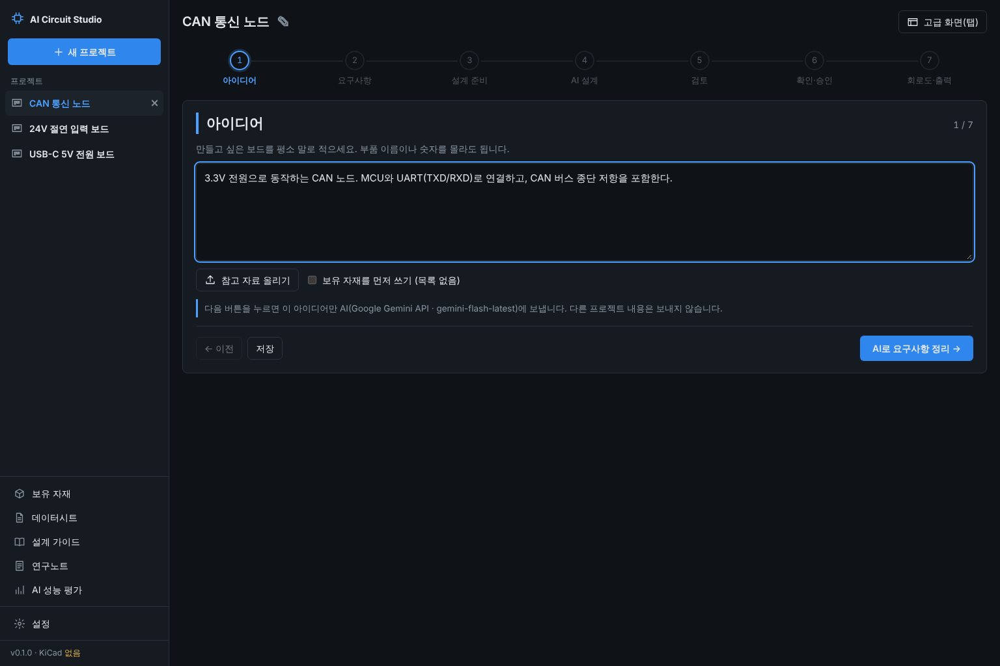
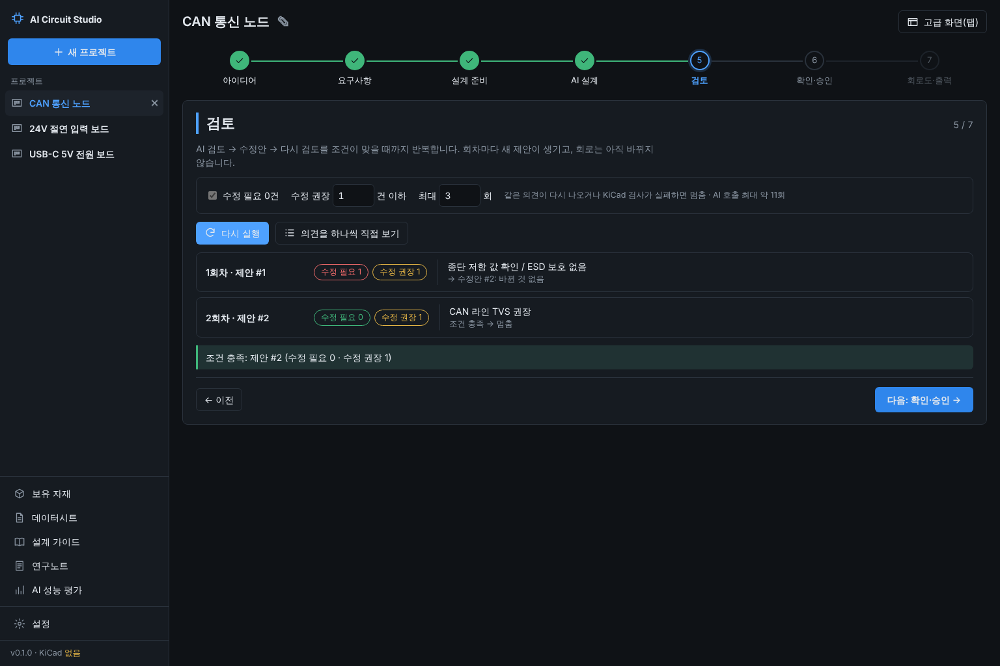
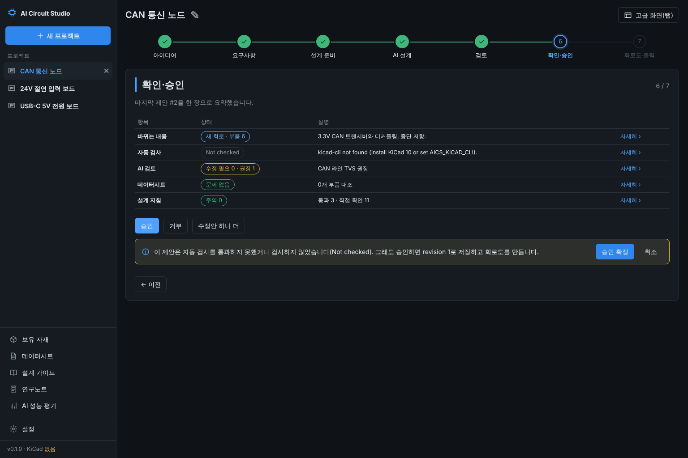
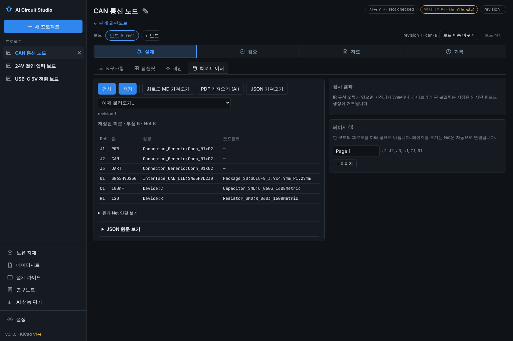

# ADR-017: 단계 화면 — 아이디어에서 회로도까지 7단계, 자동 반복 검토, 고급 화면(탭 4묶음)

- 상태: **채택(Accepted)**
- 날짜: 2026-11-08
- 관련: ADR-003(데스크톱 셸), ADR-006(AI 회로 설계), ADR-013(설계 가이드), 기획서 9장(승인 경로)

## 배경

사용자 요청: "지금 버튼들이 너무 많아. 기능을 유지하되 스테이지를 넘기면서 하나씩 확인하는 식이면 좋을듯. Ppt 처럼", "아이디어부터".

- 프로젝트 화면에 탭 11개(요구사항·템플릿·제안·회로 (IR)·회로도 · 검증·자재·데이터시트·검토·Agent·문서 · BOM·이력)가 한 줄로 있고, 탭마다 버튼과 입력칸이 많았다. 무엇을 먼저 하고 다음에 무엇을 하는지 순서가 보이지 않았다.
- 회로 데이터가 JSON 원문 편집기로 크게 보이고, 작업 폴더 경로와 내부 ID가 머리에 그대로 나왔다.
- 제안 하나를 7장 슬라이드로 넘기는 검토(2026-11-08 커밋 0b2844d)를 먼저 만들었고, 사용자가 아이디어 단계부터 같은 방식을 원했다.
- 시안: 사용자가 ChatGPT 이미지 생성으로 화면 시안 0~9를 만들었다(요청서와 프롬프트는 이 세션에서 작성). 이 결정은 그 시안을 따른다.

## 결정

1. **프로젝트를 열면 단계 화면이 기본이다.** 7단계: 1 아이디어 → 2 요구사항 → 3 설계 준비 → 4 AI 설계 → 5 검토 → 6 확인·승인 → 7 회로도·출력.
   - 위에 단계 막대(끝난 단계 초록 체크, 지금 단계 파란 테두리, 아직 못 간 단계는 누를 수 없음), 가운데 지금 단계 한 장, 아래 「← 이전」과 주된 버튼 하나.
   - 단계마다 기존 백엔드 기능을 그대로 쓴다: 요구사항 저장·AI 정리(`…/requirements/structure`), 설계 미리보기(`…/ai/design/preview`), AI 설계(`…/ai/design`), 제안·승인(`…/proposals/…`), 회로도 생성(`…/exports`), 연구노트(`…/notes/ai`). 새로 만든 백엔드는 아래 3·4번뿐이다.
   - 어디까지 왔는지는 **보드 데이터에서 계산**한다: 요구사항 글이 있으면 1단계, 정리된 요구사항이 있으면 2단계, AI 설계안이 있으면 4단계, 자동 검토가 끝났으면 5단계, 저장된 revision이 있으면 7단계까지 열린다. 보는 사람이 마지막으로 본 단계와 고른 값(보유 자재 사용, 멈출 조건)은 그 컴퓨터에만 둔다(`localStorage`, 보드별). 새 프로젝트의 요구사항 틀(제목과 주석)은 아이디어로 치지 않는다.
   - 2단계 「AI의 질문」에 적은 답은 요구사항 글 끝 「AI 질문에 대한 답」에 붙고, 답한 질문은 정리된 요구사항의 열린 질문에서 빠진다. 카드(기능·전원·인터페이스·부품 선호·제약)는 연필로 한 줄씩 고친다.
   - (2026-11) 4단계에서 KiCad 심볼이 없는 부품 때문에 멈추면, 그 자리에 부품마다 대안을 고르는 칸(1 대체·2 다른 방법·3 기타 의견)과 AI 질문 답 칸이 나오고 「고른 방법으로 이어서 설계」로 계속한다(ADR-006 추가 절). 멈춘 단계는 노란 표시다.
   - 6단계 표의 「자세히」는 그 제안의 슬라이드(개요·바뀌는 내용·자동 검사·AI 검토·데이터시트·설계 지침·결정)를 해당 장에서 연다. 승인·거부는 화면 안의 확인 상자로 한다(검사를 통과하지 못한 제안은 경고 문구).
2. **고급 화면(탭)은 그대로 남기고 4묶음으로 정리한다.** 설계(요구사항·템플릿·제안·회로 데이터), 검증(회로도 · 검증·검토·Agent), 자료(자재·데이터시트·문서 · BOM), 기록(이력). 오른쪽 위 「고급 화면(탭)」으로 들어가고 「← 단계 화면으로」로 돌아온다. 단계 화면의 「BOM·문서 받기」 같은 버튼은 해당 탭을 연다.
   - 「회로 (IR)」는 「회로 데이터」로 바꾸고, 부품 표(Ref·값·심볼·풋프린트)를 먼저 보인다. JSON 원문은 「JSON 원문 보기」에 접어 두고, 저장된 회로가 없거나 무언가를 불러왔거나 저장하지 않은 변경이 있으면 펼친다.
   - 사이드바: 「+ 새 프로젝트」 버튼(누르면 이름 칸), 프로젝트 목록, 자료 메뉴(보유 자재 수 표시), 설정. 작업 폴더 경로는 설정 화면에만 보인다.
3. **오래 걸리는 job은 지나온 단계를 기록한다.** `Job.progress`: `{at, step, text, data?}` 목록(SQLite `jobs.progress` 열). AI 설계는 parts(부품 계획·KiCad 심볼로 찾기) → pins(핀 연결·고침) → check(KiCad 검사) → proposal(제안 만듦) → review(AI 검토)를 남긴다. 4단계는 이것을 1초마다 읽어 진행 목록과 기록을 보인다. 다른 화면으로 갔다 와도 보드의 최근 job에서 이어 본다.
4. **자동 반복 검토**(`POST …/ai/auto-review`, job 하나): 제안을 AI가 검토하고, 「수정 필요(오류) 0건 · 수정 권장(경고) n건 이하」가 될 때까지 지적과 검사 문제를 반영한 수정안을 만들어 다시 검토한다.
   - 멈추는 경우: 조건 충족(`met`), 최대 횟수(`max_rounds`, 검토 횟수 기준 1~5, 기본 3), 수정안을 만들었는데 같은 의견(제목, 공백·대소문자 무시)이 다시 나옴(`repeated`), 수정안이 KiCad 검사를 통과하지 못함(`check_failed`), 수정안을 못 만듦(`revise_failed`), AI 검토 실패(`ai_failed`).
   - 「수정 필요」에는 AI 오류와 함께 자동 검사 실패(제안 상태 `invalid`·`check_failed`)를 센다.
   - **회차마다 별도 제안**이 생기고(수정안은 `ai_revision`, 부모 제안 기록), 보드의 회로는 사람이 마지막 제안을 승인해야만 바뀐다. 자동 승인은 없다.
   - 화면에 AI 호출 상한을 미리 보인다: 첫 검토 1회 + 수정안마다 최대 5회(부품 계획 1, 연결 1~3, 검토 1).
   - 회차 기록(`round`·`revised` 단계의 `data`)으로 타임라인을 그린다: 회차·제안 번호·수정 필요/권장 수·지적 제목·수정안 번호와 바뀐 점.

## 검토한 다른 안

| 안 | 판단 |
|---|---|
| 탭을 없애고 단계 화면만 | 엔지니어가 회로 데이터·Agent·이력을 직접 다룰 때 길이 막힌다. 사용자 조건이 "기능을 유지하되"였다. 고급 화면으로 남겼다. |
| 자동 반복 검토를 화면(브라우저)에서 돌림 | 화면을 옮기거나 앱을 닫으면 끊기고 중간 상태가 남지 않는다. 백엔드 job 하나로 돌리고 단계를 기록했다. |
| 조건이 맞으면 자동 승인 | 승인 경로는 하나(기획서 9장)이고 사람이 해야 한다. 조건 충족은 「확인·승인」으로 넘어가는 표시일 뿐이다. |
| 같은 의견 판정을 AI에게 맡김 | 호출이 늘고 결과가 흔들린다. 제목 비교로 보수적으로 멈추고, 남은 판단은 사람이 6단계에서 한다. |
| 단계 진행을 백엔드에 저장 | 보드 데이터에서 대부분 계산된다. 보는 사람마다 다른 "마지막으로 본 단계"만 그 컴퓨터에 둔다. |

## 검증

- `tests/test_design.py`: 설계 job의 단계 기록(순서·문구·job 목록에도 남음), 자동 반복 검토 — 한 번에 조건 충족, 두 번 고쳐 충족(회차별 수·수정안 부모·보드 회로 변경 없음·수정안의 설계 단계도 기록), 같은 의견 재등장으로 멈춤, 최대 횟수·범위 밖 값(422)·결정된 제안(409).
- `desktop/e2e/flow.spec.ts`(가짜 AI): 아이디어 → AI 정리 → 카드 고치기·질문 답(저장 내용 확인) → 설계 준비 → AI 설계 진행 기록 → 자동 반복 검토 2회차 조건 충족 → 요약 표·「자세히」 슬라이드 → 승인 전 보드 회로 없음 → 승인 → 회로도·출력, 단계 막대·화살표 키로 되돌아가기, 고급 화면 4묶음.
- 기존 e2e는 `openTab`(고급 화면 → 묶음 → 탭)과 `newProject`(「+ 새 프로젝트」) 도우미로 같은 흐름을 그대로 시험한다.
- **실제 AI로는 돌려 보지 않았다.** 가짜 AI는 각본대로 답하므로, 실제 모델에서 수정안이 지적을 얼마나 줄이는지(수렴하는지)는 AI 성능 평가(ADR-016)에 묶음을 더해 재야 한다.

## 화면

| 1 아이디어 | 5 검토 (자동 반복) |
|---|---|
|  |  |
| **6 확인·승인** | **고급 화면 (탭 4묶음)** |
|  |  |

(가짜 AI로 돌린 e2e 흐름의 화면. KiCad가 없는 환경이라 자동 검사는 「Not checked」다.)
