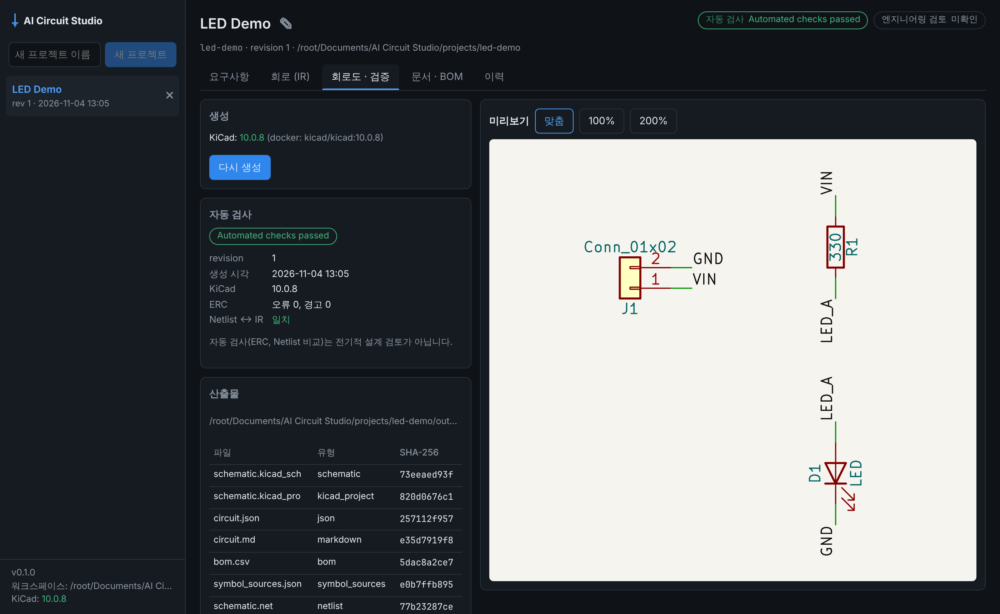
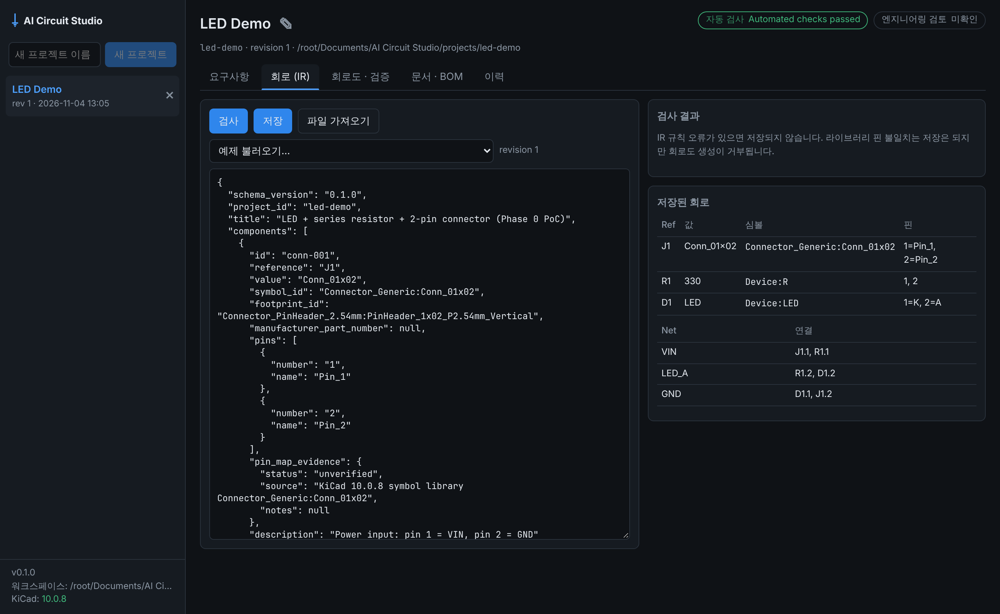

# Phase 1 작업 보고 (2026-11-04)

기준: 기획서 v1.2 12장 Phase 1, 개발 규칙 8(변경 파일, 테스트 결과, 미해결 위험, 다음 단계).

| 회로도 · 검증 | 회로 (IR) |
|---|---|
|  |  |

## 범위와 결과

| 항목 (기획서 v1.2) | 결과 | 위치 |
|---|---|---|
| 프로젝트 CRUD, SQLite 인덱스, 마지막 작업 상태 복원 | ✅ 생성·목록·이름 변경·휴지통 삭제. 인덱스는 폴더에서 다시 만들 수 있음. 마지막 프로젝트·탭 복원 | `backend/store.py`, `desktop/src/App.tsx` |
| 요구사항 텍스트 편집·저장 | ✅ `requirements.md` (필드형 사양은 Phase 2b) | `RequirementsTab.tsx` |
| Circuit IR 가져오기·편집·검증·저장, revision, 복원 | ✅ 파일 가져오기, 예제 불러오기, JSON 편집기. 저장마다 revision(내용이 같으면 생성 안 함). 복원은 새 revision으로 기록. 손상된 `circuit.json`은 스냅샷에서 복구 | `backend/store.py`, `CircuitTab.tsx`, `HistoryTab.tsx` |
| Markdown/JSON/BOM exporter (결정적) | ✅ | `circuit_core/export.py` |
| EDA Adapter job (생성 + ERC + Netlist 비교 + SVG) | ✅ job 큐(1 worker), 작업 이력 | `backend/exports.py`, `backend/jobs.py` |
| validation UI | ✅ 상태 3축 표시. 검사 결과는 IR 규칙과 라이브러리 대조로 나눠 표시. ERC 위반 목록, Netlist 일치 여부 | `SchematicTab.tsx`, `IssueList.tsx` |
| 생성 파일 경로 관리 | ✅ 임시 폴더에서 생성한 뒤 교체. manifest(유형·revision·도구 버전·SHA-256·검사 상태). 오래됨·외부 수정·누락 감지. 외부 수정이 있으면 확인 후에만 덮어씀 | `backend/exports.py` |
| 데스크톱 셸 | ✅ Electron 45. 백엔드 자동 실행, 실행마다 토큰, 렌더러 격리 | `desktop/electron/`, ADR-003 |

추가로 한 일:
- 예제 회로 API: `examples/*/circuit.json`을 UI의 "예제 불러오기"로 제공.
- SVG 미리보기 자르기: 생성기가 도면 범위를 계산해 manifest에 넣고, UI가 미리보기만 그 범위로 자름. 파일은 그대로 둠.

## Gate 판정

> Gate: 앱 재시작 후 프로젝트 복원, 동일 입력에서 동일 연결 구조 출력.

| Gate | 증거 | 결과 |
|---|---|---|
| 재시작 후 복원 | `tests/test_backend_projects.py::test_restart_restores_projects_settings_and_circuit`: 새 앱 인스턴스에서 프로젝트·설정·회로·요구사항이 같음 `test_index_is_rebuilt_from_folders`: SQLite를 지워도 복원 `desktop/e2e/app.spec.ts` 첫 시나리오: 백엔드를 재시작하고 새로고침하면 프로젝트·revision·마지막 탭(문서·BOM)이 돌아옴 | ✅ |
| 동일 입력 → 동일 출력 | `tests/test_backend_exports.py::test_same_input_gives_same_files`: 같은 프로젝트에서 두 번 생성해도, 다른 워크스페이스의 새 앱 인스턴스에서 생성해도 모든 산출물의 SHA-256이 같음. 연결 구조는 매번 KiCad Netlist ↔ IR 비교로 확인(`test_export_with_kicad_end_to_end`) | ✅ |

**판정: Phase 1 Gate 충족.** 단, 확인은 Linux 개발 환경에서만 했다(아래 위험 1).

## 테스트 결과

| 종류 | 명령 | 결과 |
|---|---|---|
| Python 전체 (KiCad 10.0.8 포함) | `AICS_KICAD_DOCKER_IMAGE=kicad/kicad:10.0.8 uv run pytest` | 113 passed |
| Python (KiCad 없음) | `uv run pytest` | 105 passed, 8 skipped (KiCad 필요 테스트는 "pending"으로 skip) |
| Python lint | `uvx ruff check .` | 통과 |
| TypeScript 타입 검사 | `npm run typecheck` (UI, Electron, e2e) | 통과 |
| Vitest | `npm test` | 7 passed |
| 브라우저 e2e (실제 백엔드 + KiCad) | `npx playwright test e2e/app.spec.ts` | 3 passed (KiCad 없이도 3 passed, 결과 Not checked) |
| Electron 셸 e2e | `xvfb-run -a npx playwright test e2e/electron.spec.ts` | 1 passed |

## 화면 점검 중 발견해 고친 문제

1. **첫 로딩 race:** 시스템 정보 요청(KiCad 감지에 1~2초)과 프로젝트 목록 요청을 함께 기다렸다. 그 사이 새 프로젝트를 만들면 늦게 도착한 옛 목록이 새 목록을 덮어써서 화면이 비었다.
   - 목록을 시스템 정보와 분리해 불러오도록 바꿨다.
   - 첫 로딩이 끝나기 전에는 "새 프로젝트" 버튼을 막았다.
   - 백엔드 시작 시 KiCad 감지를 백그라운드에서 미리 하도록 했다.
2. **미리보기가 A4 전체로 나와 회로가 아주 작았다.** 도면 범위로 미리보기만 자르도록 했다.
3. **문서 탭 레이아웃:** Markdown 표가 BOM 패널을 침범했다. 세로 배치로 바꾸고 가로 스크롤을 넣었다.
4. **같은 포트로 바로 재시작하면 bind가 실패했다.** POSIX에서만 `SO_REUSEADDR`를 켰다. Windows에서는 다른 프로세스가 포트를 공유할 수 있게 되므로 켜지 않는다.

## 미해결 위험

1. **Windows 11 미검증:** 경로, `uv` 실행, KiCad 기본 경로, `openPath`, 줄바꿈 처리를 Windows에서 실제로 돌려 보지 않았다.
2. **배포 패키징 없음:** 지금은 소스와 `uv`가 있어야 실행된다(ADR-003 남은 결정).
3. **생성 작업 취소 미지원:** 작업은 하나씩 순서대로 처리한다. 긴 작업이 생기면 취소가 필요하다(14장 비기능 요구사항).
4. **SQLite와 파일의 일관성:** 파일이 원본이고 SQLite는 시작할 때 다시 맞추므로 크게 위험하지 않다. 다만 앱 실행 중 폴더를 밖에서 고치면 다음 시작 때까지 목록에 반영되지 않는다.
5. **생성기 한계는 그대로다:** 전원 심볼, 다중 유닛 심볼, no-connect를 지원하지 않는다. 이것들이 있어야 MCU 회로를 그릴 수 있다(Phase 3).
6. **IR 편집 UX:** 지금은 JSON을 직접 편집한다. Phase 2a의 patch 연산과 diff 화면이 나오면 대부분 대체된다.

## 다음 단계 (기획서 v1.2 20장)

Phase 2a(LLM 없는 변경 흐름)를 진행한다.
1. patch 연산(`update_property`, `connect`, `disconnect`, `add_component`, `remove_component`, `move`)과 precondition 모델
2. proposal과 단일 승인 경로(approve/reject). 승인 전 파일은 `proposals/` 안에서만 만든다.
3. 코드로 계산한 before/after diff 화면
4. 통합 테스트: LED 저항값 330→1k 변경 → diff → 승인 → 생성 → ERC → Netlist 비교. 거부하거나 실패하면 원본 해시가 그대로여야 한다.

시작 전에 할 일: Windows PC에서 `npm start`와 `uv run pytest`를 실행해 위험 1을 줄인다.
