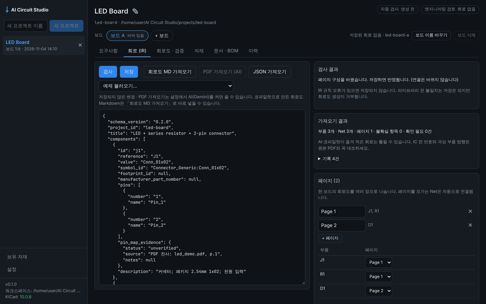
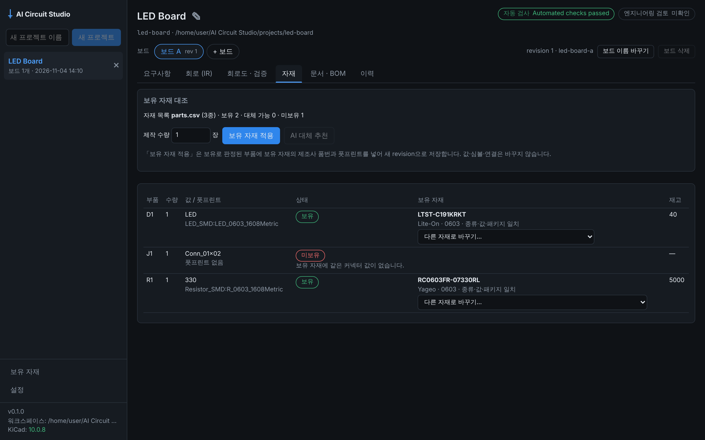

# Phase 1.5 작업 보고 (2026-11-04)

기준: 기획서 v1.3 12장 Phase 1.5, 개발 규칙 8(변경 파일, 테스트 결과, 미해결 위험, 다음 단계).

사용자 요청:
- PDF 회로도 카피. 2단계까지 만들고, 2단계(AI 변환)는 옵션으로, AI는 Gemini API를 기본으로 한다.
- 보유 자재 우선 사용. 바로 진행한다.
- 코파일럿에게 줄 "PDF 회로도 → Markdown" 프롬프트.
- 프로젝트 → 보드(A, B, C, …) → 세부 페이지 구조. 가능하면 이렇게 하고, 안 되면 프로젝트 = 보드로 본다. → **가능해서 이 구조로 만들었다.**

| 회로 (IR): 회로도 MD 가져오기와 페이지 나누기 | 자재: 보유 자재 대조 |
|---|---|
|  |  |

## 범위와 결과

| 항목 | 결과 | 위치 |
|---|---|---|
| **여러 페이지** (FR-18) | ✅ IR에 `sheets`(페이지)를 추가했다(스키마 0.2.0). 1페이지가 루트 회로도, 나머지 페이지는 계층 시트다. 페이지를 오가는 Net은 global label, 한 페이지 안의 Net은 local label을 쓴다. 페이지가 하나면 출력이 예전과 바이트 단위로 같다 | `circuit_core/models.py`, `kicad_adapter/schematic.py` |
| 자동 배치·용지 선택 | ✅ 심볼 크기(그림·핀·라벨·필드)를 계산해 선반식으로 배치한다. 넘치면 A4→A3→A2→A1→A0 순으로 큰 용지를 고른다 | `kicad_adapter/schematic.py` |
| **여러 보드** (FR-18) | ✅ 프로젝트 파일 버전 2. 보드마다 IR·revision·산출물·KiCad 프로젝트(`<프로젝트>-<보드>`)가 따로 있다. 1.0 프로젝트는 처음 열 때 "보드 A"로 자동 이관한다. 마지막으로 연 보드를 기억한다 | `backend/store.py`, `backend/app.py`, `ProjectView.tsx` |
| **PDF 카피 1단계: 회로도 MD 가져오기** (FR-19) | ✅ "회로도 MD v0.1"을 IR로 바꾼다. 핀 이름은 KiCad 라이브러리로만 번호를 찾는다(예: LED A→2, K→1). 비어 있는 심볼은 종류로 추정하고, 칩 R/C/L/LED는 패키지로 표준 풋프린트를 추정한다. 4장(Net 표)·8장(자체 점검)과 교차 확인한다. 불확실 항목이나 경고가 있으면 "검토 필요"로 둔다. 원본 Markdown 사본은 `imports/`에 둔다 | `circuit_core/schematic_md.py`, `CircuitTab.tsx`, `ImportReport.tsx` |
| 코파일럿용 프롬프트 | ✅ 형식 정의·프롬프트 본문·예시. 앱이 Gemini에 보내는 프롬프트와 같은 문장인지 테스트로 확인한다 | `docs/prompts/pdf-schematic-to-markdown.md`, `examples/led-resistor-connector/schematic.md` |
| **PDF 카피 2단계: AI 변환(옵션)** (FR-20) | ✅ Gemini가 PDF를 회로도 MD로 옮기고, 1단계와 같은 가져오기 규칙을 거쳐 편집기에 불러온다. 보내기 전에 확인을 받는다. 사용자가 저장해야 revision이 생긴다 | `ai_engine/`, `backend/routes_ai.py` |
| **보유 자재 우선 사용** (FR-21) | ✅ 자재 목록(CSV·XLSX, 한글/영문 열 이름, CP949 CSV)을 워크스페이스에 한 번 올리면 모든 프로젝트에서 쓴다. BOM 줄마다 보유/대체 가능/미보유를 판정하고 재고를 확인한다(제작 수량 반영). "보유 자재 적용"은 제조사 품번과 풋프린트만 바꿔 새 revision(출처 "보유 자재 적용")으로 저장한다. 값·심볼·연결은 바꾸지 않는다 | `circuit_core/parts.py`, `circuit_core/inventory.py`, `backend/routes_inventory.py`, `InventoryPage.tsx`, `MaterialsTab.tsx` |
| **AI 대체 추천(옵션)** (FR-22) | ✅ 보유 자재 목록 안의 후보만 AI에 보내고, 목록에 없는 id로 답하면 버린다. 보낼 내용을 먼저 보여 준다. 사용자가 고른 것만 적용한다 | `ai_engine/tasks.py`, `MaterialsTab.tsx` |
| AI 설정 | ✅ 기본은 꺼짐. API 키는 OS 보안 저장소 또는 `GEMINI_API_KEY`. 모델 선택(기본 `gemini-flash-latest`), 모델 목록 불러오기. 호출마다 `ai_runs/`에 기록(키는 기록하지 않음) | `SettingsPage.tsx`, `ai_engine/keystore.py`, ADR-004 |
| 제품 비전 기록 | ✅ "하나의 입력 창에서 회로도·아트웍·펌웨어"를 기획서 v1.3 1장과 Phase 5에 반영 | 기획서 v1.3 |

## Gate 판정

> Gate: 페이지를 나눠도 KiCad Netlist = IR, 페이지별 KiCad 재저장 무손실, 가져온 회로의 핀은 라이브러리로만 번호화, AI 결과는 사용자 확인 없이 저장되지 않음.

| Gate | 증거 | 결과 |
|---|---|---|
| 페이지를 나눠도 Netlist = IR | `tests/test_kicad_integration.py::test_two_pages_with_kicad`: KiCad 10.0.8에서 ERC 위반 0, Netlist ↔ IR 일치(2페이지 안의 local Net 포함) `tests/test_backend_exports.py::test_multi_page_export_with_kicad`: 앱의 생성 job으로도 같은 결과 `desktop/e2e/boards.spec.ts`: UI에서 페이지를 나눠 생성하면 "Automated checks passed" | ✅ |
| 페이지별 재저장 무손실 | 같은 테스트에서 페이지 파일마다 `kicad-cli sch upgrade`로 KiCad가 다시 저장하게 한 뒤 비교: 다른 줄은 `generator` 두 줄뿐 | ✅ |
| 핀은 라이브러리로만 번호화 | `tests/test_schematic_md.py`: 예제 MD → IR 연결이 `circuit.json`과 같음. 이름으로 못 찾으면 `PIN_NAME_UNRESOLVED`, 번호도 이름도 모르면 `PIN_NUMBER_UNKNOWN` 오류로 IR을 만들지 않음. 번호와 이름이 어긋나면 경고하고, 생성 단계에서 `PIN_NAME_MISMATCH`로 거부 | ✅ |
| AI 결과는 확인 없이 저장 안 함 | `tests/test_ai.py::test_pdf_import_end_to_end_with_fake_provider`: 변환이 끝나도 보드의 회로는 비어 있음 `test_suggestions_only_use_listed_parts`: 추천은 별도 적용 요청이 있어야 revision이 생김 | ✅ (가짜 공급자로 확인, 아래 위험 1) |

**판정: Phase 1.5 Gate 충족.** 단, AI 경로는 실제 Gemini 대신 가짜 공급자로 확인했다.

## 테스트 결과

| 종류 | 명령 | 결과 |
|---|---|---|
| Python 전체 (KiCad 10.0.8 포함) | `AICS_KICAD_DOCKER_IMAGE=kicad/kicad:10.0.8 uv run pytest` | 217 passed |
| Python (KiCad 없음) | `uv run pytest` | 207 passed, 10 skipped (KiCad 필요 테스트는 "pending"으로 skip) |
| Python lint | `uvx ruff@0.14.0 check .` | 통과 |
| TypeScript 타입 검사 | `npm run typecheck` (UI, Electron, e2e) | 통과 |
| Vitest | `npm test` | 10 passed |
| 브라우저 e2e (실제 백엔드 + KiCad) | `npx playwright test e2e/app.spec.ts e2e/boards.spec.ts` | 5 passed (KiCad 없이도 5 passed, 결과 Not checked) |
| Electron 셸 e2e | `xvfb-run -a npx playwright test e2e/electron.spec.ts` | 1 passed |

Phase 1 대비 Python 테스트가 113개에서 217개로 늘었다.

## 작업 중 발견해 고친 문제

1. **2페이지 이후의 local Net 이름:** KiCad Netlist는 하위 시트의 local Net을 `/시트 이름/NET`으로 적는다. IR과 비교할 때 마지막 부분만 쓰도록 고쳤다.
2. **보드를 바꾸는 순간 이전 보드의 revision이 보이던 문제:** 늦게 도착한 응답이 다른 보드 화면을 덮어써 저장이 409로 실패했다. 불러온 데이터에 보드 id를 붙이고 보드가 바뀌면 탭을 새로 그리도록 했다.
3. **저장 차단 기준:** 오류 코드 이름(`PIN_` 접두사)으로 "라이브러리 오류"를 구분하던 방식이 IR 규칙 오류 일부를 놓쳤다. 검사 결과에 단계(ir/library)를 붙여 IR 오류만 저장을 막도록 했다.
4. **자재 종류 판별:** 짧은 키워드는 단어 전체가 같을 때만 인정하는 규칙(짧은 단어가 다른 단어 속에 섞여 잘못 걸리지 않게 하려는 것)이 한글 두 글자 키워드에도 걸려 "칩저항"을 저항으로 못 알아봤다. 이 규칙을 짧은 영문 단어에만 적용하도록 바꿨다.
5. **전해 콘덴서 `-` 핀:** 표의 `-`를 "비어 있음"으로 읽어 음극 핀 이름이 사라졌다. "핀 이름" 열에서만 `-`를 값으로 읽는다.
6. **MD로 가져온 회로가 보유 자재와 안 맞던 문제:** MD에는 풋프린트가 없어 패키지 비교가 안 됐다. 칩 R/C/L/LED는 패키지(0402~1206)로 KiCad 표준 풋프린트를 추정하도록 했다. 추정한 풋프린트 16개가 KiCad 10.0.8 라이브러리에 있는지 확인했다.

## 미해결 위험

1. **실제 Gemini API로는 한 번도 호출하지 않았다.** 개발 환경에 키가 없고 `ai.google.dev`에도 접근할 수 없었다. SDK(`google-genai` 2.34.0)의 소스와 타입에 맞춰 만들고 SDK 대역으로 요청 형태를 확인했지만, 실제 응답·오류·한도는 키를 넣고 확인해야 한다(ADR-004).
2. **PDF 변환 정확도를 실제 회로도로 재지 않았다.** IC 핀 번호, 선 교차와 접속 구분, 숨은 전원 핀에서 틀릴 수 있다. 가져오기의 라이브러리 대조와 "검토 필요" 표시가 1차 안전장치다. 실제 PDF 몇 장으로 오류 유형을 모아 프롬프트를 고쳐야 한다.
3. **Windows 11 미검증(Phase 1부터 이어짐).** 이번에 추가한 Windows 자격 증명 관리자 저장, CP949 CSV, 한글 페이지 이름 SVG 파일명도 Windows에서 돌려 보지 않았다.
4. **AI 결과의 승인 방식이 임시다.** 지금은 편집기에서 검토 후 저장, 고른 추천만 적용하는 방식이다. Phase 2a에서 proposal 승인 경로로 옮겨야 기획서 1.1절의 "승인 경로는 하나"가 지켜진다.
5. **자재 대조는 값·패키지·종류·품번만 본다.** 정격(전압·전력)과 허용오차는 목록에서 읽지만 IR에 해당 정보가 없어 비교하지 않는다. "보유"는 같은 값·패키지라는 뜻이지 설계에 맞다는 뜻이 아니다.
6. **생성기 한계는 그대로다.** 전원 심볼, 다중 유닛 심볼, no-connect를 지원하지 않는다. 그래서 MCU가 있는 실제 PDF 회로도는 가져오기는 돼도 생성 단계에서 막힐 수 있다(Phase 3).

## 다음 단계 (기획서 v1.3 20장)

Phase 2a(LLM 없는 변경 흐름)를 보드 단위로 진행한다.
1. patch 연산과 precondition, proposal, 단일 승인 경로(approve/reject)
2. 코드로 계산한 before/after diff 화면
3. LED 저항값 330→1k 변경 → diff → 승인 → 생성 → ERC → Netlist 비교 통합 테스트, 거부·실패 시 원본 해시 불변 테스트
4. PDF 가져오기와 AI 대체 추천의 결과도 proposal로 제출

시작 전에 할 일:
- Windows PC에서 `npm start`, `uv run pytest`를 실행한다(위험 3).
- Gemini API 키로 설정 화면의 "모델 목록 불러오기"와 PDF 한 장 변환을 실행해 본다(위험 1·2).
