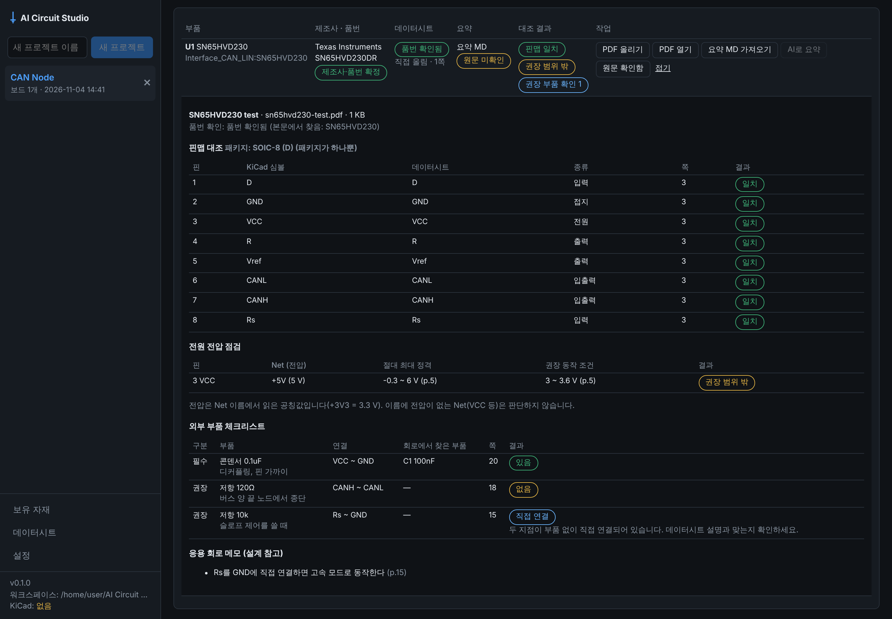

# Phase 1.6 작업 보고: 데이터시트 수집·활용 (2026-11-04)

기준: 기획서 v1.4 12장 Phase 1.6, 개발 규칙 8(변경 파일, 테스트 결과, 미해결 위험, 다음 단계). 결정 근거는 [ADR-005](adr/ADR-005-datasheets.md).

사용자 요청: "사용되는 IC가 메이커가 확실한 경우 datasheet를 자동으로 수집하여 회로 작성 또는 분석에 활용하는 기능."
사용자 결정: 출처는 KiCad 심볼 링크 + 직접 올리기. 활용은 핀맵 대조, 정격 점검, 외부 부품 체크리스트, 회로 작성 시 참고. 지금 바로 진행.

위 화면은 테스트용 요약으로 만든 예시입니다. U1(SN65HVD230)이 +5V에 연결되어 "권장 범위 밖"이 표시되고, 권장 종단 저항(120Ω)이 없어 "없음"이 표시됩니다. 요약의 정격 값은 테스트용이며 실제 데이터시트와 대조하지 않았습니다.

## 범위와 결과

| 항목 | 결과 | 위치 |
|---|---|---|
| 제조사 정보 (FR-25) | ✅ IR 부품에 `manufacturer`(스키마 0.3.0, 선택). 회로도 MD 2장에 「제조사」 열(선택, 예전 파일도 읽음). 보유 자재 적용이 제조사도 채움. BOM에 Manufacturer 열 | `circuit_core/models.py`, `schematic_md.py`, `inventory.py`, `export.py` |
| "메이커가 확실한" 부품 판정 | ✅ 제조사+품번이 있으면 `mpn`, 부품 전용 KiCad 심볼이면 `symbol`, 나머지는 `generic`(자동으로 받지 않음) | `circuit_core/datasheets.py` |
| 데이터시트 수집 (FR-12) | ✅ KiCad 심볼의 `Datasheet` 링크로 받기: 보드 심볼에 있는 링크만, 확인 후, HTTPS로, 50MB, PDF만. 직접 올리기. 받은 PDF 본문에서 품번·제품군 확인. 워크스페이스 공통 라이브러리(해시로 중복 제거, 출처 URL 기록) | `backend/datasheets.py`, `kicad_adapter/symbols.py` |
| 데이터시트 요약 MD v0.1 | ✅ 형식, 코파일럿 프롬프트(화면의 「코파일럿 프롬프트 복사」), 가져오기 검사(쪽 번호 누락, 숫자 오류, 중복 핀) | `docs/prompts/datasheet-summary.md`, `circuit_core/datasheet_md.py` |
| AI 요약(옵션) | ✅ Gemini가 같은 프롬프트로 요약 → 같은 검사를 거쳐 저장. 보내기 전 확인, 실행 기록(`datasheets/ai_runs/`, 키 없음) | `ai_engine/tasks.py`, `backend/routes_ai.py` |
| 핀맵 대조 (FR-24) | ✅ 패키지 자동 선택(핀 수 → 풋프린트 이름, 못 고르면 묻기). 핀 번호별 일치/불일치/누락. 노출 패드(EP) 짝 맞추기 | `circuit_core/datasheet_checks.py` |
| 정격 점검 (FR-24) | ✅ 전원 핀이 연결된 Net의 이름에서 공칭 전압을 읽어 절대 최대 정격(초과=오류)·권장 조건(밖=경고)과 비교 | 같은 파일 |
| 외부 부품 체크리스트 (FR-24) | ✅ 데이터시트의 두 지점 사이에 같은 종류·값의 부품이 있는지: 있음 / 부족 / 값 다름 / 없음 / 직접 연결 / 확인 불가 | 같은 파일 |
| 회로 작성 시 참고 | 🔶 응용 회로 메모와 외부 부품을 저장하고 화면에 보여 준다. 설계안에 쓰는 것은 Phase 2b(설계안 생성) 몫이다 | 기획서 Phase 2b |
| 화면 | ✅ 보드의 「데이터시트」 탭(부품별 상태, 작업 버튼, 자세히 보기), 사이드바 「데이터시트」(라이브러리 목록·열기·삭제) | `DatasheetsTab.tsx`, `DatasheetLibraryPage.tsx` |

"회로 작성 시 참고"를 🔶로 둔 이유: 회로를 고치거나 새로 그리는 제안은 승인 흐름(Phase 2a)과 설계안 생성(Phase 2b)이 있어야 안전하게 할 수 있다. 이번에는 그때 쓸 근거 데이터(쪽 번호 포함)를 저장하는 데까지 했다.

## Gate 판정

| Gate (기획서 v1.4 Phase 1.6) | 증거 | 결과 |
|---|---|---|
| 대조는 회로를 바꾸지 않음 | `test_upload_summary_and_checks`: 올리기·요약·확인 뒤에도 revision 1 그대로 | ✅ |
| 보드 심볼에 없는 링크는 받지 않음 | `test_fetch_only_confirmed_library_links`: 다른 주소는 `URL_NOT_FROM_LIBRARY`, 다운로드 함수 호출 없음 | ✅ |
| 일반 심볼에는 데이터시트를 연결하지 않음 | `test_generic_symbols_are_never_linked_and_prompts_are_served`: `Device:R`은 무시 | ✅ |
| AI 실행 기록에 API 키 없음 | `test_ai_summary`: `ai_runs/` 기록에 키 없음 | ✅ |
| http 링크를 평문으로 받지 않음 | `test_fetch_pdf`: 기본 설정에서 `http://` 링크는 HTTPS로만 시도, `file://` 거부 | ✅ |

**판정: Phase 1.6 Gate 충족.** 단, 실제 제조사 사이트와 실제 Gemini는 이 환경에서 쓸 수 없어 로컬 테스트 서버와 가짜 공급자로 확인했다(위험 1, 2).

## 테스트 결과

| 종류 | 명령 | 결과 |
|---|---|---|
| Python 전체 (KiCad 10.0.8 포함) | `AICS_KICAD_DOCKER_IMAGE=kicad/kicad:10.0.8 uv run pytest` | 264 passed |
| Python (KiCad 없음) | `uv run pytest` | 254 passed, 10 skipped (KiCad 필요 테스트는 "pending"으로 skip) |
| Python lint | `uvx ruff@0.14.0 check .` | 통과 |
| TypeScript 타입 검사 | `npm run typecheck` | 통과 |
| Vitest | `npm test` | 12 passed |
| 브라우저 e2e (실제 백엔드, KiCad 있음/없음) | `npx playwright test e2e/app.spec.ts e2e/boards.spec.ts e2e/datasheets.spec.ts` | 6 passed / 6 passed |
| Electron 셸 e2e | `xvfb-run -a npx playwright test e2e/electron.spec.ts` | 1 passed |

새 테스트: `tests/test_datasheets.py`(38), `tests/test_backend_datasheets.py`(9), `desktop/e2e/datasheets.spec.ts`(1), Vitest 2.
테스트용 자료: `tests/fixtures/datasheets/`(테스트용 PDF·요약·회로, 실제 데이터시트 아님), `tests/fixtures/kicad_symbols/`에 KiCad 10.0.8의 `SN65HVD230`, `AP1117-15`, `AMS1117-3.3`(파생 심볼), `Device:C` 추가.

## 작업 중 확인·수정한 것

1. **KiCad 라이브러리의 데이터시트 링크 비율을 실제로 셌다.** 23,772개 중 19,970개(약 84%). 키 없이도 IC 대부분을 받을 수 있다는 판단의 근거다.
2. **파생 심볼의 링크.** 생성기는 파생 심볼(`extends`)을 아직 못 그리지만, 데이터시트 링크는 읽을 수 있게 따로 조회한다(`AMS1117-3.3`으로 확인).
3. **표 파서 공용화.** 회로도 MD와 데이터시트 요약 MD가 같은 표 읽기 코드를 쓴다(`circuit_core/md_tables.py`). 회로도 MD의 기존 테스트가 모두 그대로 통과한다.
4. **연결 표기 충돌.** 핀 이름에 `-`가 들어가는 경우(예: `IN-`)가 있어 외부 부품 연결 구분자를 `~`로 정했다. `VCC-GND`처럼 `-`가 하나뿐이면 그것도 읽는다. 같은 이유로 반전 신호는 `RESET#`으로 쓰게 했다.
5. **한 쪽이 직접 연결된 경우.** 예: Rs를 GND에 바로 연결(고속 모드). "부품 없음"이 아니라 "직접 연결"로 따로 표시한다.
6. **화면:** 상태 칩이 좁은 칸에서 글자 중간에 줄바꿈되던 것을 고쳤다.
7. **프로젝트별 빈 `datasheets/` 폴더**를 더 만들지 않는다. 데이터시트는 워크스페이스 라이브러리로 옮겼다.

## 미해결 위험

1. **실제 제조사 사이트에서 받아 보지 않았다.** 이 환경은 ST·TI·Microchip·ADI 사이트가 막혀 있다(403). 일부 사이트는 자동 다운로드를 막거나, 링크가 제품 페이지로 바뀌었을 수 있다. 이때 앱은 원인과 "PDF 올리기"를 안내한다. 사용자 PC에서 확인이 필요하다.
2. **실제 Gemini로 요약해 보지 않았다**(ADR-004와 같은 이유). 데이터시트가 길면(100쪽 이상) 출력이 잘릴 수 있다. 이 경우 경고를 띄우고, 필요한 쪽만 잘라 올리도록 안내한다.
3. **요약 정확도.** 코파일럿·AI 요약은 틀릴 수 있다. 모든 행에 쪽 번호가 있고, "원문 확인함"을 누르기 전에는 미확인으로 표시한다.
4. **전압 점검 범위.** Net 이름에 전압이 있을 때만 판단한다. 신호 핀 입력 전압, 전원 순서, 전압 강하는 보지 않는다.
5. **패키지 선택.** 핀 수와 풋프린트가 같은 패키지가 여럿이면 고르지 않는다. 지금은 풋프린트를 지정하는 방법만 있고 화면에서 고르는 기능은 없다.
6. **Windows 11 미검증**(Phase 1부터 이어짐). PDF 열기(`openPath`)도 Windows에서 확인해야 한다.

## 다음 단계

기획서 v1.4 20장대로 Phase 2a(LLM 없는 변경 흐름)를 보드 단위로 진행한다. 데이터시트와 관련해 이어서 할 일:
- Phase 2a: 외부 부품 체크리스트의 "없음"을 patch 제안(예: VCC~GND에 0.1uF 추가)으로 만들 수 있게 한다. 적용은 승인 경로로만 한다.
- Phase 2b: 설계안이 데이터시트 요약을 쪽 번호와 함께 인용하고, 제안 뒤 같은 대조를 다시 통과하게 한다.
- 사용자 PC에서 할 일: 실제 IC(예: STM32, CAN 트랜시버)로 「링크로 받기」를 시도하고, 코파일럿으로 요약을 만들어 대조 결과를 확인한다.
