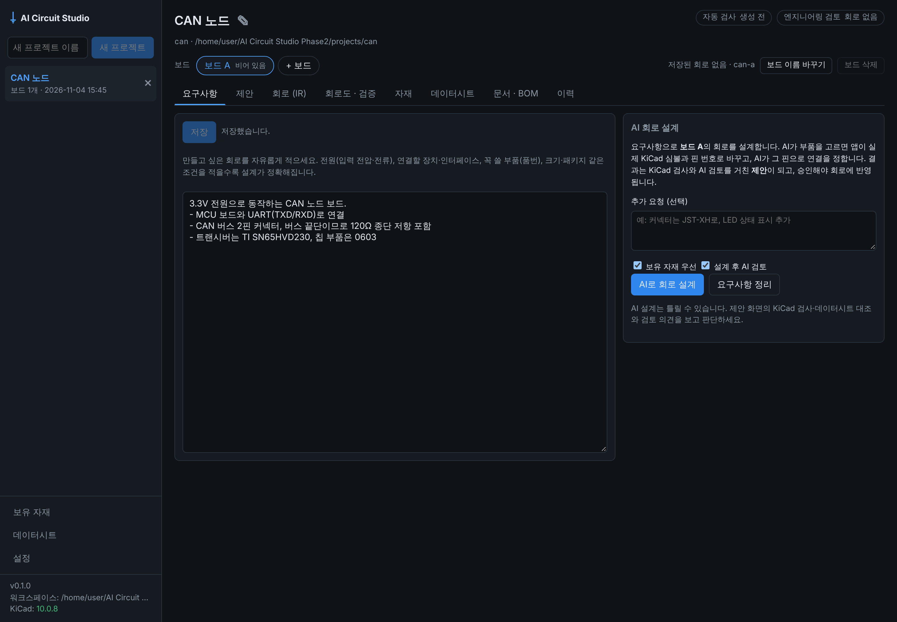
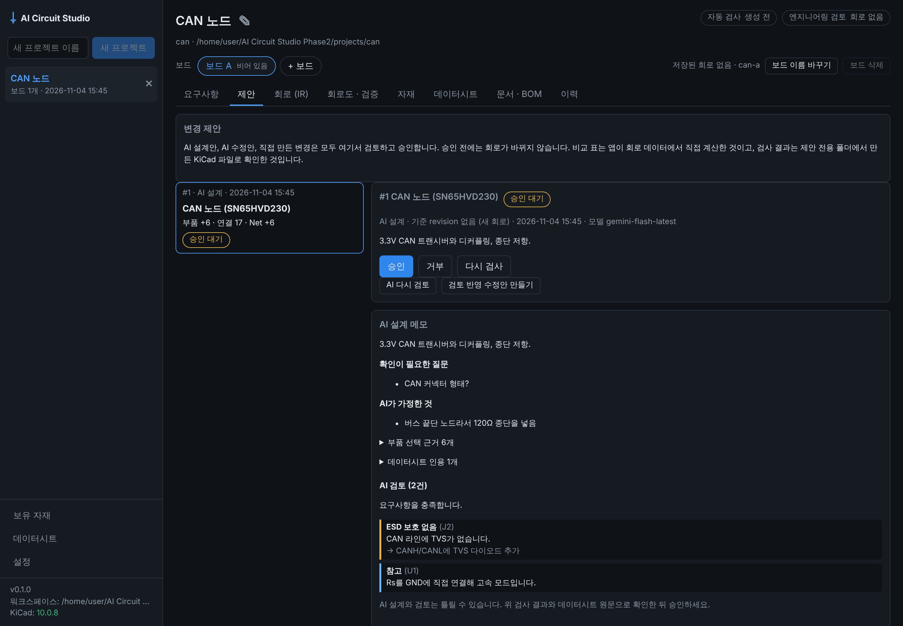
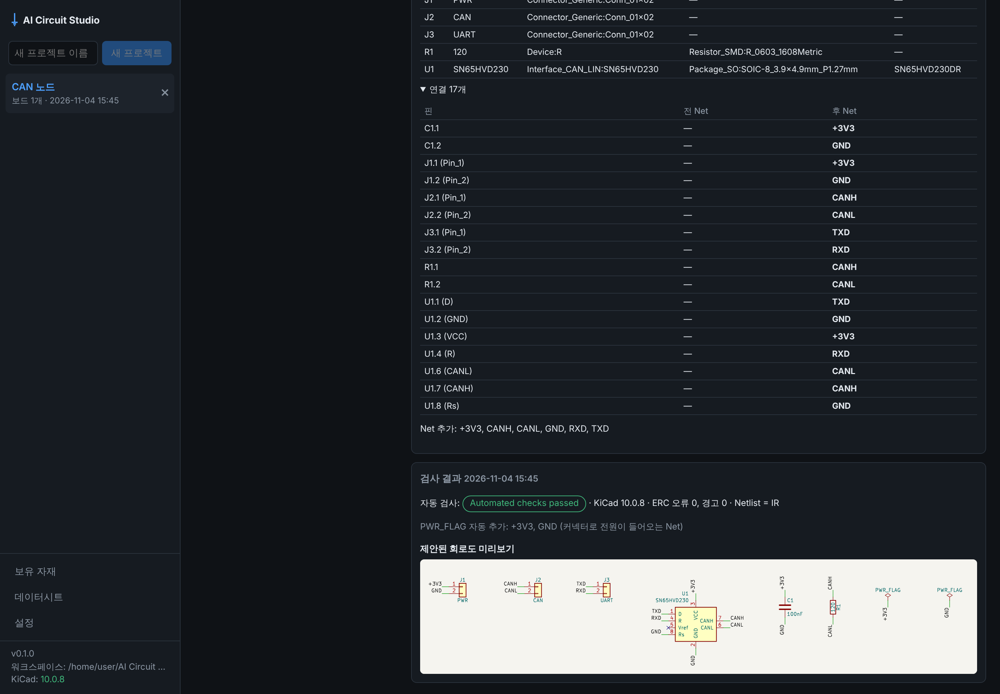

# Phase 2 작업 보고: 변경 흐름과 AI 회로 설계·검토 (2026-11-04)

기준: 기획서 v1.5 12장 Phase 2, 개발 규칙 8(변경 파일, 테스트 결과, 미해결 위험, 다음 단계). 결정 근거는 [ADR-006](adr/ADR-006-ai-circuit-design.md).

사용자 요청: "우선 Phase 2까지 완료해줘. 내가 원하는 요구사항 적기 → AI가 회로도 자동으로 작성/검토해주기가 되었으면 좋겠음."

| 1. 요구사항 적기 | 2. AI 설계안(제안)과 AI 검토 | 3. KiCad 검사와 미리보기 |
|---|---|---|
|  |  |  |

위 화면은 **각본대로 답하는 가짜 AI**로 만든 것이다. 이 환경에는 Gemini 키가 없다. AI의 답을 뺀 나머지는 실제 동작이다: KiCad 심볼 확정, 핀 검사, 수정 요청, KiCad 10.0.8 검사, 미리보기, 비교 표.

## 흐름

```text
요구사항 탭 ─(선택) AI 요구사항 정리 → 사용자가 저장
     │
     └ AI로 회로 설계 ─ ① AI: 부품 계획 ─ ② 코드: 실제 KiCad 심볼·핀 확정 ─ ③ AI: 연결(핀 번호만)
                          │                                                    │
                          │                코드: 모든 핀 검사 → 문제 있으면 AI에게 돌려보냄(최대 2회)
                          ▼
                     제안(proposal) ─ 격리 검사: IR 규칙 · KiCad ERC/Netlist · 데이터시트 ─ AI 검토(의견만)
                          │
              승인 → 새 revision → 회로도 재생성        거부 → 아무것도 바뀌지 않음
              (검토 반영 수정안 → 새 제안)
```

## 범위와 결과

| 항목 | 결과 | 위치 |
|---|---|---|
| **2a: patch 연산** | ✅ set_property, add/remove_component, connect, disconnect, rename_net, set_no_connect, move, replace_circuit. 연산마다 precondition이 있고, 하나라도 어긋나면 patch 전체를 거부 | `circuit_core/patch.py` |
| **2a: 비교 표(diff)** | ✅ IR 두 개에서 코드로 계산: 부품 추가·삭제, 속성, 핀별 연결, Net, 배치, 페이지 | `circuit_core/diff.py` |
| **2a: 제안과 단일 승인 경로** | ✅ 제안은 `boards/<b>/proposals/<id>/`에만 파일을 만든다. 격리 검사(IR·라이브러리, KiCad ERC·Netlist, 데이터시트). 기준 revision이 그대로일 때만 승인 → 새 revision(출처 "제안 승인") → 재생성. 자동 검사 미통과는 한 번 더 확인 | `backend/proposals.py`, `routes_proposals.py` |
| **2b: 요구사항 정리** | ✅ AI가 기능·전원·인터페이스·선호 부품·제약·질문으로 정리 → 사용자가 저장한 것만 설계에 사용 | `ai_engine/design.py`, `routes_design.py` |
| **2b: AI 회로 설계** | ✅ 계획 → 심볼 확정(일반 부품, 보유 자재, AI 추정 심볼 확인, 라이브러리 검색) → 연결 → 코드 검사 → 최대 2회 수정 → 제안 | `ai_engine/design.py`, `backend/design_resolver.py` |
| **2b: KiCad 심볼 색인** | ✅ 설치된 라이브러리 22,911개 심볼, 처음 약 11초·이후 0.4초, 검색 약 25 ms. 품번·제품군 와일드카드 | `kicad_adapter/symbol_index.py` |
| **2b: AI 검토와 수정안** | ✅ 제안이나 저장된 회로에 대한 지적 사항(error·warning·info). 회로는 바꾸지 않음. 의견을 반영한 수정안은 새 제안 | `routes_design.py` |
| **AI 결과의 승인 경로 통일** | ✅ PDF 가져오기(AI)도 제안으로. 기획서 1.1절 v1.3 항목 이행 | `backend/routes_ai.py` |
| **생성기 확장(Phase 3에서 앞당김)** | ✅ no-connect 표시, PWR_FLAG 자동(커넥터로 전원이 들어오는 Net만), 파생 심볼 평탄화. IR 핀에 `no_connect` | `kicad_adapter/schematic.py`, `symbols.py` |
| **화면** | ✅ 요구사항 탭(AI 설계 패널), 제안 탭(목록, 비교 표, 검사 결과, 미리보기, AI 메모·검토, 승인·거부·재검사·수정안, 직접 제안 양식), 현재 회로 AI 검토 | `RequirementsTab.tsx`, `ProposalsTab.tsx` |

## Gate 판정

> Gate: 승인 전 데이터 불변, 거부 시 변경 없음, 수정 후 재검증. 통합 테스트: LED 저항값 330→1k → diff → 승인 → 생성 → ERC → Netlist 비교. 거부·실패 시 원본 파일 해시 불변.

| Gate | 증거 | 결과 |
|---|---|---|
| 승인 전 데이터 불변 | `test_create_check_and_reject_change_nothing`: 제안을 만들고 KiCad 검사까지 해도 보드 파일(회로, revision, outputs)의 해시가 그대로<br>`test_design_creates_a_checked_and_reviewed_proposal`: AI 설계 후에도 보드 회로가 비어 있음 | ✅ |
| 거부·실패 시 변경 없음 | 같은 테스트(거부), `test_stale_and_invalid_proposals`: 기준이 바뀐 제안, 규칙 위반 제안, 거부된 patch 모두 해시 그대로 | ✅ |
| 330→1k 통합 | `test_led_330_to_1k_with_kicad`(KiCad 10.0.8): 제안 검사 통과 → 승인 → 재생성 → Netlist에 `1k`, `330` 없음<br>`e2e/proposals.spec.ts`: 화면에서 같은 흐름, 이력에 "제안 승인" | ✅ |
| 수정 후 재검증 | 「다시 검사」, 수정안은 새 제안으로 다시 격리 검사<br>`test_review_and_revise` | ✅ |
| AI 설계 회로가 KiCad 검사 통과 | `test_ai_designed_circuit_passes_kicad_checks`: ERC 오류 0, Netlist = IR. `test_ic_circuits_pass_erc_with_no_connect_and_power_flags`: 재저장 무손실 | ✅ (가짜 AI의 답 기준) |

**판정: Phase 2 Gate 충족.** 단, AI 쪽은 가짜 AI로만 확인했다(위험 1).

## 테스트 결과

| 종류 | 명령 | 결과 |
|---|---|---|
| Python 전체 (KiCad 10.0.8 포함) | `AICS_KICAD_DOCKER_IMAGE=kicad/kicad:10.0.8 uv run pytest` | 294 passed |
| Python (KiCad 없음) | `uv run pytest` | 281 passed, 13 skipped (KiCad 필요 테스트는 "pending"으로 skip) |
| Python lint | `uvx ruff@0.14.0 check .` | 통과 |
| TypeScript 타입 검사 | `npm run typecheck` | 통과 |
| Vitest | `npm test` | 14 passed |
| 브라우저 e2e (실제 백엔드, KiCad 있음/없음) | `npx playwright test e2e/app.spec.ts e2e/boards.spec.ts e2e/datasheets.spec.ts e2e/proposals.spec.ts` | 7 passed / 7 passed |
| Electron 셸 e2e | `xvfb-run -a npx playwright test e2e/electron.spec.ts` | 1 passed |

새 테스트: `tests/test_patch.py`(10), `tests/test_backend_proposals.py`(5), `tests/test_design.py`(9), 생성기 확장 테스트(`test_schematic.py`, `test_kicad_integration.py`, `test_validation.py`), `desktop/e2e/proposals.spec.ts`.
테스트용 자료: KiCad 10.0.8 `power:PWR_FLAG` 추가, `tests/circuits.py`에 `ldo_supply`(파생 심볼 AMS1117-3.3).

## 작업 중 확인·수정한 것

1. **IC 회로가 KiCad ERC를 통과하지 못했다.** SN65HVD230 회로에서 "Pin not connected"(Vref)와 "Input Power pin not driven"(VCC, GND) 오류 3개가 나왔다. AI 설계안 대부분이 같은 문제를 겪을 것이라, Phase 3 항목인 no-connect와 PWR_FLAG를 앞당겼다. 이후 ERC 0.
2. **PWR_FLAG를 아무 데나 붙이지 않는다.** 모든 전원 Net에 붙이면 "레귤레이터 출력이 실제로 연결되지 않음" 같은 진짜 오류가 가려진다. 커넥터로 전원이 들어오고, 보드 안에 전원 출력 핀이 없는 Net에만 붙인다. 붙인 Net은 검사 결과에 표시한다.
3. **파생 심볼.** 레귤레이터 등 많은 KiCad 심볼이 다른 심볼을 확장(`extends`)한다. KiCad와 같은 방식으로 평탄화해, 생성 결과가 KiCad 재저장 후에도 바이트 단위로 같다(generator 두 줄 제외).
4. **심볼 색인 속도.** 220 MB 라이브러리를 매번 파싱하면 너무 느려, 가벼운 패턴 검색과 워크스페이스 캐시로 바꿨다. 앱 시작 시 백그라운드로 만든다.
5. **미리보기 크기.** 넓고 낮은 회로도에서 미리보기 아래가 비어 보이던 것을 고쳤다.

## 미해결 위험

1. **실제 Gemini로 설계·검토해 보지 않았다.** 흐름과 검사는 각본대로 답하는 가짜 AI로 확인했다. 확인이 필요한 것:
   - 실제 모델이 부품을 얼마나 잘 고르는지(존재하는 품번, 알맞은 값)
   - 연결 수정이 몇 번 필요한지
   - 출력 토큰 한도 안에 드는지

   키를 넣고 몇 가지 요구사항으로 재 봐야 한다.
2. **"맞는 회로"와 "좋은 회로"는 다르다.** 코드 검사는 핀·연결·ERC·데이터시트 표를 본다. 다음 같은 설계 판단은 AI 검토 의견과 사람의 검토에 맡긴다. 엔지니어링 검토 상태는 사람만 바꾼다.
   - 저항값 계산, 전원 용량·발열
   - 보호 회로
   - 신호 품질
3. **KiCad 심볼이 없거나 다중 유닛인 부품은 설계할 수 없다.** OP앰프, 일부 MCU가 해당한다. 이유와 AI의 질문을 보여 주고 멈춘다. 다중 유닛 지원은 Phase 3.
4. **배치가 단순하다.** 부품을 격자로 놓고 Net 라벨로 잇는다. 읽기 좋은 블록 배치와 직접 배선은 아직 없다.
5. **Windows 11에서 이번 기능을 실행해 보지 않았다.** 사용자가 `npm start`로 앱을 띄운 것은 확인했지만 이번 기능은 아직이다. 심볼 색인 캐시와 KiCad 경로를 확인해야 한다.
6. **비용.** 설계 한 번에 AI 호출이 3~5번이다(계획, 연결 1~3회, 검토). 호출마다 사용 토큰을 `ai_runs/`에 남기지만 비용 상한은 아직 없다(Phase 4의 비용 상한과 함께).

## 다음 단계 (기획서 v1.5 20장)

- **사용자 PC에서 할 일**
  - 설정에서 Gemini 키를 넣고 AI 기능을 켠다.
  - 요구사항 탭에 실제로 필요한 보드를 적고 **AI로 회로 설계**를 눌러 본다.
  - 제안 화면의 검사 결과와 검토 의견이 쓸 만한지 알려 주면, 프롬프트와 검사 규칙을 조정한다.
- **Phase 3**
  - 다중 유닛 심볼
  - 검토된 템플릿(전원부, MCU 최소 회로, CAN)을 AI 설계의 우선 재료로 쓰기
  - 엔지니어 검토 기록(이것만 「엔지니어링 검토」 상태를 바꿈)
