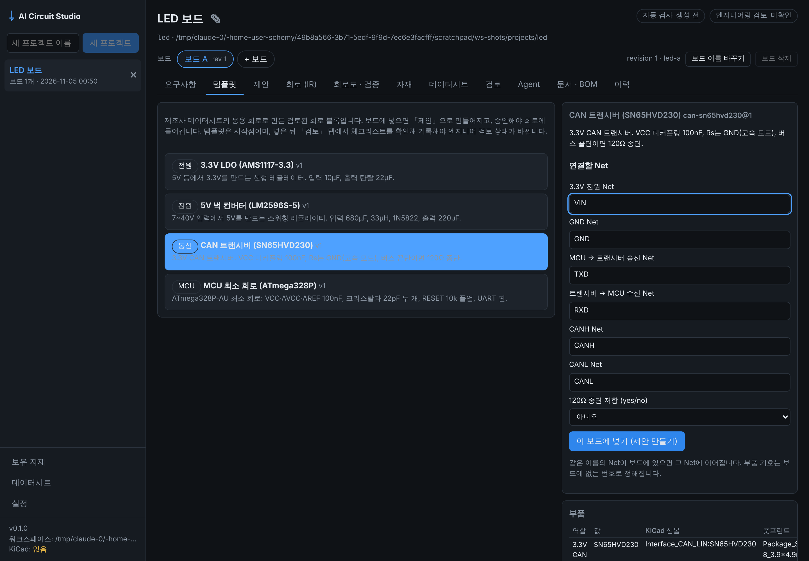
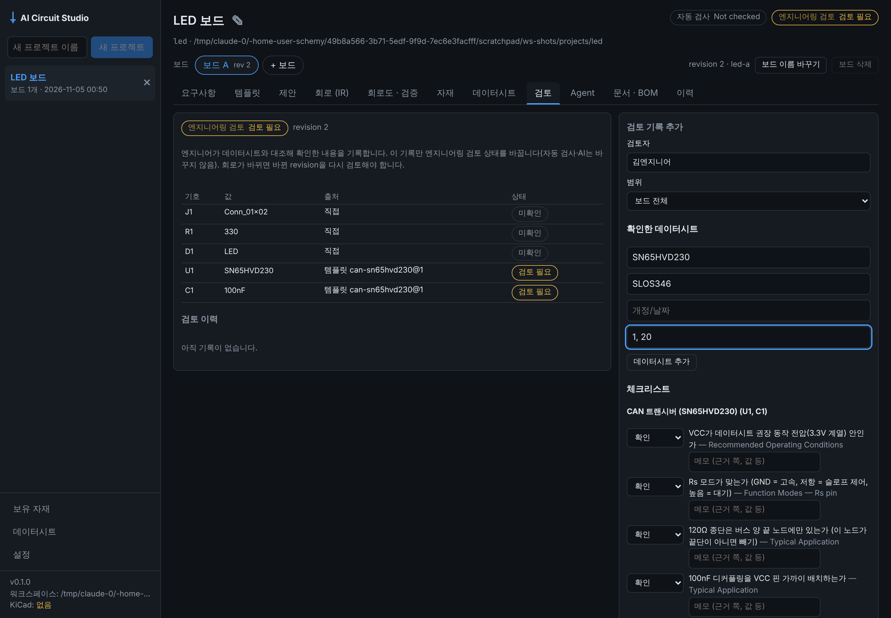

# Phase 3 작업 보고: 엔지니어링 템플릿 (2026-11-05)

기준: 기획서 v1.7 12장 Phase 3, 20장 후속 프롬프트(v1.6), 개발 규칙 8. 결정 근거는 [ADR-007](adr/ADR-007-templates-and-engineering-review.md).

사용자 요청: "Phase 4까지 진행"

| 템플릿 탭 | 엔지니어 검토 탭 |
|---|---|
|  |  |

## 범위와 결과

| 항목 (20장 v1.6 프롬프트) | 결과 | 위치 |
|---|---|---|
| 1. 다중 유닛 심볼 | ✅ 유닛마다 같은 기호(U1A, U1B, U1C)로 따로 배치한다. 인스턴스마다 KiCad처럼 부품의 모든 핀을 고유 uuid로 나열한다. LM358(유닛 A·B·전원)으로 KiCad 10.0.8 ERC 0건, Netlist = IR, 재저장 무손실(생성기 두 줄만 다름) | `kicad_adapter/schematic.py`, `symbols.py` |
| 1-1. 숨은 전원 핀 | ✅ KiCad 10 라이브러리에는 숨은 power_in 핀이 없었다(전 라이브러리 검색). 대신 **같은 점에 겹친 숨은 핀**(MCU의 GND·VCC 여러 개)이 2만 개 넘게 있었다. 이 핀들은 한 점으로 그리고, 같은 Net이어야 한다(`STACKED_PINS_DIFFER`). AI 설계는 보이는 핀의 Net에 숨은 핀을 자동으로 넣는다 | `schematic.py`, `ai_engine/design.py` |
| 2. 검토된 템플릿 | ✅ 3.3V LDO(AMS1117-3.3), 5V 벅(LM2596S-5), CAN(SN65HVD230), MCU 최소 회로(ATmega328P). 템플릿마다 데이터시트 절 근거, 체크리스트(4~7개), 버전, 실제로 있는 풋프린트. 시험 회로로 KiCad ERC 0건·Netlist = IR | `circuit_core/templates.py`, `tests/test_templates.py` |
| 2-1. 쪽 번호 | ⚠️ 데이터시트 사이트(ti.com, microchip.com 등)가 이 환경의 네트워크 정책에서 막혀 원문을 열 수 없었다. 쪽 번호는 지어내지 않고, 엔지니어가 검토 기록에 남기게 했다 | ADR-007 |
| 3. AI 설계가 템플릿 우선 | ✅ 계획 단계에서 템플릿 목록을 주고, 고른 템플릿은 코드가 펼쳐 고정한다. AI는 단자 Net 이름으로만 잇는다. 부품마다 `origin`(템플릿/AI)을 남기고, 제안 화면 표의 「출처」에 보인다 | `ai_engine/design.py`, `ProposalsTab.tsx` |
| 3-1. 템플릿 직접 넣기 | ✅ 「템플릿」 탭 → 단자 Net 이름 입력 → 제안. 보드의 같은 이름 Net에 이어지고, 기호·id는 겹치지 않는다 | `backend/routes_templates.py`, `TemplatesTab.tsx` |
| 4. 엔지니어 검토 기록 | ✅ 검토자, revision, 범위, 데이터시트(개정·쪽), 체크 항목 결과, 결과. 이것만 엔지니어링 검토 축을 바꾼다. `verified`는 문제 항목이 없고 템플릿 체크리스트를 모두 기록했을 때만. 회로가 바뀌면 다시 「검토 필요」 | `backend/reviews.py`, `ReviewTab.tsx` |
| 5. KiCad 동작 확인 | ✅ 모든 KiCad 관련 항목을 로컬 KiCad 10.0.8(Docker)에서 실행해 확인 | `tests/test_kicad_integration.py`, `test_templates.py` |

IR 스키마는 **0.4.0**이다(`Component.origin`이 생김). 이전 문서도 그대로 읽힌다.

## Gate 판정 ("각 템플릿에 근거와 검증 체크리스트 첨부")

| 템플릿 | 근거(데이터시트 절) | 체크리스트 | KiCad ERC / Netlist |
|---|---|---|---|
| ldo-ams1117-3v3@1 | Typical Applications, Application Hints — Stability, Dropout Voltage | 4 | 0건 / 일치 |
| buck-lm2596-5v@1 | Typical Application (Fixed Output), Inductor Selection, Catch Diode / Output Capacitor, 1N5822 Maximum Ratings | 6 | 0건 / 일치 |
| can-sn65hvd230@1 | Typical Application, Function Modes — Rs pin, Recommended Operating Conditions | 5 | 0건 / 일치 |
| mcu-atmega328p-min@1 | Speed Grades, Low Power Crystal Oscillator, Pin Descriptions — AVCC/AREF, System Control and Reset | 7 | 0건 / 일치 |

## 테스트 결과

- `uv run pytest`: Phase 3 시점 323 passed. KiCad 표시 테스트(`-m kicad`, KiCad 10.0.8 Docker): 17 passed.
  새 테스트: `test_templates.py`(템플릿 근거, 단독 생성, 기존 회로 옆에 넣기, 파라미터 검사, API, KiCad), `test_reviews.py`(상태 계산, 미완료·문제·오래된 revision 거부, 회로 변경 뒤 재검토), 다중 유닛·겹친 핀(`test_schematic.py`), 템플릿을 쓰는 AI 설계(`test_design.py`).
- 데스크톱: vitest 14, typecheck 통과. e2e 추가: `templates.spec.ts`(템플릿 → 제안 → 승인 → 검토 기록 → 헤더 「Engineer reviewed」).

## 미해결 위험

- 템플릿 값은 데이터시트 원문 대조 전이다. 근거 절과 체크리스트, `needs_review` 상태로 드러나게 했다.
- 오른쪽에서 IC를 향하는 커넥터는 좌우 반전으로 그린다. 반대 방향이나 위아래를 향하는 커넥터 반전은 아직 없다.
- 검토자는 자유 입력이다(로컬 단일 사용자).
