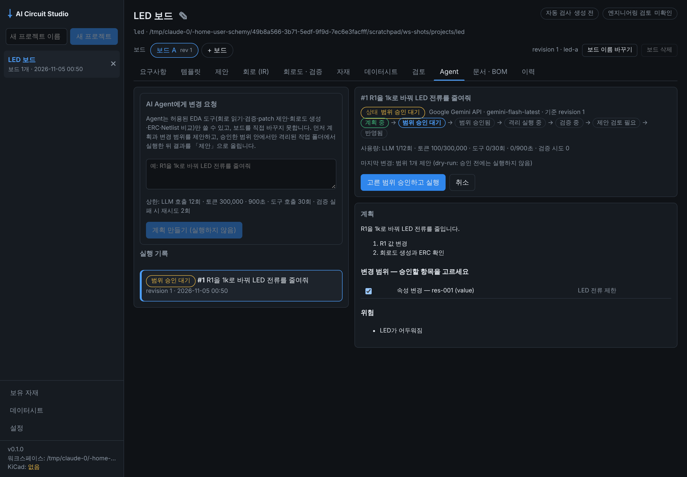
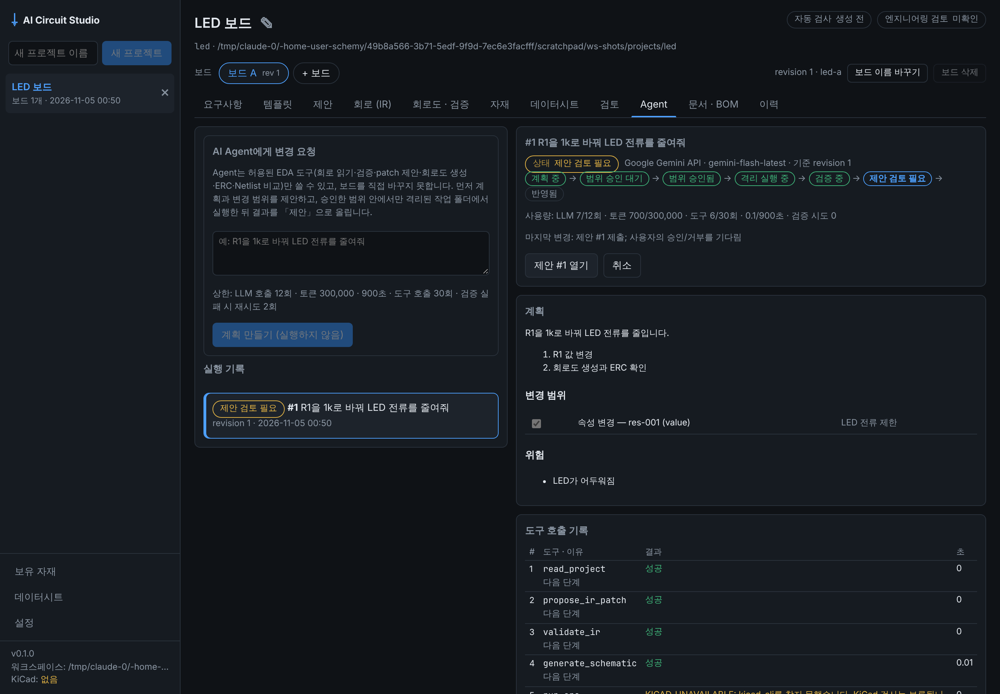

# Phase 4 작업 보고: 제한된 AI EDA Agent (2026-11-05)

기준: 기획서 v1.7 9.1절, 12장 Phase 4, FR-13·14·15, 개발 규칙 8. 결정 근거는 [ADR-008](adr/ADR-008-bounded-eda-agent.md).

| 1. 계획과 범위 (dry-run) | 2. 격리 실행·검증 → 제안 |
|---|---|
|  |  |

위 화면은 **각본대로 답하는 가짜 AI**로 만든 것이다(이 환경에는 AI 키가 없음). 나머지는 실제 동작이다: Gateway, 범위 검사, 코드 검증, 제안, 승인.

## 흐름

```text
요청 ─ PLANNING ─ AI: 계획 + 범위(연산·대상) ─ PROPOSED_PLAN  ← 기본 dry-run: 여기서 멈춤
                                                   │ 사용자가 범위(일부도 가능) 승인
                                                   ▼
        SANDBOX_EXECUTION: AI가 한 단계에 도구 하나 ─ Gateway(allowlist·인자 검사·시간 제한·workspace)
             │ finish                         │ request_scope_change → PROPOSED_PLAN (재승인)
             ▼
        VALIDATION (코드): 범위 · 기준 revision에 patch · IR/라이브러리 · 생성 · ERC · Netlist
             │ 실패 → 이유를 돌려보내고 재시도(최대 2회) → 그다음 FAILED
             ▼
        REVIEW_REQUIRED: 제안(source agent) 제출 ── 승인 → COMMITTED (새 revision)
                                                └─ 거부 → REJECTED
    어디서든: CANCELLED(사용자) · FAILED(상한·오류) · STALE(보드 revision 변경)
```

## 범위와 결과

| 항목 | 결과 | 위치 |
|---|---|---|
| EDA Tool Gateway (FR-14) | ✅ 9.1절 도구 11개와 finish·request_scope_change만 허용. Pydantic 인자, 도구별 시간 제한, 실행별 `workspace/` 밖 쓰기 거부, 보드는 읽기 전용 | `backend/agent/gateway.py` |
| 범위 승인과 강제 (9.0) | ✅ 연산 + 대상 id. 계획에 없는 대상(회로에 없는 부품)은 범위에서 빠진다. propose_ir_patch와 최종 검증이 코드로 검사. replace_circuit은 항상 거부. move는 범위 안 부품이면 허용 | `gateway.py`, `runner.py` |
| 상태 머신 (9.1) | ✅ PLANNING/PROPOSED_PLAN/SCOPE_APPROVED/SANDBOX_EXECUTION/VALIDATION/REVIEW_REQUIRED/COMMITTED/REJECTED/CANCELLED/FAILED/STALE. 전이마다 이유와 시각을 남김 | `backend/agent/runner.py` |
| 자동 재검증 루프 (FR-15) | ✅ 검증 실패 이유를 Agent에게 돌려보내고 최대 2회 다시 시도, 그다음 FAILED. 원본은 그대로 | `runner.py` |
| 작업 기록 (FR-13) | ✅ 실행 폴더의 `log.jsonl`: 상태 전이, LLM 호출(모델·프롬프트 해시·토큰), 도구 호출(인자·결과·오류·시간), 검증 실패. 키·토큰 문자열은 가림. `run.json`에 사용량과 기준 revision | `runner.py` |
| 비용 상한 | ✅ 기본 LLM 12회, 토큰 300,000, 900초, 도구 30회, 재시도 2회. 넘으면 FAILED(limit_exceeded) | `runner.py` |
| 변경 전후 보고 | ✅ IR diff(값, 핀별 연결, 부품 추가·삭제). KiCad가 있으면 변경 전·후 회로도의 Netlist를 직접 비교(Net·부품값) | `runner.py` |
| API (8장) | ✅ `GET/POST …/boards/{b}/agent-runs`, `GET …/agent-runs/{id}`(기록 포함), `POST …/approve-scope`, `POST …/cancel`, `GET /agent/tools` | `backend/agent/routes.py` |
| UI | ✅ 「Agent」 탭: 요청, 상한, 실행 목록, 상태 흐름, 계획·범위 체크박스, 위험·질문, 도구 기록, 코드 검증, 전후 보고, 제안 열기·취소 | `AgentTab.tsx` |

## Gate 판정

| Gate | 판정 | 근거 |
|---|---|---|
| 원본 무단 변경 0건 | ✅ | 계획·실행·검증·제출 내내 보드 `circuit.json` 해시 불변. 쓰기 도구가 없고, 제안 승인 뒤에만 바뀜(`test_led_resistor_change_end_to_end`, `test_scope_is_enforced…`) |
| 실패 시 복구 | ✅ | 범위 밖 patch 거부, 검증 3회 실패 → FAILED, 제안 없음, 원본 불변. 취소하면 열린 제안도 거부. 보드가 바뀌면 STALE이고 범위 승인도 거부 |
| 변경 전후 Netlist/부품값 차이 보고 | ✅ | KiCad 10.0.8로 LED R1 330→1k: 검증 ERC 0건·Netlist = IR, 보고 `values_changed = {R1: 330→1k}`, `nets_changed = {}`(`test_led_change_with_kicad_reports_netlist_before_and_after`) |
| 기획서 시나리오 | ✅ | "AI가 LED 회로의 저항값 변경을 제안하고, 승인된 범위 안에서 재생성·ERC 수행" — 위 테스트와 e2e `agent.spec.ts`(화면: 계획 → 범위 승인 → 실행 → 제안 → 승인 → 반영됨) |

## 테스트 결과

- `uv run pytest`: 329 passed. `-m kicad`(KiCad 10.0.8 Docker): 18 passed.
- `tests/test_agent.py`: 종단 시나리오, 범위 강제와 재시도, 범위 재승인, 상한, 취소·STALE, Gateway allowlist·인자·경로·시간 제한, KiCad 종단.
- 데스크톱: vitest 14, typecheck 통과, Playwright e2e 9 passed(1 skipped: Electron, 디스플레이 없음).
- e2e는 테스트 전용 실행기 `tests/e2e_backend.py`로 가짜 AI를 넣는다. 앱 실행 경로(`python -m backend`)는 그대로다.

## 미해결 위험

- 실제 Gemini/Claude가 JSON 행동과 patch 형식을 얼마나 잘 지키는지는 사용자 환경에서 확인해야 한다(이 환경에는 키가 없음).
- 도구 시간 제한은 기다림을 멈출 뿐, 실행 중인 Python 함수를 강제로 끝내지는 못한다.
- 구조적 격리이며 OS 샌드박스가 아니다.
