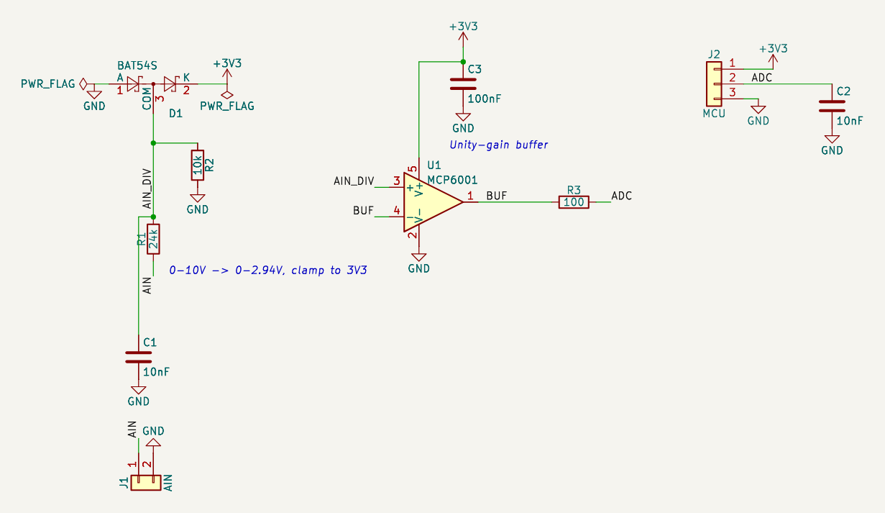

# 예제: 0~10 V 아날로그 입력 (MCP6001 버퍼)

산업용 0~10 V 신호를 분압·클램프·OP앰프 버퍼·RC 필터를 거쳐 3.3 V MCU의 ADC로 읽습니다. 24 V 오입력에도 버티게 했습니다.

실무 회로 점검에서 고른 다섯 회로 중 하나입니다. 앱의 설계 경로(부품 목록 → 핀 연결 → 심볼·풋프린트 해석 → 검사)에 부품 목록과 연결을 넣어(AI 역할은 이번 세션이 대신함) 만들고, 앱의 모든 검사를 돌린 뒤 엔지니어 연구노트를 남겼습니다.

- [`research-note.md`](research-note.md): 연구노트(확인한 것, 배운 점, 다음 설계에 적용할 것, 열린 질문, 근거 번호)
- [`requirements.md`](requirements.md): 요구사항
- [`circuit.json`](circuit.json), [`analog-0-10v.kicad_sch`](analog-0-10v.kicad_sch): 회로 데이터와 앱이 만든 KiCad 회로도(골든 파일)

## 구성

| 부품 | 값 | 역할 | 풋프린트 |
|---|---|---|---|
| C1 | 10nF | 입력 필터 | `C_0603_1608Metric` |
| C2 | 10nF | ADC 콘덴서 | `C_0603_1608Metric` |
| C3 | 100nF | OP앰프 디커플링 | `C_0603_1608Metric` |
| D1 | BAT54S | 입력 클램프 | `SOT-23` |
| J1 | AIN | 입력 단자 | `TerminalBlock_Phoenix_MKDS-1,5-2_1x02_P5.00mm_Horizontal` |
| J2 | MCU | MCU 헤더 | `PinHeader_1x03_P2.54mm_Vertical` |
| R1 | 24k | 분압 상단 | `R_0603_1608Metric` |
| R2 | 10k | 분압 하단 | `R_0603_1608Metric` |
| R3 | 100 | ADC 직렬 저항 | `R_0603_1608Metric` |
| U1 | MCP6001 (MCP6001T-I/OT) | 버퍼 OP앰프 | `SOT-23-5` |

## 앱에서 나온 결과

| 검사 | 결과 |
|---|---|
| KiCad (10.0.8, Docker) | ERC 오류 0 경고 0, 넷리스트 대조 일치 |
| 기술 검토 (자동 계산) | 실패 0, 주의 0, 참고 3, 통과 4 — 참고: U1 입력(AIN_DIV): 최대 입력 24 V에서 D1로 850 µA 클램프; C3 (100nF): 정격 전압 미기재; D1 (BAT54S): 역전압 3.3 V |
| 설계 지침 | 해당 15개: 자동 검사 통과 5, 사람이 확인 10 |
| 설계 결정 기록 | 10개 |
| 엔지니어 검토 | 미검증 (사람의 검토 기록이 없음). 연구노트도 AI 초안 |

## 점검하며 고친 것

- 설계 수정 없음. 앱을 고쳤습니다: 한쪽만 적힌 전압 범위(AIN 최대 24 V)를 버리던 문제, ADC 분압·클램프 검사(`adc_divider`, `adc_clamp`)

## 남은 확인 (사람)

- 24 V 오입력 때 850 µA가 +3V3로 들어감: 3.3 V 레일 최소 부하와 비교(아니면 블리더·제너)
- 클램프 중 OP앰프 입력이 VDD + 0.3~0.4 V: MCP6001 입력 최대 정격
- BAT54S 역전압 정격(품번 표에 없음)
