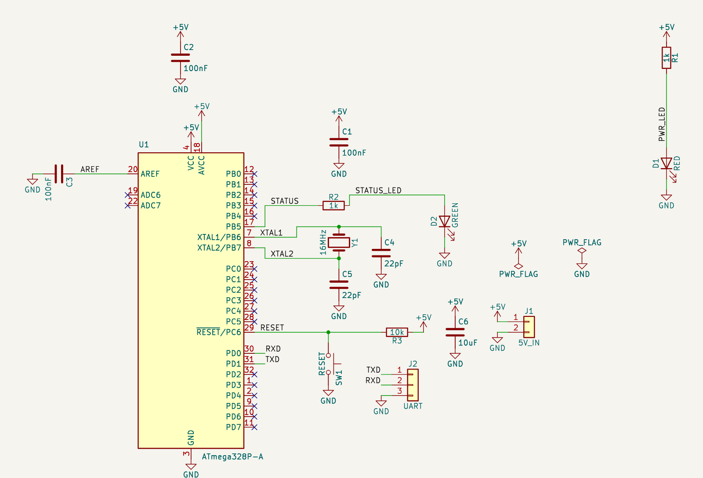

# 예제: ATmega328P 상태 LED 보드 (샘플 보드)

앱의 흐름(요구사항 → 제안 → 승인 → 회로도·검증)을 보여 주려고 **요구사항을 임의로 정해** 만든 샘플 보드입니다.
요구사항은 [`requirements.md`](requirements.md)에 있고, 결과 IR은 [`circuit.json`](circuit.json)입니다.



## 구성

| 블록 | 부품 | 출처 |
|---|---|---|
| 5V 입력 | J1 2핀 헤더, C6 10µF(0805) 벌크 | 직접 입력 |
| MCU 최소 회로 | U1 ATmega328P-A(TQFP-32), Y1 16MHz, C4·C5 22pF, C1·C2 100nF(VCC·AVCC), C3 100nF(AREF), R3 10k(RESET 풀업) | 템플릿 `mcu-atmega328p-min@1` |
| 상태 LED | R2 1k → D2 녹색, PB5(17번 핀, Arduino D13) | 직접 입력 |
| 전원 LED | R1 1k → D1 적색, +5V에서 GND로 | 직접 입력 |
| UART 헤더 | J2 3핀: 1 = TXD, 2 = RXD, 3 = GND | 직접 입력 |
| 리셋 버튼 | SW1 6mm 택트 스위치, RESET ↔ GND | 직접 입력 |

- **UART 연결:** J2 1번(TXD)은 MCU가 내보내는 선(PD1)이므로 어댑터의 **RX**에, 2번(RXD)은 MCU가 받는 선(PD0)이므로 어댑터의 **TX**에 잇습니다. 어댑터는 5V 레벨이어야 합니다.
- **리셋 버튼이 있는 이유:** 3핀 헤더에는 DTR이 없어 업로드 때 자동 리셋이 되지 않습니다. 부트로더는 리셋 직후 잠깐만 업로드를 기다리므로, 업로드를 시작하면서 SW1을 눌렀다 뗍니다.
- **LED 전류:** (5V − Vf) / 1kΩ. 적색(Vf ≈ 2V)은 약 3mA, 녹색은 종류에 따라 약 2~3mA입니다. Vf는 실제 부품의 데이터시트로 확인하세요.

## 만든 방법

앱 백엔드 API를 사용자가 화면에서 하는 순서대로 호출해서 만들었습니다. AI는 쓰지 않았습니다(이 개발 환경에는 AI 키가 없음). 제안 세 개를 차례로 승인했고, 제안마다 KiCad 10.0.8로 자동 검사를 했습니다.

| # | 제안 | 방법 | 자동 검사 |
|---|---|---|---|
| 1 | 전원 입력, UART 헤더, 전원·상태 LED, 벌크 콘덴서 | 「회로 (IR)」 직접 입력 | ERC 0건, Netlist = IR |
| 2 | MCU 최소 회로 (ATmega328P) | 「템플릿」 탭. 단자: vcc = `+5V`, gnd = `GND`, crystal = 16MHz, reset = `RESET`, rxd = `RXD`, txd = `TXD` | ERC 0건, Netlist = IR |
| 3 | 상태 LED를 PB5에, 리셋 버튼을 RESET에 연결 | patch(connect, add_component) | ERC 0건, Netlist = IR |

1·2단계에서 "한쪽만 연결된 Net" 경고(`SINGLE_NODE_NET`)가 나온 것은 정상입니다. STATUS·RESET Net의 나머지 연결은 3단계에서 들어옵니다.

## 상태와 남은 검토

- **자동 검사 통과:** ERC 0건, Netlist가 IR과 일치합니다. 이것은 설계 검토가 아닙니다.
- **엔지니어 검토 기록 없음:** 템플릿 부품(U1, Y1, C1~C5, R3)은 「검토 필요」, 나머지는 「미검증」입니다.
- 「검토」 탭에서 기록하려면 템플릿 체크리스트 7개를 모두 확인해야 합니다: 전원 전압별 최대 클럭(5V·16MHz), 크리스탈 CL에 맞는 부하 커패시터, AVCC 연결, 디커플링 배치, RESET 풀업과 프로그래밍 방식, UART 레벨, 쓰지 않는 핀 처리. 데이터시트 쪽 번호는 원문을 확인한 검토자가 적습니다.
- 그 밖에 확인할 것: 부트로더가 없는 칩이면 ISP 헤더가 따로 필요합니다(이 보드에는 없음). 10µF는 정격 10V 이상을 고르세요.

## 앱에서 열기

1. 새 프로젝트를 만들고 **회로 (IR)** 탭의 **예제 불러오기**에서 「ATmega328P 상태 LED 보드」를 고른 뒤 저장합니다.
2. **회로도 · 검증** 탭에서 생성합니다.
3. 요구사항을 **요구사항** 탭에 붙여 넣고 AI 설계를 돌려, 결과를 이 예제와 비교해 볼 수도 있습니다.

## KiCad에서 열기

KiCad 10에서 **파일 → 프로젝트 열기**로 `atmega328p-led-board.kicad_pro`를 열고, 프로젝트 관리자에서 회로도를 엽니다. `.kicad_sch`만 단독으로 열지 마세요(이유는 [LED 예제의 README](../led-resistor-connector/README.md#kicad에서-열기) 참고).

이 폴더의 `.kicad_sch`도 테스트 기준 파일(golden)입니다. KiCad에서 저장했다면 `git checkout -- examples/`로 되돌리세요.

## 다시 생성하기

```bash
uv run aics generate examples/atmega328p-led-board/circuit.json \
    --out my-sample-board --project-name atmega328p-led-board \
    --symbol-dir tests/fixtures/kicad_symbols --check
```
