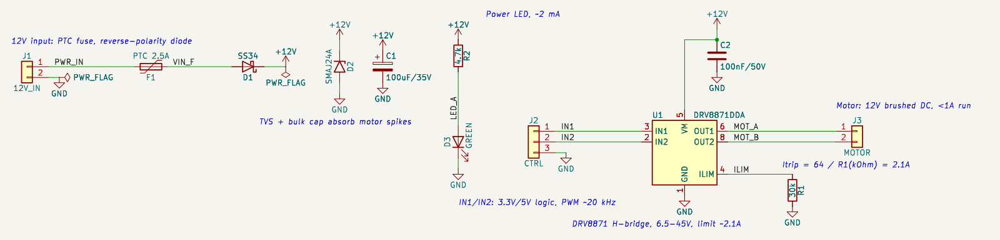

# 예제: 12V DC 모터 드라이버 (DRV8871)

요청은 "모터제어 회로 하나 그려줘봐. 검토까지 끝내고 리포트도 첨부"였습니다. 모터 종류와 조건이 없어 **12 V 브러시 DC 모터(연속 1 A 이하)를 외부 컨트롤러의 PWM 신호 2개로 정·역회전과 속도를 제어하는 드라이버 보드**로 정했습니다.

- [`review.md`](review.md): 설계 검토 리포트. 연결·전압·전류·발열 검토, 주의·권장 사항, 확인하지 못한 것
- [`rationale.md`](rationale.md): 근거 리포트. 선택마다 누가 정했는지(요구 반영 / AI 선정), 이유, 계산, 출처, 자동 기술 검토
- [`requirements.md`](requirements.md): 요청 원문과 정한 가정

## 구성

| 부품 | 값 | 역할 |
|---|---|---|
| J1 | 2핀 단자대 | 12 V 입력 |
| F1 | PTC 2.5 A | 자동 복귀 퓨즈 |
| D1 | SS34 | 역전압 보호 (직렬 쇼트키) |
| D2 | SMAJ24A | 전원 서지 보호 TVS |
| C1, C2 | 100 µF/35 V 전해, 100 nF/50 V | VM 벌크, VM 디커플링 |
| U1 | DRV8871DDA | H-브리지 모터 드라이버 (6.5~45 V, 최대 3.6 A) |
| R1 | 30 kΩ | 전류 제한 약 2.1 A |
| J2 | 3핀 헤더 | 제어 입력: IN1, IN2, GND |
| J3 | 2핀 단자대 | 모터 출력 |
| R2, D3 | 4.7 kΩ, 녹색 LED | 12 V 전원 표시 (약 2 mA) |

## 확인 결과

- KiCad 10.0.8: ERC 오류·경고 0, Netlist = 회로 데이터, KiCad가 다시 저장해도 파일이 그대로입니다(생성기 이름 두 줄 제외).
- 기술 검토(자동 계산): 실패 0, 주의 0, 통과 10. 설계 검토에서 구속(모터가 막힘) 시 발열 등 주의 3건을 따로 적었습니다.
- 엔지니어링 검토: 미확인. 데이터시트 원문 대조와 실물 시험이 남아 있습니다.
