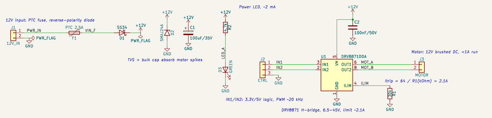

# 설계 검토 리포트: 12V DC 모터 드라이버 (DRV8871)

- 대상: `examples/dc-motor-drv8871` (회로 데이터 IR 0.8.0, 부품 12개)
- 검토: 설계한 AI(Claude)의 자체 검토 + 앱의 자동 검사. **엔지니어 검토가 아닙니다.** 앱의 「엔지니어링 검토」 상태는 `미확인`이고, 엔지니어가 「검토」 탭에 기록을 남겨야 바뀝니다.
- 데이터시트: 이 개발 환경에서는 제조사 사이트에 접근할 수 없어 원문을 열지 못했습니다. 데이터시트 값은 일반적으로 알려진 값이고, 모두 "원문 확인 필요"입니다.
- 선택의 근거(누가 정했는지, 이유, 계산)는 [`rationale.md`](rationale.md)에 있습니다.

## 1. 결론

| 구분 | 결과 |
|---|---|
| 연결 (앱 규칙 검사, KiCad 라이브러리 핀 대조) | 통과: 오류·경고 0 |
| KiCad 10.0.8 ERC | 통과: 오류 0, 경고 0 |
| Netlist ↔ 회로 데이터 | 일치 |
| KiCad에서 열고 다시 저장 | 생성기 이름 두 줄 외 파일 그대로 |
| 기술 검토 (앱의 자동 계산) | 실패 0, 주의 0, 참고 0, 통과 10 |
| 설계 검토 (아래 3장) | 바로 고칠 문제 없음. **주의 3건**(구속 시 발열, 벌크 콘덴서 리플, 제어 쪽 구속 감지)과 **권장 4건** |

연속 1 A 정도의 12 V 브러시 DC 모터에는 이대로 쓸 수 있는 구성입니다. 다만 모터가 자주 걸리거나 막히는(구속) 용도라면 3장의 주의 항목을 먼저 반영하세요.

## 2. 회로 요약

| 블록 | 부품 | 하는 일 |
|---|---|---|
| 전원 입력 | J1, F1(PTC 2.5 A), D1(SS34) | 12 V 입력, 과전류(자동 복귀 퓨즈), 역전압(직렬 쇼트키) |
| 전원 보호·저장 | D2(SMAJ24A), C1(100 µF/35 V) | 모터가 돌려보내는 서지 흡수, PWM 전류 변동 완충 |
| 드라이버 | U1(DRV8871DDA), C2(100 nF/50 V), R1(30 kΩ) | H-브리지, VM 디커플링, 전류 제한 약 2.1 A |
| 제어 입력 | J2(IN1, IN2, GND) | 외부 MCU 등에서 3.3 V/5 V PWM |
| 모터 출력 | J3 | 모터 연결 |
| 표시 | R2(4.7 kΩ), D3(녹색 LED) | 12 V 전원 표시, 약 2 mA |

### 제어 방법 (DRV8871 진리표, 원문 확인 필요)

| IN1 | IN2 | 모터 |
|---|---|---|
| 0 | 0 | 정지(코스트). 계속 0이면 저전력 대기 |
| PWM | 0 | 정회전, 속도 = 듀티 |
| 0 | PWM | 역회전, 속도 = 듀티 |
| 1 | 1 | 브레이크(급정지) |

- PWM은 20 kHz 정도를 권장합니다(사람 귀에 들리지 않는 주파수). 드라이버가 받는 최대 PWM 주파수는 데이터시트로 확인하세요.
- 아두이노 예: J2-1 → D9(PWM), J2-2 → D10(PWM), J2-3 → GND.

## 3. 설계 검토 항목

### 3.1 연결

| 항목 | 결과 | 근거 |
|---|---|---|
| DRV8871 핀 | 통과 | KiCad 심볼 `Driver_Motor:DRV8871DDA`: 1 GND, 2 IN2, 3 IN1, 4 ILIM, 5 VM, 6 OUT1, 7 GND(PGND), 8 OUT2, 9 방열 패드. 회로 연결이 이와 같고, 앱이 라이브러리 핀과 대조했습니다. 데이터시트 핀 표와의 대조는 원문 확인 필요 |
| GND 핀 3개(1, 7, 9) | 통과 | 모두 GND. 방열 패드(9)는 PCB에서 넓은 GND 구리와 열 비아에 연결(풋프린트에 열 비아 포함) |
| TVS 방향 | 통과 | SMAJ24A 1번 핀(캐소드, 띠 쪽)이 +12V, 2번 핀이 GND. 심볼 그림 기준이며 풋프린트 1번 패드 = 캐소드인지 부품 데이터시트로 확인 |
| 역전압 다이오드 방향 | 통과 | D1 애노드가 입력(VIN_F), 캐소드가 +12V |
| 제어선이 빠졌을 때 | 통과 | IN1·IN2는 드라이버 내장 풀다운으로 0 → 모터 정지 |

### 3.2 전압

| 항목 | 결과 | 계산 |
|---|---|---|
| VM 동작 범위 | 통과 | 11.6 V (12 V − D1 약 0.4 V) / 6.5~45 V. 어댑터가 14 V까지 올라도 범위 안 |
| 서지 보호 | 통과 | 14 V(전원 최대) < 24 V(TVS 스탠드오프) < 약 39 V(TVS 클램프) < 45 V(VM 동작 최대) < 50 V(절대 최대) |
| 콘덴서 정격 | 통과 | C1 35 V / 11.6 V = 3.0배, C2 50 V / 11.6 V = 4.3배. TVS 클램프(약 39 V)를 넘는 서지는 TVS가 먼저 받음 |
| 제어 신호 수준 | 통과(확인 필요) | 3.3 V·5 V 로직 모두 입력 High 기준(데이터시트 VIH, 약 1.5 V로 알려짐)보다 높음 |

### 3.3 전류와 발열

| 항목 | 결과 | 계산 |
|---|---|---|
| 전류 제한 | 통과 | I_TRIP = 64 / 30 kΩ ≈ 2.13 A < 최대 3.6 A. 모터 기동·구속 전류가 여기서 묶임 |
| 드라이버 손실 (운전 1 A) | 통과 | P = 1² × 0.565 Ω ≈ 0.57 W. 방열 패드를 GND 구리에 붙이면 무리 없음 |
| 드라이버 손실 (구속 2.13 A) | **주의** | P = 2.13² × 0.565 Ω ≈ 2.6 W. 오래 지속되면 과열 보호(TSD)로 출력이 꺼졌다 켜지기를 반복. 짧은 기동 전류는 문제없음 |
| 역전압 다이오드 손실 | 통과(구속 시 주의) | 1 A: 0.55 V × 1 A ≈ 0.55 W. 구속 2.13 A: 약 1.2 W로 SMA 패키지가 뜨거워짐. 구속이 잦으면 P채널 MOSFET 역전압 보호로 바꾸기 |
| PTC 퓨즈 | 통과 | 유지 2.5 A > 전류 제한 2.13 A이므로 정상 동작과 구속 중에는 끊기지 않고, 단락 같은 고장에서만 끊김(의도한 동작) |
| 전원 LED | 통과 | (11.6 − 2.0~3.2 V) / 4.7 kΩ ≈ 1.8~2.0 mA, R2 손실 약 20 mW |

### 3.4 주의 (반영 권장)

1. **구속 감지는 제어 쪽에서.** DRV8871은 전류를 2.1 A로 묶어 줄 뿐 모터가 막혀도 계속 밉니다. 컨트롤러가 일정 시간(예: 1~2초) 안에 목표 동작이 안 되면 IN1·IN2를 0으로 내려 멈추게 하세요. 그렇지 않으면 위의 2.6 W 발열과 다이오드 1.2 W가 계속됩니다.
2. **구속 발열.** 구속이 잦은 용도(문, 밸브, 그리퍼처럼 끝에서 미는 동작)라면 R1을 키워 전류 제한을 낮추거나(예: 43 kΩ → 약 1.5 A), PCB 방열 구리를 넓히세요.
3. **벌크 콘덴서 리플 전류.** PWM 전류의 교류 성분이 C1에 흐릅니다. 저ESR 전해(리플 전류 정격 1 A 이상)를 고르세요. 전원선이 길면(50 cm 이상) 용량을 220~470 µF로 늘리는 것이 안전합니다.

### 3.5 권장 (보드 밖·PCB)

1. 모터 단자에 100 nF 세라믹을 **모터 쪽에** 달고, 모터 선은 꼬아서 잡음을 줄이세요.
2. PCB: C2는 VM 핀(5번) 바로 옆, VM–GND 전류 루프는 짧게, 모터·전원 전류 경로는 1 mm 이상(1 oz 구리 기준 2 A).
3. 제어 쪽과 GND를 반드시 함께 연결하세요(J2-3). 컨트롤러와 기준 전위가 다르면 오동작합니다.
4. 12 V 어댑터는 2.5 A 이상 출력을 고르세요(기동 전류 2.1 A + 여유).

## 4. 확인하지 못한 것

- **실물 시험:** 회로를 만들어 모터를 돌려 보지 않았습니다(기동·구속 전류, 발열, PWM 소음).
- **데이터시트 원문:** DRV8871(전류 제한 식, Rds(on), 입력 기준 전압, 진리표, 권장 콘덴서), SS34, SMAJ24A, PTC 퓨즈의 값과 쪽 번호. `docs/user-checklist.md` 3장의 방법으로 확인해 주세요.
- **시뮬레이션:** SPICE 같은 회로 시뮬레이션은 하지 않았습니다(기획서상 MVP 범위 밖).
- **부품 품번:** F1(PTC)은 값만 정했고 품번(예: 1812 크기, 유지 2.5 A, 16 V 이상)은 고르지 않았습니다.
