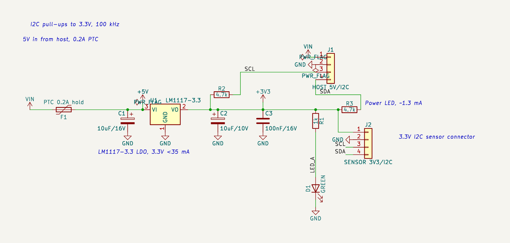

# 예제: 3.3V I2C 센서 연결 보드 (LM1117-3.3)

"아무 기본 회로나 한 번 짜서 결과까지 알려줘"에 대해 고른 기본 회로입니다. 호스트 MCU 보드의 5 V와 I2C를 받아 3.3 V I2C 센서 모듈에 전원과 신호를 연결합니다. 앱을 실제로 띄워(KiCad 10.0.8, 전체 KiCad 심볼 라이브러리) 사용자와 같은 순서로 진행했습니다: 요구사항 → 회로 저장 → KiCad 생성·검사 → 기술 검토 → 설계 지침 확인 → TI 사이트에서 데이터시트 받기 → 요약·대조 → 근거 리포트.

- [`rationale.md`](rationale.md): 앱이 만든 근거 리포트(선택마다 누가 정했는지, 이유, 계산, 데이터시트 쪽)
- [`lm1117-datasheet-summary.md`](lm1117-datasheet-summary.md): 실제 TI 데이터시트(SNOS412Q, 2023-01)에서 옮겨 적은 요약 MD(쪽 번호 포함)
- [`requirements.md`](requirements.md): 요구사항

## 구성

| 부품 | 값 | 역할 |
|---|---|---|
| J1 | JST PH 4핀 (키 있음) | 호스트: +5V, GND, SCL, SDA |
| F1 | PTC 0.2 A 유지 | 입력 과전류 보호 |
| U1 | LM1117MPX-3.3/NOPB (TI, SOT-223) | 5 V → 3.3 V LDO |
| C1, C2 | 10 µF/16 V, 10 µF/10 V 탄탈 3528 | LDO 입력, 출력(안정성) |
| C3 | 100 nF/16 V | 센서 커넥터 디커플링 |
| R1, D1 | 1 kΩ, 녹색 LED | 3.3 V 전원 표시 |
| R2, R3 | 4.7 kΩ | SCL·SDA 풀업(3.3 V) |
| J2 | JST PH 4핀 | 센서: +3V3, GND, SCL, SDA |

## 앱에서 나온 결과

| 단계 | 결과 |
|---|---|
| 회로 저장 | 규칙 오류 0, KiCad 라이브러리 핀 대조 통과, revision 1 |
| KiCad 생성·검사 (32 s, Docker) | ERC 오류 0 · 경고 0, Netlist = 회로 데이터 |
| 기술 검토 (자동 계산) | 실패 0, 주의 0, 통과 14 — LDO 발열 59.5 mW, 입출력 전압 차 1.7 V, 콘덴서 정격 3배 이상, I2C 풀업 있음, LED 0.1~1.3 mA |
| 설계 지침 확인 | 해당 15개: 자동 검사 통과 7, 직접 확인 8 (역극성 보호, 과전류 보호, 서지·ESD, 전원 예산 등) |
| 데이터시트 찾기 | 후보 2곳(KiCad 심볼 링크, TI 주소 규칙). TI 규칙 `ti.com/lit/gpn/lm1117`로 3.6 s에 받음(47쪽), **품번 확인됨**(LM1117MPX-3.3/NOPB, 23쪽 주문 정보) |
| 데이터시트 대조 | 핀맵 일치(1 GND, 2 VOUT, 3 VIN, TAB = 2번), 입력 5 V는 권장 15 V·절대 최대 20 V 안, 필수 출력 콘덴서 10 µF(C2)·권장 입력 콘덴서 10 µF(C1) 있음 |
| 근거 리포트 | 결정 11개(요구 반영 2, AI 선정 9), 부품 11개 모두 근거 있음 |
| 엔지니어 검토 | 미검증 (사람의 검토 기록이 없음) |

## 설계 검토 (계산)

- **발열**: P = (5.0 − 3.3) V × 35 mA = 60 mW, SOT-223 RθJA 61.6 °C/W(데이터시트 p.4) → 약 3.7 °C 상승. 문제 없음.
- **드롭아웃**: 최대 1.2 V @100 mA(p.6). 호스트 5 V가 −5%(4.75 V)여도 1.45 V로 0.25 V 여유. 앱의 자동 계산은 공칭 5 V로만 봅니다(1.7 V).
- **출력 콘덴서**: 10 µF 이상 탄탈, ESR 0.3~22 Ω이어야 안정(p.15). 회로에는 10 µF 탄탈이 있지만 ESR은 회로 데이터에 없어 앱이 확인하지 못합니다. 부품을 고를 때 ESR이 이 범위인 품번을 고르세요.
- **역극성 보호를 넣지 않은 이유**: 직렬 쇼트키(0.3~0.4 V)를 넣으면 4.75 V 입력에서 LDO 입력이 4.35~4.45 V가 되어 드롭아웃 조건(4.5 V)을 지키지 못합니다. 대신 키 있는 커넥터로 막았습니다(설계 지침 G-PRT-01은 「직접 확인」으로 남음).
- **LED**: 1 kΩ은 Vf 2.0 V 녹색 LED에서 1.3 mA입니다. 앱이 녹색 Vf 범위(2.0~3.2 V)로 계산하면 0.1~1.3 mA라, **Vf 3 V급(InGaN) 녹색이면 0.3 mA 이하로 어둡습니다.** Vf 2 V급(황록색) LED를 쓰거나, InGaN이면 R1을 330 Ω으로 바꾸세요.
- **I2C 풀업**: 4.7 kΩ, 버스 용량 200 pF에서 상승 시간 약 0.8 µs < 1 µs(100 kHz 표준 모드). 센서 모듈에도 풀업이 있으면 병렬이 되니 확인하세요.
- **호스트 로직 전압**: 버스 하이가 3.3 V라 5 V MCU(VIH = 0.6 × VCC = 3.0 V)는 여유가 0.3 V뿐입니다. 호스트가 5 V 로직이면 레벨 시프터를 검토하세요.
- **PTC**: 유지 0.2 A(정상 35 mA의 약 5.7배). 품번은 정하지 않았습니다(유지 0.2 A, 6 V 이상).

## 앱을 돌리다 발견해 고친 문제

이 회로를 앱으로 끝까지 돌리면서 다음 문제를 찾아 고쳤습니다(테스트 추가).

1. **데이터시트 핀 이름 대조**: 실제 데이터시트는 VIN·VOUT·ADJ/GND, KiCad 심볼은 VI·VO·GND라서 핀맵이 「불일치 3」으로 나오고, 전압·외부 부품 대조는 핀을 찾지 못해 「확인 불가」였습니다. 흔한 별칭과 「ADJ/GND」 같은 겸용 이름, 같은 신호의 탭 핀(SOT-223 TAB = VOUT)을 같은 핀으로 보게 했습니다.
2. **품번 확인**: 앞 6쪽만 읽어 TI 주문 품번(23쪽)을 못 찾고 「제품군 확인됨」이었습니다. 앞뒤 40쪽까지 읽게 했습니다(47쪽 3.3 s).
3. **설계 지침 고르기**: 모터·크리스탈·DC-DC·MCU 지침이 이 보드에 나왔습니다(지침의 아무 분야나 맞으면 적용, 요구사항의 "호스트 MCU"를 MCU로 봄, "led"가 "controlled"에도 맞는 부분 문자열 비교). 주 분야로만 적용하고, 회로가 있으면 요구사항 단어로 분야를 늘리지 않고, 영어 단어는 낱말 단위·약어는 대문자로 비교합니다. 사람이 손대지 않은 기본 지침은 앱 업데이트를 받습니다.
4. **「충족」 표시**: 지침에 연결된 자동 검사는 일부만 봅니다(예: 「입출력 콘덴서는 데이터시트대로」인데 검사는 콘덴서가 있는지만 확인). 「검사 통과」로 바꾸고 설명을 붙였습니다.

## 남은 확인 (사람)

- 탄탈 C2의 ESR(0.3~22 Ω) 품번 선정, LED 종류(Vf), PTC 품번
- 호스트 5 V 허용 오차와 I2C 로직 전압, 센서 모듈의 내장 풀업 여부
- 케이블로 나가는 센서 선의 ESD 보호(지침 G-PRT-03, 「검토」)
- 데이터시트 요약은 사람이 원문에서 옮긴 것이라 「원문 확인함」은 엔지니어가 표시해야 합니다
