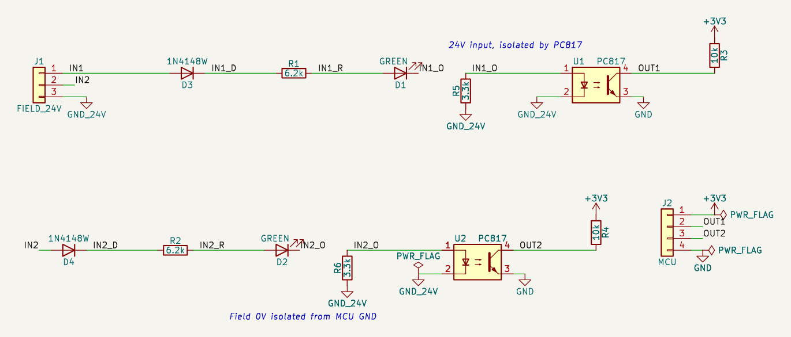

# 예제: 24 V 절연 디지털 입력 2채널 (PC817)

PLC 센서의 24 V 신호(15~30 V ON, 5 V 이하 OFF)를 포토커플러로 절연해 3.3 V MCU가 읽습니다. 산업용 장비 입력의 기본 회로입니다.

실무 회로 점검에서 고른 다섯 회로 중 하나입니다. 앱의 설계 경로(부품 목록 → 핀 연결 → 심볼·풋프린트 해석 → 검사)에 부품 목록과 연결을 넣어(AI 역할은 이번 세션이 대신함) 만들고, 앱의 모든 검사를 돌린 뒤 엔지니어 연구노트를 남겼습니다.

- [`research-note.md`](research-note.md): 연구노트(확인한 것, 배운 점, 다음 설계에 적용할 것, 열린 질문, 근거 번호)
- [`requirements.md`](requirements.md): 요구사항
- [`circuit.json`](circuit.json), [`iso-24v-input.kicad_sch`](iso-24v-input.kicad_sch): 회로 데이터와 앱이 만든 KiCad 회로도(골든 파일)

## 구성

| 부품 | 값 | 역할 | 풋프린트 |
|---|---|---|---|
| D1 | GREEN | 입력 1 표시 LED | `LED_0603_1608Metric` |
| D2 | GREEN | 입력 2 표시 LED | `LED_0603_1608Metric` |
| D3 | 1N4148W | 입력 1 역접속 보호 | `D_SOD-123` |
| D4 | 1N4148W | 입력 2 역접속 보호 | `D_SOD-123` |
| J1 | FIELD_24V | 현장 단자 | `TerminalBlock_Phoenix_MKDS-1,5-3_1x03_P5.00mm_Horizontal` |
| J2 | MCU | MCU 헤더 | `PinHeader_1x04_P2.54mm_Vertical` |
| R1 | 6.2k | 입력 1 전류 제한 | `R_1206_3216Metric` |
| R2 | 6.2k | 입력 2 전류 제한 | `R_1206_3216Metric` |
| R3 | 10k | 출력 1 풀업 | `R_0603_1608Metric` |
| R4 | 10k | 출력 2 풀업 | `R_0603_1608Metric` |
| R5 | 3.3k | 입력 1 켜짐 문턱(분로) | `R_0603_1608Metric` |
| R6 | 3.3k | 입력 2 켜짐 문턱(분로) | `R_0603_1608Metric` |
| U1 | PC817 (PC817C) | 입력 1 포토커플러 | `DIP-4_W7.62mm` |
| U2 | PC817 (PC817C) | 입력 2 포토커플러 | `DIP-4_W7.62mm` |

## 앱에서 나온 결과

| 검사 | 결과 |
|---|---|
| KiCad (10.0.8, Docker) | ERC 오류 0 경고 0, 넷리스트 대조 일치 |
| 기술 검토 (자동 계산) | 실패 0, 주의 0, 참고 2, 통과 9 — 참고: U1 (PC817): 입력 약 6.1 V부터 출력이 켜질 수 있음; U2 (PC817): 입력 약 6.1 V부터 출력이 켜질 수 있음 |
| 설계 지침 | 해당 18개: 자동 검사 통과 4, 사람이 확인 14 |
| 설계 결정 기록 | 14개 |
| 엔지니어 검토 | 미검증 (사람의 검토 기록이 없음). 연구노트도 AI 초안 |

## 점검하며 고친 것

- R1·R2 4.7 kΩ → 6.8 kΩ: 30 V에서 저항이 147 mW로 정격(0.25 W)의 50 % 초과(검사 `r_power`)
- 6.8 kΩ → 6.2 kΩ + LED 양단 분로 R5·R6 3.3 kΩ: CTR 최대 부품이면 4.2 V에서 출력이 켜져 「5 V 이하 OFF」를 못 맞춤(이번에 추가한 검사 `opto_threshold`). 분로 후 문턱 약 6.1 V, 15 V에서 LED 1.09 mA

## 남은 확인 (사람)

- 최저 LED 전류(1.09 mA)에서의 실제 CTR(데이터시트 CTR–If 곡선)
- 누설 전류 있는 센서를 받을지, 응답 시간
