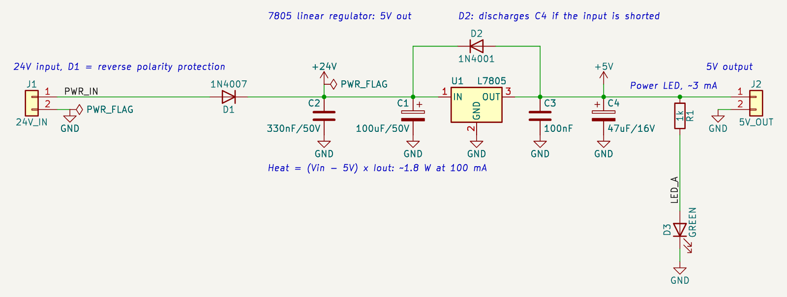
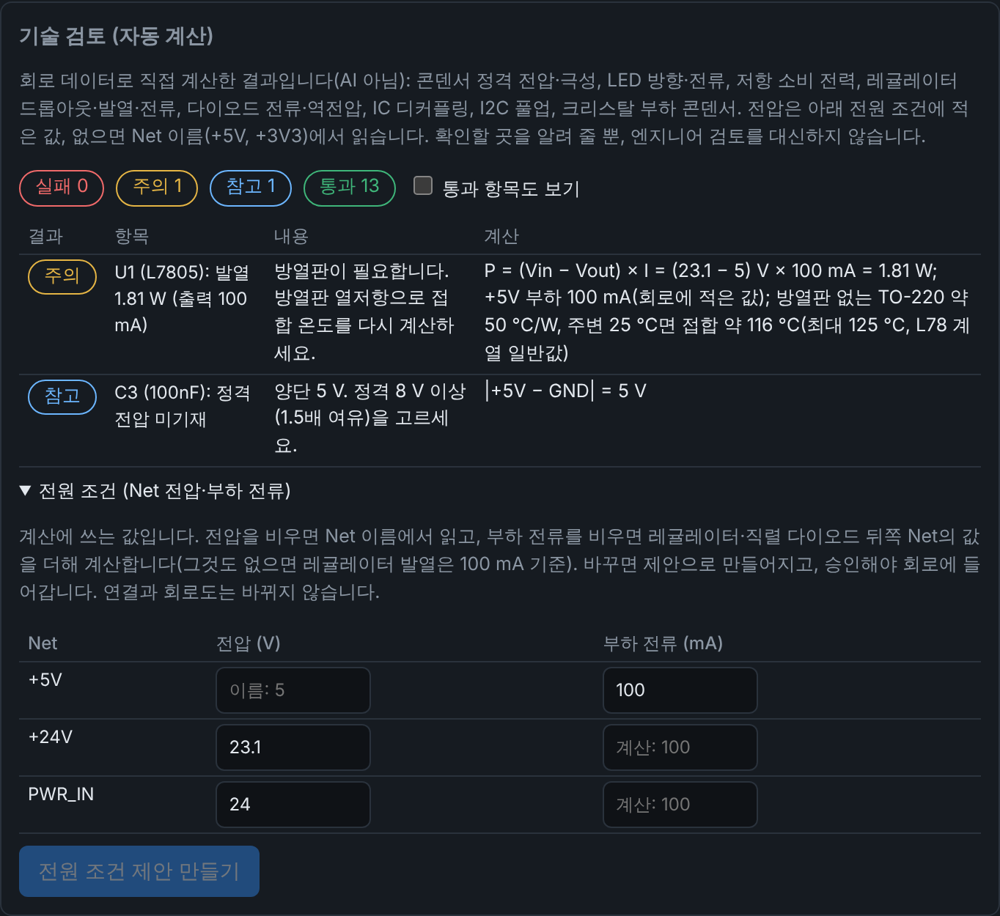

# 예제: 24V → 5V 레귤레이터 (7805)

요청은 "24V → 5V DC-DC, 사용 IC 7805"였습니다. 다만 **7805는 스위칭 DC-DC가 아니라 리니어 레귤레이터**입니다. 입력과 출력의 전압 차이 × 출력 전류가 그대로 열이 됩니다. 아래 열 계산을 꼭 보세요.



## 구성

| 부품 | 값 | 역할 |
|---|---|---|
| J1 | 2핀 단자대 | 24V 입력 |
| D1 | 1N4007 | 역전압 보호 (직렬, 약 0.9V 강하) |
| C1, C2 | 100µF/50V 전해, 330nF/50V | 입력 벌크, 입력 세라믹(데이터시트 응용 회로의 0.33µF) |
| U1 | L7805 (TO-220) | 5V 레귤레이터 |
| C3, C4 | 100nF, 47µF/16V 전해 | 출력 세라믹(데이터시트의 0.1µF), 출력 벌크 |
| D2 | 1N4001 | 입력이 단락되면 C4가 레귤레이터 출력으로 역류하지 않고 방전되는 경로 |
| R1, D3 | 1kΩ, 녹색 LED | 5V 전원 표시 (약 3mA) |
| J2 | 2핀 단자대 | 5V 출력 |

## 열 계산 (중요)

- 레귤레이터 입력 ≈ 24V − 0.9V(D1) ≈ 23V이므로 손실 ≈ (23V − 5V) × 출력 전류 = **18V × I**입니다.
- 100mA면 약 1.8W, 300mA면 약 5.4W, 1A면 약 18W입니다.
- TO-220 패키지에 방열판이 없으면 접합-주변 열저항이 약 50°C/W입니다(L78 계열 데이터시트의 일반값, 쓰는 부품의 데이터시트로 확인하세요). 1.8W면 온도가 약 90°C 오릅니다. 그래서 **100mA에서도 방열판이 필요**합니다.
- 방열판 없이 쓰려면 수십 mA 이하로 쓰세요. 그보다 큰 전류가 필요하면 스위칭 벅 컨버터가 맞습니다. 앱의 「템플릿」 탭에 **5V 벅 컨버터 (LM2596S-5)** 가 있습니다.
- L7805의 입력 최대 전압(35V)에는 24V가 여유 있게 들어갑니다.

## 앱의 기술 검토

회로에 전원 조건(PWR_IN 24 V, D1 뒤 +24V 23.1 V, +5V 부하 100 mA)을 적어 두어, 「검토」 탭의 기술 검토가 이 값으로 발열(1.81 W, 방열판 없이 접합 약 116 °C), 레귤레이터 최대 전류, D1 전류, D2 역전압을 계산합니다. 자세한 근거는 [`rationale.md`](rationale.md)에 있습니다.



## 확인 결과

- KiCad 10.0.8: ERC 0건, Netlist = IR, KiCad가 다시 저장해도 파일이 그대로입니다.
- 이것은 자동 검사이고, 설계 검토가 아닙니다. 엔지니어 검토 기록은 없습니다.

## 그리는 방식

레귤레이터 블록은 교과서처럼 그립니다.
- 입력(+24V)과 출력(+5V)을 선으로 긋고, 입출력 콘덴서는 그 선에서 GND로 내립니다.
- D2는 레귤레이터 위를 가로지르고, 전원 LED는 출력 선에서 세로로 내려갑니다.
- 선으로 이어진 레일 묶음마다 전원 심볼을 하나씩 붙입니다(ADR-009).

## 앱에서 열기 / 다시 생성하기

새 프로젝트의 **회로 (IR)** 탭 → **예제 불러오기** → 「24V → 5V 레귤레이터 (7805)」 → 저장 → **회로도 · 검증**에서 생성.

```bash
uv run aics generate examples/lm7805-24v-to-5v/circuit.json \
    --out my-7805 --project-name lm7805-24v-to-5v \
    --symbol-dir tests/fixtures/kicad_symbols --check
```
