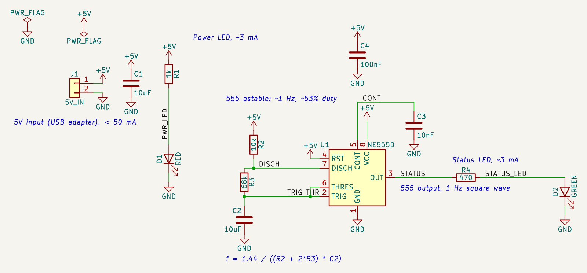
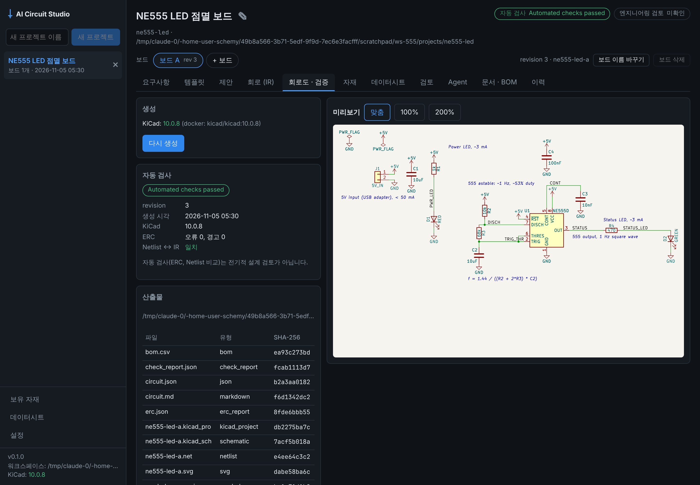
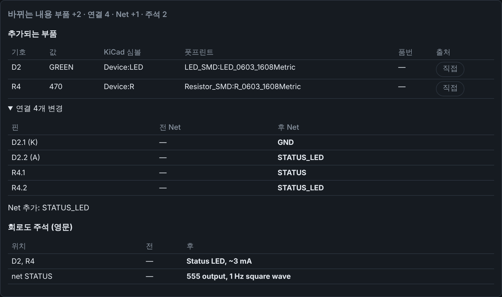

# 예제: NE555 LED 점멸 보드 (MCU 없는 샘플 보드)

MCU 없이 타이머 IC(NE555) 하나로 상태 LED를 약 1Hz로 깜빡이는 보드입니다. **요구사항은 임의로 정했습니다.**
요구사항은 [`requirements.md`](requirements.md), 결과 IR은 [`circuit.json`](circuit.json)입니다.



회로도의 파란 기울임 글씨는 **영문 주석**(IR `notes`)입니다. 블록마다 무엇을 하는 부분인지와 핵심 사양을, STATUS Net에는 그 Net이 나르는 신호를 적었습니다. 주석은 연결에 영향을 주지 않습니다.

## 앱 화면

| 「회로도 · 검증」: 생성, 자동 검사, 미리보기 | 「제안」 #3: 비교 표에 주석 변경도 나옴 |
|---|---|
|  |  |

## 구성

| 블록 | 부품 | 영문 주석 |
|---|---|---|
| 5V 입력 | J1 2핀 헤더, C1 10µF(0805) | `5V input (USB adapter), < 50 mA` |
| 전원 LED | R1 1k → D1 적색 | `Power LED, ~3 mA` |
| 555 타이머 | U1 NE555D(SOIC-8), R2 10k, R3 68k, C2 10µF(타이밍), C3 10nF(CONT), C4 100nF(VCC 디커플링) | `555 astable: ~1 Hz, ~53% duty`, `f = 1.44 / ((R2 + 2*R3) * C2)` |
| 상태 LED | R4 470Ω → D2 녹색 | `Status LED, ~3 mA` |
| STATUS Net | U1 OUT(3번) → R4 | `555 output, 1 Hz square wave` |

- **주파수:** f = 1.44 / ((R2 + 2·R3)·C2) = 1.44 / (146kΩ × 10µF) ≈ 0.99Hz. 듀티 = (R2 + R3) / (R2 + 2·R3) ≈ 53%.
- **RST(4번)** 은 VCC에 묶었습니다. 리셋 기능은 쓰지 않습니다.
- **LED 전류:** 상태 LED는 555 출력 High 전압(5V보다 낮음)에서 470Ω으로 약 3mA, 전원 LED는 (5V − Vf) / 1kΩ ≈ 3mA입니다. 출력 High 전압(VOH)과 LED Vf는 실제 부품의 데이터시트로 확인하세요.

## 만든 방법

앱 백엔드 API를 사용자가 화면에서 하는 순서대로 호출해 만들었습니다. AI는 쓰지 않았습니다(이 개발 환경에는 AI 키가 없음). 제안마다 KiCad 10.0.8로 자동 검사를 했습니다.

| # | 제안 | 내용 | 자동 검사 |
|---|---|---|---|
| 1 | 5V 입력과 전원 LED | 회로 전체(replace_circuit) + 주석 2개 | ERC 0건, Netlist = IR |
| 2 | NE555 비안정 타이머 (약 1Hz) | 부품 추가·연결 + 주석 2개(`set_note`) | ERC 0건, Netlist = IR |
| 3 | 상태 LED (555 출력) | 부품 추가·연결 + 블록 주석, STATUS Net 주석 | ERC 0건, Netlist = IR |

2단계의 `SINGLE_NODE_NET` 경고(STATUS가 아직 U1 한 핀에만 연결)는 3단계에서 해소됩니다.

## 상태와 남은 검토

- **자동 검사 통과:** ERC 0건, Netlist가 IR과 일치하고, KiCad가 다시 저장해도 파일이 그대로입니다. 이것은 설계 검토가 아닙니다.
- **엔지니어 검토 기록 없음:** 모든 부품이 「미검증」입니다.
- 확인할 것: 타이밍 콘덴서(C2)의 허용오차·누설이 주기에 주는 영향, 555 출력 VOH에서의 실제 LED 전류, 입력 콘덴서 정격(10V 이상).

## 앱에서 열기

새 프로젝트의 **회로 (IR)** 탭 → **예제 불러오기** → 「NE555 LED 점멸 보드」 → 저장 → **회로도 · 검증**에서 생성.

## KiCad에서 열기 / 다시 생성하기

KiCad 10에서 `ne555-led-board.kicad_pro`를 엽니다(`.kicad_sch`만 단독으로 열지 마세요). 이 폴더의 `.kicad_sch`는 테스트 기준 파일(golden)이므로, KiCad에서 저장했다면 `git checkout -- examples/`로 되돌리세요.

```bash
uv run aics generate examples/ne555-led-board/circuit.json \
    --out my-555-board --project-name ne555-led-board \
    --symbol-dir tests/fixtures/kicad_symbols --check
```
