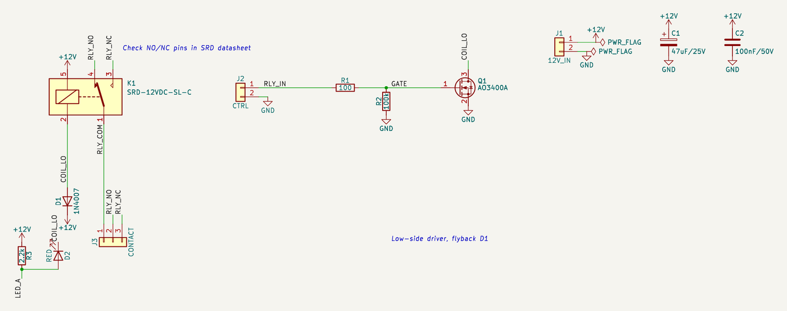

# 예제: 12 V 릴레이 구동 (AO3400A 로우사이드)

3.3 V GPIO 하나로 12 V 릴레이를 켜고 끕니다. 플라이백 다이오드, 게이트 풀다운, 동작 LED를 둔 가장 흔한 부하 구동 블록입니다.

실무 회로 점검에서 고른 다섯 회로 중 하나입니다. 앱의 설계 경로(부품 목록 → 핀 연결 → 심볼·풋프린트 해석 → 검사)에 부품 목록과 연결을 넣어(AI 역할은 이번 세션이 대신함) 만들고, 앱의 모든 검사를 돌린 뒤 엔지니어 연구노트를 남겼습니다.

- [`research-note.md`](research-note.md): 연구노트(확인한 것, 배운 점, 다음 설계에 적용할 것, 열린 질문, 근거 번호)
- [`requirements.md`](requirements.md): 요구사항
- [`circuit.json`](circuit.json), [`relay-driver-12v.kicad_sch`](relay-driver-12v.kicad_sch): 회로 데이터와 앱이 만든 KiCad 회로도(골든 파일)

## 구성

| 부품 | 값 | 역할 | 풋프린트 |
|---|---|---|---|
| C1 | 47uF/25V | 12V 벌크 | `CP_Elec_6.3x5.4` |
| C2 | 100nF/50V | 12V 바이패스 | `C_0603_1608Metric` |
| D1 | 1N4007 | 플라이백 다이오드 | `D_DO-41_SOD81_P10.16mm_Horizontal` |
| D2 | RED | 동작 표시 LED | `LED_0603_1608Metric` |
| J1 | 12V_IN | 12V 입력 | `TerminalBlock_Phoenix_MKDS-1,5-2_1x02_P5.00mm_Horizontal` |
| J2 | CTRL | 제어 입력 | `PinHeader_1x02_P2.54mm_Vertical` |
| J3 | CONTACT | 접점 단자 | `TerminalBlock_Phoenix_MKDS-1,5-3_1x03_P5.00mm_Horizontal` |
| K1 | SRD-12VDC-SL-C | 릴레이 | `Relay_SPDT_SANYOU_SRD_Series_Form_C` |
| Q1 | AO3400A | 코일 스위치 | `SOT-23` |
| R1 | 100 | 게이트 직렬 저항 | `R_0603_1608Metric` |
| R2 | 100k | 게이트 풀다운 | `R_0603_1608Metric` |
| R3 | 2.2k | 표시 LED 저항 | `R_0603_1608Metric` |

## 앱에서 나온 결과

| 검사 | 결과 |
|---|---|
| KiCad (10.0.8, Docker) | ERC 오류 0 경고 0, 넷리스트 대조 일치 |
| 기술 검토 (자동 계산) | 실패 0, 주의 0, 참고 0, 통과 12 |
| 설계 지침 | 해당 17개: 자동 검사 통과 7, 사람이 확인 10 |
| 설계 결정 기록 | 12개 |
| 엔지니어 검토 | 미검증 (사람의 검토 기록이 없음). 연구노트도 AI 초안 |

## 점검하며 고친 것

- 설계 수정 없음. 대신 앱을 고쳤습니다: 핀 이름이 빈 릴레이·포토커플러 심볼용 핀 역할표, 릴레이·MOSFET 검사 규칙, MOSFET이 켜졌을 때 기준의 LED 전류 계산

## 남은 확인 (사람)

- KiCad 심볼 핀 3·4(NO/NC)와 실제 SRD-12VDC-SL-C 핀 배치 대조(회로도 주석으로 남김)
- 접점 부하 사양(요구사항에 없음), 12 V 입력 역접속 보호
