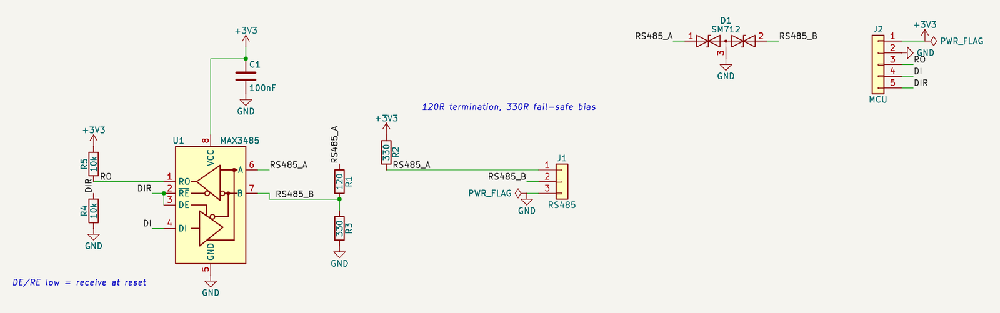

# 예제: RS-485 인터페이스 3.3 V (MAX3485)

3.3 V MCU의 UART를 RS-485 반이중으로 바꾸는 버스 끝단 노드입니다. 종단, 페일세이프 바이어스, TVS, DE·/RE 기본 수신을 갖춘 산업용 통신의 기본 회로입니다.

실무 회로 점검에서 고른 다섯 회로 중 하나입니다. 앱의 설계 경로(부품 목록 → 핀 연결 → 심볼·풋프린트 해석 → 검사)에 부품 목록과 연결을 넣어(AI 역할은 이번 세션이 대신함) 만들고, 앱의 모든 검사를 돌린 뒤 엔지니어 연구노트를 남겼습니다.

- [`research-note.md`](research-note.md): 연구노트(확인한 것, 배운 점, 다음 설계에 적용할 것, 열린 질문, 근거 번호)
- [`requirements.md`](requirements.md): 요구사항
- [`circuit.json`](circuit.json), [`rs485-3v3.kicad_sch`](rs485-3v3.kicad_sch): 회로 데이터와 앱이 만든 KiCad 회로도(골든 파일)

## 구성

| 부품 | 값 | 역할 | 풋프린트 |
|---|---|---|---|
| C1 | 100nF | 디커플링 | `C_0603_1608Metric` |
| D1 | SM712 (SM712.TCT) | 버스 TVS | `SOT-23` |
| J1 | RS485 | 버스 단자 | `TerminalBlock_Phoenix_MKDS-1,5-3_1x03_P5.00mm_Horizontal` |
| J2 | MCU | MCU 헤더 | `PinHeader_1x05_P2.54mm_Vertical` |
| R1 | 120 | 종단 저항 | `R_0805_2012Metric` |
| R2 | 330 | A 페일세이프 풀업 | `R_0603_1608Metric` |
| R3 | 330 | B 페일세이프 풀다운 | `R_0603_1608Metric` |
| R4 | 10k | DE/RE 풀다운 | `R_0603_1608Metric` |
| R5 | 10k | RO 풀업 | `R_0603_1608Metric` |
| U1 | MAX3485 (MAX3485ESA+) | RS-485 트랜시버 | `SOIC-8_3.9x4.9mm_P1.27mm` |

## 앱에서 나온 결과

| 검사 | 결과 |
|---|---|
| KiCad (10.0.8, Docker) | ERC 오류 0 경고 0, 넷리스트 대조 일치 |
| 기술 검토 (자동 계산) | 실패 0, 주의 0, 참고 1, 통과 6 — 참고: C1 (100nF): 정격 전압 미기재 |
| 설계 지침 | 해당 16개: 자동 검사 통과 7, 사람이 확인 9 |
| 설계 결정 기록 | 10개 |
| 엔지니어 검토 | 미검증 (사람의 검토 기록이 없음). 연구노트도 AI 초안 |

## 점검하며 고친 것

- 바이어스 R2·R3 680 Ω → 330 Ω: 버스 양 끝 종단(60 Ω)에서 유휴 차동 전압이 139 mV로 수신 문턱 200 mV 미달(검사 `rs485_bias`). 330 Ω에서 275 mV
- 앱 수정: MAX3485(파생 심볼)의 빈 풋프린트를 부모 것으로 채워 KiCad ERC 「라이브러리와 다름」 경고 제거

## 남은 확인 (사람)

- SM712 클램프 전압 vs MAX3485 A·B 최대 정격(데이터시트)
- 이 노드가 실제 버스 끝인지(아니면 종단·바이어스 점퍼)
