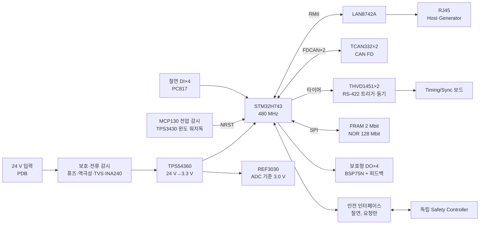
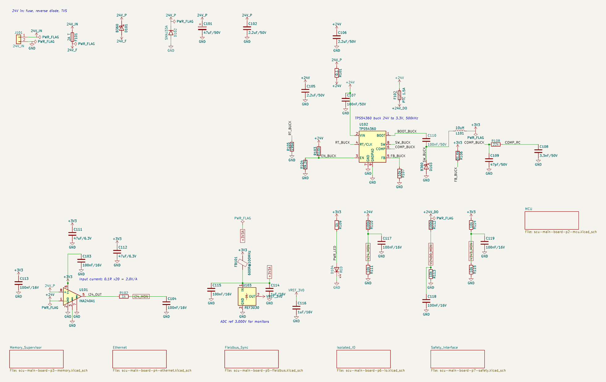
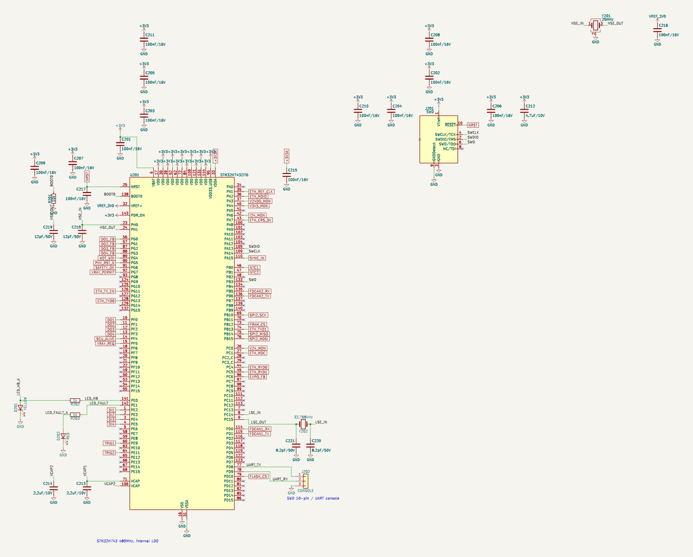
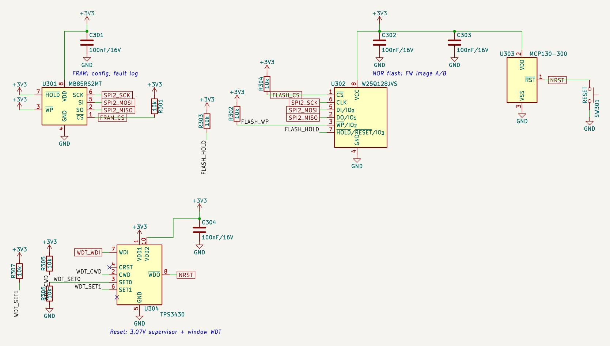
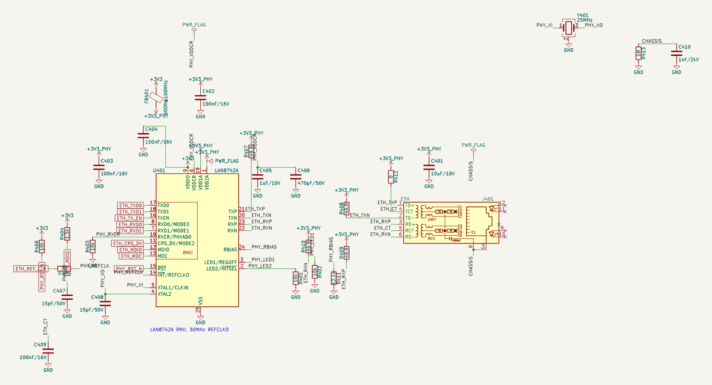
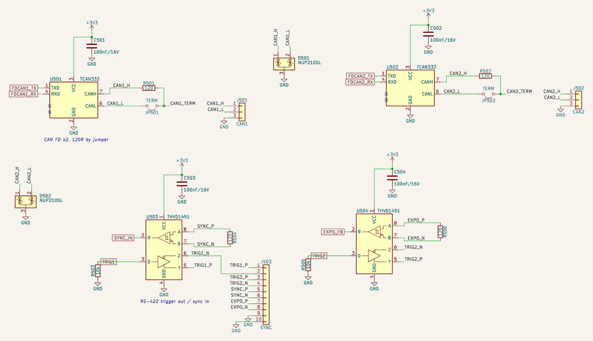
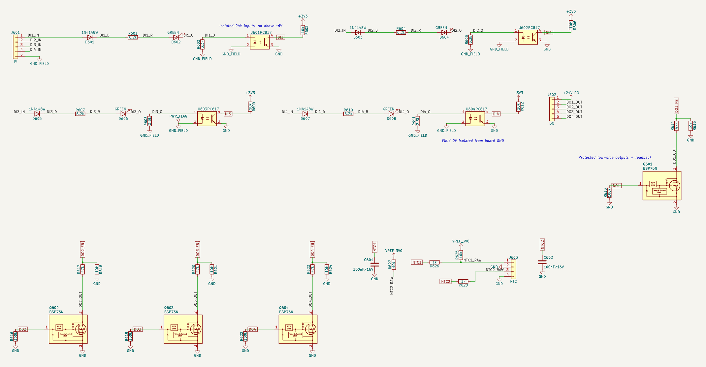
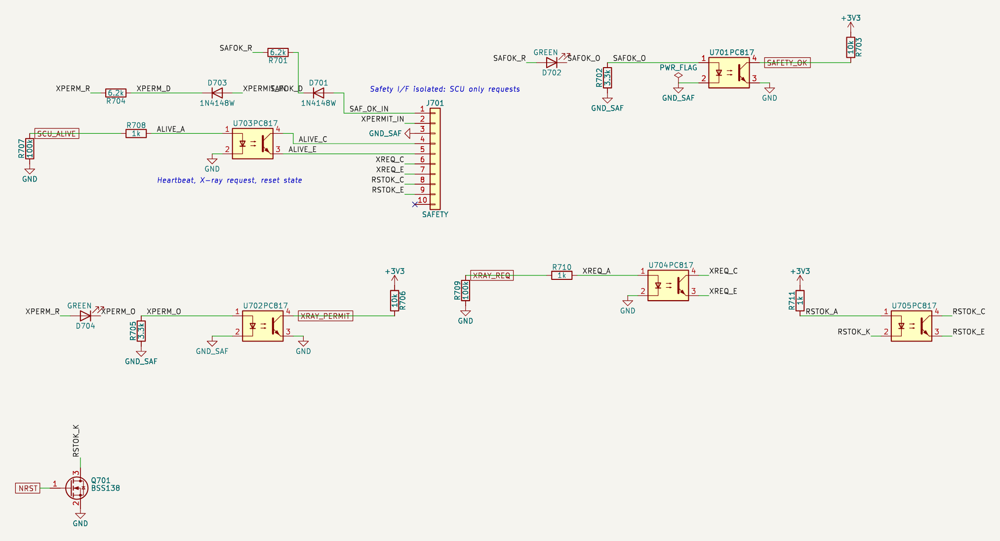

# 예제: 차세대 CT SCU 메인 제어보드 (STM32H743) — 개념 회로 v0.1

차세대 의료용 CT HW 요구사항 정의서(HRS Rev 0.1)를 보고 **SCU(System Control Unit) 메인보드 회로만** 설계한 개념 회로입니다.
부품 212개, Net 157개, 7페이지입니다. 부품마다 실제 KiCad 10.0.8 심볼과 풋프린트를 쓰고, 앱의 모든 검사를 돌렸습니다. 결과는 아래
「앱에서 나온 결과」에 있습니다.

> **사람의 검토 전인 개념 회로입니다.** 전기안전(IEC 60601-1 절연·연면거리), EMC(IEC 60601-1-2), 위험관리(ISO 14971) 검증과
> 데이터시트 원문 대조를 하지 않았습니다. 아래 「확인할 것」을 끝내기 전에는 시제품에 쓰지 마세요.

- [`requirements.md`](requirements.md): 이 보드에 적용한 요구사항(HRS의 SCU-001~012, 전원·통신·동기화·안전)
- [`circuit.json`](circuit.json): 회로 데이터. 부품마다 설계 결정(이유·요구 출처·계산)이 들어 있음
- [`scu-main-board.kicad_sch`](scu-main-board.kicad_sch) 외 6페이지: KiCad 프로젝트(앱이 만든 골든 파일, KiCad에서 바로 열림)
- [`design.py`](design.py): 이 보드의 부품 목록과 핀 연결. `uv run python examples/scu-main-board/design.py`로 `circuit.json`을 다시 만듦

## 구성

| 페이지 | 내용 | 부품 |
|---|---|---|
| 1 Power | 24 V 입력 보호(2 A 퓨즈, B360 역극성, SMAJ33A TVS), 입력 전류 감시(0.1 Ω × 20 = 2.0 V/A), TPS54360 벅(500 kHz, UVLO 약 16 V), 아날로그 3.3 V·3.0 V 기준, DO 전원 PTC, 전압 감시 분압 | 46 |
| 2 MCU | STM32H743ZIT6, VDD마다 100 nF(11개) + 4.7 µF, VCAP 2.2 µF ×2, 25 MHz HSE·32.768 kHz LSE, BOOT0, SWD 10핀, UART 콘솔, 상태 LED | 31 |
| 3 Memory·Supervisor | MB85RS2MT FRAM(설정·Fault 기록), W25Q128 NOR(FW A/B), MCP130 전압 감시 리셋, TPS3430 윈도 워치독, 리셋 버튼 | 16 |
| 4 Ethernet | LAN8742A(25 MHz 크리스탈 → 50 MHz REF_CLK 출력), 스트랩, 49.9 Ω 종단, 마그네틱 내장 RJ45, 섀시 RC | 27 |
| 5 Fieldbus·Sync | CAN FD ×2(종단 점퍼, NUP2105L ESD), RS-422 트리거 출력 ×2·동기 입력 ×2(120 Ω 수신 종단, 리셋 중 Low) | 21 |
| 6 Isolated I/O | 절연 DI ×4(15~30 V ON, 켜짐 문턱 약 6.1 V), 보호형 로우사이드 DO ×4 + 상태 피드백, NTC ×2 | 49 |
| 7 Safety Interface | Safety Controller와 절연 연결: 입력 2(안전 OK, X-ray 허가), 출력 3(Heartbeat, X-ray 요청, 리셋 상태) | 22 |

## 설계 요점

### 전원
- 24 V(18~30 V) → **TPS54360**(입력 최대 60 V): 24 V 계통 TVS(SMAJ33A)의 클램프 전압 약 53 V보다 레귤레이터 정격이 높아야 해서 36 V급 대신 60 V급을 골랐습니다.
- 출력 0.8 V × (1 + 31.6k/10k) = 3.33 V, 500 kHz(RT 196k), 인덕터 10 µH: 리플 0.57 A. UVLO 분압(510k/39.2k)은 약 16 V에서 켜고 14 V에서 끕니다(보상값과 UVLO 상수는 데이터시트로 재계산 필요).
- ADC는 별도 **REF3030**(3.000 V)을 기준으로 쓰고, VDDA와 PHY 아날로그 전원은 페라이트로 분리했습니다.
- 감시: 24 V(100k/10k, 30 V → 2.73 V), DO 전원, 3.3 V, 입력 전류(INA240, 공통 모드 80 V).

### 제어·리셋 (독립성)
- **MCP130**: 3.3 V 저전압이면 NRST를 잡는 오픈 드레인 감시 IC(MCU 내부 BOR과 별개).
- **TPS3430 윈도 워치독**: MCU가 너무 늦게도, 너무 빨리도(폭주) 갱신하지 못하게 합니다. WDO도 오픈 드레인으로 NRST에 직결.
- 리셋 상태(NRST)는 BSS138 → 포토커플러로 Safety Controller에 그대로 나갑니다. **MCU 소프트웨어를 거치지 않는 신호**입니다.

### 통신·동기화
- CAN FD: TCAN332(3.3 V, 5 Mbps) ×2, 종단 120 Ω은 버스 끝일 때만 점퍼로.
- Ethernet: LAN8742A가 25 MHz 크리스탈로 50 MHz REF_CLK를 만들어 MCU(PA1)에 줍니다.
- **HW 트리거**: 마이크로초급 동기는 CAN/Ethernet 메시지가 아니라 타이머(TIM1 출력, TIM2/TIM3 입력 캡처)와 RS-422(THVD1451, 50 Mbps, 수신 페일세이프)로 처리합니다. 트리거 입력은 10k 풀다운으로 리셋 중 Low입니다.

### I/O
- 절연 DI: [`examples/iso-24v-input`](../iso-24v-input/)에서 검증한 채널을 그대로 썼습니다(6.2 kΩ + LED 양단 3.3 kΩ 분로, 15 V에서 LED 1.09 mA, 30 V에서 저항 0.11 W, 켜짐 문턱 약 6.1 V > OFF 요구 5 V).
- DO: **BSP75N**(HITFET, 과전류·과열 보호, 유도성 부하 클램프). 출력 단자 전압을 47k/10k로 읽어 「켰는데 High(단락 보호 동작)」, 「껐는데 Low(단선)」를 검출합니다. 리셋 중에는 100k 풀다운으로 꺼짐.

### 안전 인터페이스
- SCU는 X-ray를 **요청(XRAY_REQ)만** 합니다. 허가는 독립 Safety Controller가 자기 인터록과 함께 결정하고, SCU는 허가 상태를 읽기만 합니다(XRAY_PERMIT 입력).
- 출력 3개(Heartbeat, X-ray 요청, 리셋 상태)는 포토커플러 오픈 컬렉터로 절연, 입력 2개는 24 V 절연 입력입니다. 리셋·부팅 중에는 모두 꺼짐(요청 없음).
- Heartbeat가 멈추거나(SW 정지) 리셋 상태가 Low(워치독·저전압)이면 Safety Controller가 조사를 막는 구조를 전제로 합니다(Safety Controller 쪽 설계는 범위 밖).

### MCU 핀 배정 (STM32CubeMX로 확인 필요)

| 기능 | 핀 |
|---|---|
| Ethernet RMII | PA1 REF_CLK, PA2 MDIO, PC1 MDC, PA7 CRS_DV, PC4/PC5 RXD0/1, PG11 TX_EN, PG13 TXD0, PB13 TXD1 |
| CAN FD | FDCAN1 PD0 RX / PD1 TX, FDCAN2 PB5 RX / PB6 TX |
| SPI2 (FRAM·NOR) | PB10 SCK, PB14 MISO, PB15 MOSI, PB12 FRAM_CS, PD10 FLASH_CS |
| 트리거·동기 | PE9 TRIG1(TIM1_CH1), PE11 TRIG2(TIM1_CH2), PA15 SYNC_IN(TIM2_CH1), PC6 EXPO_FB(TIM3_CH1) |
| ADC | PC0 24 V, PA3 DO 전원, PA4 3.3 V, PA6 입력 전류, PB0/PB1 NTC |
| DI / DO / 피드백 | PE2~PE5 / PF0~PF3 / PG0~PG3 |
| 안전 | PF4 SCU_ALIVE, PF5 XRAY_REQ, PG6 SAFETY_OK, PG7 XRAY_PERMIT |
| 기타 | PG4 워치독 WDI, PG5 PHY 리셋, PD8/PD9 UART, PA13/PA14/PB3 SWD, PE0/PE1 LED, PH0/PH1 HSE, PC14/PC15 LSE |

## 앱에서 나온 결과

| 검사 | 결과 |
|---|---|
| 부품 해석·핀 대조 | 212개 모두 KiCad 심볼·풋프린트 있음, 모든 핀이 Net에 있거나 미사용 표시(MCU 미사용 핀 포함 71개) |
| IR 규칙 | 오류 0 |
| KiCad 10.0.8 (Docker) | **ERC 오류 0 · 경고 0**, 넷리스트 = 회로 데이터 |
| 기술 검토 (자동 계산) | 실패 0, 주의 0, 참고 6(절연 입력 켜짐 문턱 6.1 V — OFF 요구 5 V보다 높음, 확인용), 통과 98 |
| 설계 지침 | 해당 37개: 자동 검사 통과 16, 사람이 확인 21 |
| 엔지니어 검토 | 미검증 (사람의 검토 기록 없음) |

통과 항목 예: 퓨즈 2 A / 부하 1.2 A, PTC 1.5 A / DO 1 A, 콘덴서 38개 정격 전압, IC 13개 전원·접지 핀 연결, 크리스탈 3개 부하 콘덴서,
포토커플러 9개 입력 전류·CTR·절연, LED 전류 1.1~1.5 mA, 6.2 kΩ 입력 저항 112 mW / 0.25 W.
앱의 계산 검토는 **스위칭 레귤레이터(TPS54360)의 보상·인덕터·발열과 고속 신호(RMII, RS-422)는 보지 않습니다.**

## 설계하며 고친 것

설계·검사를 돌리며 회로 두 군데와 앱 여러 곳을 고쳤습니다.

- 회로: 3.3 V로 켜는 Heartbeat LED 녹색 → 노랑(녹색 Vf 최대 3.2 V면 0.1 mA로 거의 안 보임), DO 전원 PTC 1.1 A → 1.5 A(부하 1 A에 여유 1.1배뿐).
- KiCad ERC 오류 4개를 하나씩 원인대로 없앴습니다:
  - TPS3808의 RESET이 라이브러리에서 「출력」으로 되어 있어 오픈 드레인 신호와 충돌 → 오픈 드레인으로 정확히 모델링된 MCP130으로 교체.
  - 두 VCAP 핀을 한 Net으로 묶음 → 핀마다 따로.
  - Flash WP/HOLD를 3.3 V에 직결 → 풀업 저항으로.
  - LAN8742A VDDCR(내부 레귤레이터 출력이지만 라이브러리는 전원 입력) → 앱이 이런 핀을 구동원으로 보게 고침.
- 앱(검사기): 페라이트를 퓨즈로 보던 것, 퓨즈를 위쪽 Net의 부하와 비교하던 것(아래쪽 = 실제로 퓨즈를 지나는 전류), 로직 입력 「IN」(BSP75N)을 전원 핀으로 보던 것, 벅 인덕터 너머 스위치 노드에 3.3 V를 매기던 것, 4패드 크리스탈의 GND 패드를 크리스탈 끝으로 보던 것, 스위치로 켜는 포토커플러 LED 전류를 계산하지 못하던 것.
- 앱(부품 해석·회로도): 1210·2512·1812 칩, 3225/2012 크리스탈, 파워 인덕터, 1.27 mm 2열 헤더, 택트 스위치 풋프린트 추가(모두 KiCad 10.0.8에 있는 이름), 하위 시트 상자의 파일 이름 글자가 옆 상자와 겹치던 것.
- AI 설계 경로는 부품 60개까지라(MAX_PARTS) 이 보드는 같은 부품 해석·핀 검사(`build_circuit`)를 직접 불러 만들었습니다(`design.py`).

## 확인할 것 (사람)

- **데이터시트 대조**: TPS54360 보상(22k / 3.3 nF / 47 pF)·UVLO 상수, TPS3430 SET0/SET1/CWD 표(지금은 스트랩 저항으로 둠), MCP130 임계값 품번(-300), LAN8742A 마그네틱 센터탭·49.9 Ω 연결(Microchip 레퍼런스), BSP75N 3.3 V 입력에서의 Rds(on), MB85RS2MT 패키지 폭, 크리스탈 CL.
- **핀 배정**: STM32CubeMX로 대체 기능(AF) 확인. 특히 FDCAN2(PB5/PB6), SPI2, 타이머 채널.
- **안전 아키텍처**: 위험분석 후 Safety Controller와의 신호 정의(Heartbeat 주기·감시 방식, 요청/허가 시퀀스)를 확정. 독립성(공통원인고장) 분석.
- **절연**: DI·안전 인터페이스의 포토커플러 절연은 기능 절연입니다. IEC 60601-1 보호수단(MOOP/MOPP)이 필요한지, 연면거리·내전압을 시스템 절연 다이어그램에서 정하세요. CAN을 절연할지(ISO1042 등)도 결정 필요.
- **EMC**: 섀시 접지 방식, 케이블 차폐 종단, CAN·RS-422·Ethernet 커넥터의 ESD·서지 등급.
- **회로도 가독성**: Ethernet 페이지 PHY 스트랩 저항 주변과 안전 페이지 일부에서 라벨 글자가 겹칩니다(연결은 ERC·넷리스트로 확인됨). KiCad에서 정리한 뒤 앱의 「KiCad 배치 가져오기」로 되돌릴 수 있습니다.
- **빠진 기능**: 보드 온도 센서, RTC 백업 전원(VBAT은 3.3 V에 묶음), RJ45 LED(미사용), 실장 구멍·섀시 연결 방식.
