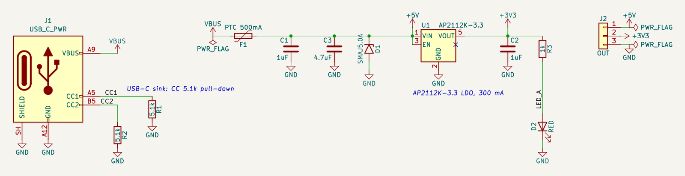

# 예제: USB-C 5 V 입력 3.3 V 전원 보드 (AP2112K-3.3)

USB-C 전원 전용 리셉터클로 기본 USB 전원(5 V, PD 없음)을 받아 PTC·TVS로 보호하고 3.3 V 300 mA를 만듭니다. 보드 전원 입력으로 가장 흔히 쓰는 블록입니다.

실무 회로 점검에서 고른 다섯 회로 중 하나입니다. 앱의 설계 경로(부품 목록 → 핀 연결 → 심볼·풋프린트 해석 → 검사)에 부품 목록과 연결을 넣어(AI 역할은 이번 세션이 대신함) 만들고, 앱의 모든 검사를 돌린 뒤 엔지니어 연구노트를 남겼습니다.

- [`research-note.md`](research-note.md): 연구노트(확인한 것, 배운 점, 다음 설계에 적용할 것, 열린 질문, 근거 번호)
- [`requirements.md`](requirements.md): 요구사항
- [`circuit.json`](circuit.json), [`usbc-5v-3v3.kicad_sch`](usbc-5v-3v3.kicad_sch): 회로 데이터와 앱이 만든 KiCad 회로도(골든 파일)

## 구성

| 부품 | 값 | 역할 | 풋프린트 |
|---|---|---|---|
| C1 | 1uF | LDO 입력 콘덴서 | `C_0603_1608Metric` |
| C2 | 1uF | LDO 출력 콘덴서 | `C_0603_1608Metric` |
| C3 | 4.7uF | 5V 벌크 | `C_0805_2012Metric` |
| D1 | SMAJ5.0A | 입력 TVS | `D_SMA` |
| D2 | RED | 3.3V 전원 LED | `LED_0603_1608Metric` |
| F1 | PTC 500mA | 입력 과전류 보호 | `Fuse_1206_3216Metric` |
| J1 | USB_C_PWR | USB-C 전원 입력 | `USB_C_Receptacle_GCT_USB4125-xx-x_6P_TopMnt_Horizontal` |
| J2 | OUT | 출력 헤더 | `PinHeader_1x03_P2.54mm_Vertical` |
| R1 | 5.1k | CC1 풀다운 (싱크 표시) | `R_0603_1608Metric` |
| R2 | 5.1k | CC2 풀다운 (싱크 표시) | `R_0603_1608Metric` |
| R3 | 1k | LED 전류 제한 | `R_0603_1608Metric` |
| U1 | AP2112K-3.3 (AP2112K-3.3TRG1) | 3.3V LDO | `SOT-23-5` |

## 앱에서 나온 결과

| 검사 | 결과 |
|---|---|
| KiCad (10.0.8, Docker) | ERC 오류 0 경고 0, 넷리스트 대조 일치 |
| 기술 검토 (자동 계산) | 실패 0, 주의 0, 참고 4, 통과 11 — 참고: C1 (1uF): 정격 전압 미기재; C2 (1uF): 정격 전압 미기재; C3 (4.7uF): 정격 전압 미기재; U1 (AP2112K-3.3): 발열 585 mW (출력 300 mA) |
| 설계 지침 | 해당 18개: 자동 검사 통과 9, 사람이 확인 9 |
| 설계 결정 기록 | 12개 |
| 엔지니어 검토 | 미검증 (사람의 검토 기록이 없음). 연구노트도 AI 초안 |

## 점검하며 고친 것

- C3 10 µF → 4.7 µF: VBUS에 보이는 콘덴서 합이 11 µF로 USB 2.0 기준(10 µF)을 넘었음(검사 `usb_vbus_cap`)
- D2 녹색 → 빨강: 3.3 V 구동에서 녹색 Vf 최댓값(3.2 V)이면 0.1 mA로 거의 안 보임(이번에 추가한 `led_current` 「어두움」 알림)

## 남은 확인 (사람)

- 콘덴서 정격 전압(C1·C3 10 V, C2 6.3 V 이상)
- LDO 발열 585 mW(300 mA 전부 쓸 때)와 패키지 열저항
- SMAJ5.0A 클램프 전압 vs AP2112K 입력 최대 정격(데이터시트)
